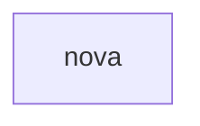

# Whole-System Architecture

_Batch: `c7012ab2592eef3f2cf00f50553e7d290ce204fc` — 2026-10-20_

## System Overview

The system comprises a single component (`nova`) representing the core subsystems of the OpenStack Compute service, extracted across six batches to 443 files. The component spans: the REST API layer (`api/`) implementing the WSGI framework, request dispatch, authentication middleware, API versioning, metadata service, JSON schema validation, and the full OpenStack Compute REST API (servers, flavors, keypairs, and more); the accelerator integration layer (`accelerator/`) brokering communication with the Cyborg accelerator management service; the CLI entry points (`cmd/`) providing nine service launcher scripts plus the `nova-manage` administration command; the compute service (`compute/`) implementing the public compute API and per-hypervisor compute manager for instance lifecycle; the conductor service (`conductor/`) coordinating multi-node operations (build, migrate, evacuate, unshelve); the configuration layer (`conf/`) declaring oslo.config option groups for all Nova sub-systems; the console subsystem (`console/`) providing VNC/RFB, serial, and SPICE console proxy infrastructure; exception and internationalisation utilities (`exception.py`, `i18n.py`, `service_auth.py`, `utils.py`); code-style enforcement (`hacking/`) providing Nova-specific pep8/hacking lint-check plug-ins; the Glance image client (`image/`) handling image download with cryptographic signature verification; the key-manager wrapper (`keymgr/`) delegating encryption-key storage to oslo.castellan; quota-limit enforcement (`limit/`) implementing API-side and Placement-side unified-limit checks; the versioned object layer (`objects/`) defining Nova's domain entities; the database access layer (`db/`) providing Alembic-managed schemas for both the API and main databases with a full SQLAlchemy query API; the network integration layer (`network/`) providing the Neutron client, network model, and security group API; and the scheduler subsystem (`scheduler/`) implementing placement-aware host selection, filtering, weighing, and Placement resource-provider management.

Sources: `docs/components/nova.md` (Overview), `docs/components/index.md`.

---

## Component Inventory

Line counts are sums of the code lines stated in each Component document's File Inventory, taken from KB `lines` fields.

| Component | Language(s) | File count | Code lines |
|-----------|-------------|------------|------------|
| `nova`    | Python      | 443        | 97,716     |

Sources: `docs/components/nova.md` (File Inventory); Verification Summary `.aee/verification-summary.md`: "KB aggregate totals (136,294 total / 97,716 code) computed and verified ✓".

---

## Cross-Component Dependency Map

The Link Graph (`.aee/link-summary.md`, batch `c7012ab2`) records 1,577 file edges and zero cross-component edges (`summary.crossComponentEdges: 0`; "All 1577 file edges are intra-component (within the `nova` component)"). There is one component in the system; no cross-component directed edges exist. No cross-component seams were found (`summary.seams: 0`).

The graph is built from static imports and shared literals and may miss other coupling.

---

## System-Wide Data Flow

Data enters the system through the public interfaces of the `nova` component. Entry points span multiple subsystems (sources: `docs/components/nova.md`, Side Effects and Defined Symbols; KB `securitySurface` arrays):

- **HTTP API requests** — inbound WSGI requests enter through `api/` routing; `api/auth.py` applies keystoneauth1 token verification middleware on each request.
- **Metadata proxy requests** — enter `api/metadata/handler.py` at the `@webob.dec.wsgify`-decorated entry (line 97); HMAC validation against `CONF.neutron.metadata_proxy_shared_secret` is applied when the secret is configured (lines 276–280).
- **Accelerator parameters** — `context`, `dp_name`, `instance_uuid`, `arq_uuid`, `bindings` accepted by `accelerator/cyborg.py` module-level functions and forwarded to the Cyborg REST API.
- **Scheduler hints** — user-controlled JSON strings accepted via `spec_obj.get_scheduler_hint('query')` at `scheduler/filters/json_filter.py:135` and dispatched through `JsonFilter._parse_string` (lines 93–112).
- **CLI arguments** — nine service launcher scripts (`cmd/api.py`, `cmd/compute.py`, `cmd/conductor.py`, `cmd/scheduler.py`, `cmd/novncproxy.py`, `cmd/serialproxy.py`, `cmd/spicehtml5proxy.py`, `cmd/status.py`) each call `config.parse_args(sys.argv)` as their primary entry point (`docs/components/nova.md`, Defined Symbols > cmd/).
- **Console connections** — `console/serial.py` opens a raw network socket (`network-socket` entry point at L83) for serial console connections; `console/rfb/authvencrypt.py` performs the VeNCrypt TLS handshake to the QEMU VNC backend.

Data flows through the following subsystems:

- **API path:** inbound requests are dispatched through `api/openstack/` routers to compute resource handlers; JSON schema validation is applied by the `schema` decorator factory in `api/validation/__init__.py`; response serialisers in `api/openstack/compute/views/` format outbound data.
- **Compute/Conductor path:** `compute/api.py` (class `API`) is the public compute service interface; operations requiring cross-node coordination are delegated via RPC to `conductor/manager.py` (`ConductorManager`). `compute/manager.py` (`ComputeManager`) executes per-hypervisor operations and issues 50+ RPC calls to the conductor, scheduler, and network services.
- **Accelerator path:** caller-supplied parameters flow through `_CyborgClient` (`cyborg.py:L118–L419`) and exit via HTTP calls to the Cyborg REST API; `network/neutron.py` calls `get_client()` (line 673), `get_arq_pci_device_profile` (line 1715), and `get_device_amount_of_dp_groups` (line 2369).
- **Metadata path:** `api/metadata/handler.py` issues HTTP calls to the metadata service backend; when shared-secret is absent, provider identity headers are accepted without HMAC validation (Finding 1, CWE-306).
- **Image path:** `image/glance.py` issues 43 outbound HTTP calls to the Glance image service via `GlanceClientWrapper`; `GlanceImageServiceV2._verify_and_write` (CCN 17) streams image data to local files (`image/glance.py:L413, L429`) while verifying cryptographic signatures (`docs/components/nova.md`, Side Effects).
- **Limit/Quota path:** `limit/local.py` enforces API-side quotas via `oslo_limit.limit.Enforcer`; `limit/placement.py` enforces Placement-side resource quotas; `limit/utils.py` queries Keystone via the `openstack` SDK to detect unified-limit configuration.
- **Objects/DB path:** OVO objects (`objects/*.py`) issue SQLAlchemy sessions against `db/api/` and `db/main/`; `db/main/api.py` (4,967 lines, 3,535 LOC) provides the complete query API (`docs/components/nova.md`, Defined Symbols > db/).
- **Network path:** `network/neutron.py` (3,989 lines) issues 80+ outbound Neutron REST API calls (port CRUD, security groups, floating IP, network listing) (`docs/components/nova.md`, Side Effects).
- **Scheduler path:** `scheduler/manager.py` orchestrates host selection via `select_destinations`; `scheduler/client/report.py` issues HTTP calls to the OpenStack Placement API (line 279).
- **Auth path:** `service_auth.py` constructs service-user keystoneauth1 auth plugins and sessions (lines 56, 70) consumed by `accelerator/cyborg.py` and `utils.py`.
- **Console path:** `console/websocketproxy.py` serves as WebSocket proxy base for noVNC, SPICE, and serial console; `console/securityproxy/rfb.py` implements the RFB security handshake; `console/rfb/authvencrypt.py` performs outbound TLS negotiation with the QEMU VNC backend (L151–L152).
- **Key management path:** `keymgr/conf_key_mgr.py` (`ConfKeyManager`) stores and retrieves encryption keys via oslo.castellan.

Sources: `docs/components/nova.md` (Overview, Side Effects, Defined Symbols); KB records under `.aee/kb/src/nova/`.

---

## External Dependencies

Third-party and standard-library packages imported across the 443 files. Source: `docs/components/nova.md` (External Dependencies table).

### Most widely used (by file count)

| Package | Files importing |
|---------|----------------|
| `oslo_utils` | 132 |
| `oslo_log` | 111 |
| `webob` | 86 |
| `copy` | 70 |
| `oslo_config` | 61 |
| `sqlalchemy` | 59 |
| `oslo_serialization` | 44 |
| `oslo_db` | 30 |
| `keystoneauth1` | 26 |
| `functools` | 25 |
| `collections` | 25 |
| `alembic` | 18 |
| `re` | 17 |
| `sys` | 15 |
| `os` | 14 |
| `oslo_messaging` | 13 |
| `typing` | 11 |
| `itertools` | 10 |
| `urllib` | 10 |
| `oslo_reports` | 10 |

Additional packages (fewer files): `ast`, `binascii`, `castellan`, `cryptography`, `cursive`, `eventlet`, `glanceclient`, `greenlet`, `hacking`, `hashlib`, `inspect`, `jsonschema`, `netaddr`, `openstack`, `os_resource_classes`, `os_service_types`, `os_traits`, `oslo_concurrency`, `oslo_i18n`, `oslo_limit`, `oslo_middleware`, `oslo_service`, `oslo_versionedobjects`, `osc_lib`, `random`, `retrying`, `stat`, `time`, and standard-library modules. Total unique external packages: 95.

New packages added in batch 6: `glanceclient` (image/), `castellan` (keymgr/), `oslo_limit` (limit/), `hacking` (hacking/), `cryptography` and `cursive` (image/glance.py signature verification), `ast` (hacking/checks.py AST visitors).

### Unresolved internal nova imports

286 unresolved imports across 14 symbol roots (Link Summary `.aee/link-summary.md`). Dominant gaps:

| Symbol root | Refs | Notes |
|-------------|------|-------|
| `nova` | 151 | bare generic import |
| `nova.policies` | 60 | policy layer — not yet extracted |
| `nova.virt` | 23 | virt driver layer — not yet extracted |
| `nova.notifications.objects` | 17 | notification objects — not yet extracted |
| `nova.pci` | 13 | PCI management — not yet extracted |

Resolved since batch 5: `nova.image` (was 9 refs) and `nova.limit` (was 10 refs) — both fully extracted in Batch 6. New entrant: `nova.storage` (1 ref).
