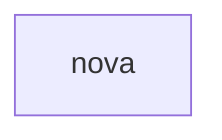

# Whole-System Architecture

## System Overview

The system comprises a single component (`nova`) that implements the accelerator subsystem within the Nova compute service. It exposes a thin public API of module-level functions and an internal HTTP client class (`_CyborgClient`) that brokers communication between Nova and the Cyborg accelerator management service via a REST HTTP interface. The public API provides lifecycle operations over Accelerator Request Quotas (ARQs) and device profile queries, while all outbound calls are authenticated using service credentials retrieved at request time.

Sources: `docs/components/index.md`, `docs/components/nova.md` (Overview).

---

## Component Inventory

Line counts are sums of the code lines stated in each Component document's File Inventory, taken from KB `lines` fields.

| Component | Language(s) | File count | Code lines |
|-----------|-------------|------------|------------|
| `nova`    | Python      | 2          | 324        |

Sources: `docs/components/nova.md` (File Inventory); KB records `.aee/kb/src/nova/accelerator/__init__.py.json` (lines: 0) and `.aee/kb/src/nova/accelerator/cyborg.py.json` (lines: 324).

---

## Cross-Component Dependency Map

The Link Graph (`.aee/link-graph.json`) records zero file edges (`fileEdges: []`) and zero cross-component edges (`summary.crossComponentEdges: 0`). There is one component in the system; no cross-component directed edges exist. No cross-component seams were found (`crossComponentSeams: []`, `summary.seams: 0`).

The graph is built from static imports and shared literals and may miss other coupling.

---

## System-Wide Data Flow

Data enters the system through the public module-level functions of `src/nova/accelerator/cyborg.py`. The entry points identified in `docs/components/nova.md` (Local Data Flow > Entry Points) are:

- **`context`** — caller authentication/session state; accepted at `get_client` (cyborg.py:56) and stored in `_CyborgClient.__init__` (cyborg.py:116–118).
- **`dp_name`** — device profile name; accepted at `get_device_profile_request_groups` (cyborg.py:88) and forwarded to `_get_device_profile_list` and `_create_arqs`.
- **`instance_uuid`** — instance UUID; accepted at `get_arqs_for_instance` (cyborg.py:291) and `delete_arqs_for_instance` (cyborg.py:370).
- **`arq_uuid`** — ARQ UUID; accepted at `get_arq_by_uuid` (cyborg.py:337).
- **`bindings`** — dict from caller; accepted at `bind_arqs` (cyborg.py:255) and serialized as RFC 6902 JSON patch.

Data flows through the `_CyborgClient` class. Outbound HTTP calls to the Cyborg REST API are the only sinks (all in `src/nova/accelerator/cyborg.py`):

| Sink | Lines |
|------|-------|
| GET `/device_profiles?name=<dp_name>` | 153–154 |
| POST `/accelerator_requests` with `dp_name` in JSON body | 205 |
| PATCH `/accelerator_requests` with `bindings` as JSON patch | 282–283 |
| GET `/accelerator_requests?instance=<instance_uuid>` | 318 |
| GET `/accelerator_requests/<arq_uuid>` (path-interpolated) | 358–359 |
| DELETE `/accelerator_requests?instance=<instance_uuid>` | 378–379 |
| DELETE `/accelerator_requests?arqs=<uuid1,uuid2,...>` | 406–407 |

All outbound calls are authenticated using service credentials retrieved via `service_auth.get_service_user_token_auth_plugin` (cyborg.py:130–131) through the `_client` property (cyborg.py:121–134).

`src/nova/accelerator/__init__.py` is empty and participates in no data flow (`docs/components/nova.md`, File Inventory).

Sources: `docs/components/nova.md` (Local Data Flow, Side Effects); KB record `.aee/kb/src/nova/accelerator/cyborg.py.json` (`securitySurface`, `sideEffects`).

---

## External Dependencies

| Module    | Component(s) |
|-----------|-------------|
| `oslo_log` | `nova`     |

The six `nova.*` imports (`nova`, `nova.i18n`, `nova.scheduler`, `nova.service_auth`, `nova.utils`) in `src/nova/accelerator/cyborg.py` (lines 46–51) are unresolved in the Link Graph (`.aee/link-graph.json`, `unresolved` array, reason: `module-not-found`) and resolve to modules outside the repository boundary; they are not listed as external dependencies of this repository.

Sources: `docs/components/nova.md` (External Dependencies); `.aee/link-graph.json` (`summary.externalImports: 1`).
