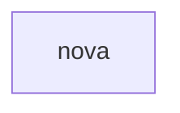

# Whole-System Architecture

_Batch: `868bfe40c13e07d11a2aa58ddb0c8900f9d9744d` — 2026-10-20_

## System Overview

The system comprises a single component (`nova`) representing the core subsystems of the OpenStack Compute service, extracted across three batches. The 122 files span: the accelerator integration layer (`accelerator/`) brokering communication with the Cyborg accelerator management service; the exception catalog and internationalisation shim (`exception.py`, `i18n.py`); the service-authentication helpers and general utilities (`service_auth.py`, `utils.py`); the versioned object layer (`objects/`) defining Nova's domain entities; the database access layer (`db/`) providing the Alembic-managed schema for both the API and main databases and a full SQLAlchemy query API; and the scheduler subsystem (`scheduler/`) implementing placement-aware host selection, request filtering, weighing, and Placement resource-provider management.

Sources: `docs/components/nova.md` (Overview), `docs/components/index.md`.

---

## Component Inventory

Line counts are sums of the code lines stated in each Component document's File Inventory, taken from KB `lines` fields.

| Component | Language(s) | File count | Code lines |
|-----------|-------------|------------|------------|
| `nova`    | Python      | 122        | 28,982     |

Sources: `docs/components/nova.md` (File Inventory; aggregate verified in Verification Summary `.aee/verification-summary.md`: "42,016 total / 28,982 code"); KB records under `.aee/kb/src/nova/`.

---

## Cross-Component Dependency Map

The Link Graph (`.aee/link-graph.json`, commit `6bd3ba5`) records 382 file edges and zero cross-component edges (`summary.crossComponentEdges: 0`; Link Summary `.aee/link-summary.md`: "All 382 file edges are intra-component (within the `nova` component)"). There is one component in the system; no cross-component directed edges exist. No cross-component seams were found (`crossComponentSeams: []`, `summary.seams: 0`).

The graph is built from static imports and shared literals and may miss other coupling.

---

## System-Wide Data Flow

Data enters the system through the public API of the `nova` component. Entry points identified in `docs/components/nova.md` (Local Data Flow > Entry Points):

- **`context`** — caller authentication/session state; accepted at `accelerator/cyborg.py:56` and stored for all outbound Cyborg calls.
- **`dp_name`** — device profile name; accepted at `accelerator/cyborg.py:88` and forwarded as a Cyborg API query parameter or JSON body.
- **`instance_uuid`** — instance UUID; accepted at `accelerator/cyborg.py:291, 370` and forwarded to the Cyborg REST API as query parameter `instance`.
- **`arq_uuid`** — ARQ UUID; accepted at `accelerator/cyborg.py:337` and interpolated into the Cyborg REST API URL path.
- **`bindings`** — binding dict; accepted at `accelerator/cyborg.py:255` and serialised as RFC 6902 JSON patch body.
- **HTTP entry via `webob.exc`** — `exception.py:27–35`: `ConvertedException` wraps `webob.exc.WSGIHTTPException`.
- **Scheduler hints** — user-controlled JSON strings accepted via `spec_obj.get_scheduler_hint('query')` at `scheduler/filters/json_filter.py:135` and parsed by `JsonFilter._parse_string` (lines 93–112).

Data flows through several subsystems:

- **Accelerator path:** caller-supplied parameters flow through `_CyborgClient` (cyborg.py:112–419) and exit via seven outbound HTTP calls to the Cyborg REST API (see `docs/components/nova.md`, Sinks table).
- **Objects/DB path:** OVO objects (`objects/*.py`) issue SQLAlchemy sessions against the Nova API database (`db/api/`) and main database (`db/main/`) via 165 network-class side effects. `db/main/api.py` (4,967 lines) provides the complete query API.
- **Scheduler path:** `scheduler/manager.py` (class `SchedulerManager`) orchestrates host selection; `scheduler/client/report.py` (class `SchedulerReportClient`) issues HTTP calls to the OpenStack Placement API for resource-provider inventory and allocation records (`scheduler/client/report.py:279`).
- **Auth path:** `service_auth.py` constructs service-user keystoneauth1 auth plugins and sessions (service_auth.py:56, 70) consumed by `cyborg.py` and `utils.py`.

All outbound Cyborg calls are authenticated using service credentials retrieved via `service_auth.get_service_user_token_auth_plugin` (`accelerator/cyborg.py:130`).

Sources: `docs/components/nova.md` (Local Data Flow, Side Effects); KB records under `.aee/kb/src/nova/`.

---

## External Dependencies

Third-party and standard-library packages imported across the 122 files. Source: `docs/components/nova.md` (External Dependencies table).

### Most widely used (by file count)

| Package | Files importing |
|---------|----------------|
| `oslo_utils` | 62 |
| `sqlalchemy` | 56 |
| `oslo_log` | 47 |
| `oslo_db` | 25 |
| `oslo_serialization` | 24 |
| `alembic` | 18 |
| `keystoneauth1` | 6 |
| `oslo_versionedobjects` | 6 |
| `netaddr` | 4 |
| `os_resource_classes` | 4 |
| `os_traits` | 3 |
| `oslo_config` | 3 |
| `oslo_messaging` | 3 |
| `oslo_concurrency` | 2 |
| `oslo_middleware` | 2 |
| `webob` | 2 |

Additional packages used by fewer files: `cursive`, `eventlet`, `openstack`, `os_service_types`, `oslo_i18n`, `oslo_service`, `retrying`.

### Unresolved internal nova imports

The following `nova.*` import roots remain unresolved in `.aee/link-graph.json` (`unresolved` array, reason: `module-not-found`): `nova` (35 refs), `nova.conf` (31), `nova.compute` (12), `nova.virt` (8), `nova.network` (4), `nova.notifications.objects` (4), `nova.context` (2), `nova.pci` (2), `nova.share` (1). The `nova.db.*` family that dominated earlier batches is now resolved — the database layer was extracted in Batch 3. Remaining dominant gaps are `nova.conf` (configuration layer) and `nova.compute` (compute service layer). (Link Summary `.aee/link-summary.md`)
