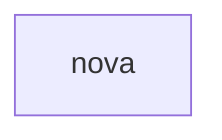

# Whole-System Architecture

_Batch: `733c737267c89a04a0ad54b304c4e167bd16c887` — 2026-10-19_

## System Overview

The system comprises a single component (`nova`) that implements the accelerator client, the exception catalog, the internationalisation shim, the versioned-objects (OVO) layer, the service-authentication helpers, and general-purpose utilities of the OpenStack Nova compute service. The accelerator subsystem (`accelerator/`) brokers communication between Nova compute and the Cyborg accelerator management service via a REST HTTP client. The objects layer (`objects/`) provides 47 versioned object modules that define Nova's domain entities as versionable, serialisable Python objects mapping to both the API and the database. Cross-cutting services (`exception.py`, `i18n.py`, `service_auth.py`, `utils.py`) are consumed broadly across all 55 files.

Sources: `docs/components/nova.md` (Overview), `docs/components/index.md`.

---

## Component Inventory

Line counts are sums of the code lines stated in each Component document's File Inventory, taken from KB `lines` fields.

| Component | Language(s) | File count | Code lines |
|-----------|-------------|------------|------------|
| `nova`    | Python      | 55         | 15,164     |

Sources: `docs/components/nova.md` (File Inventory Summary); KB records under `.aee/kb/src/nova/`.

---

## Cross-Component Dependency Map

The Link Graph (`.aee/link-graph.json`) records 212 file edges and zero cross-component edges (`summary.crossComponentEdges: 0`; Link Summary `.aee/link-summary.md`: "All 212 file edges are intra-component (within the `nova` component)"). There is one component in the system; no cross-component directed edges exist. No cross-component seams were found (`crossComponentSeams: []`, `summary.seams: 0`).

The graph is built from static imports and shared literals and may miss other coupling.

---

## System-Wide Data Flow

Data enters the system through the public API of the `nova` component. Entry points identified in `docs/components/nova.md` (Local Data Flow > Entry Points):

- **`context`** — caller authentication/session state; accepted at `accelerator/cyborg.py:56` (`get_client`) and stored in `_CyborgClient.__init__` (cyborg.py:116–118) for all outbound Cyborg calls.
- **`dp_name`** — device profile name from caller; accepted at `accelerator/cyborg.py:88` (`get_device_profile_request_groups`) and forwarded as Cyborg API query parameter or JSON body.
- **`instance_uuid`** — instance UUID from caller; accepted at `accelerator/cyborg.py:291` and `370`; forwarded as query parameter key `instance` to the Cyborg REST API.
- **`arq_uuid`** — ARQ UUID from caller; accepted at `accelerator/cyborg.py:337`; interpolated into the Cyborg REST API URL path.
- **`bindings`** — binding dict from caller; accepted at `accelerator/cyborg.py:255`; serialised as RFC 6902 JSON patch body.
- **HTTP entry via `webob.exc`** — `exception.py:27–35`: `ConvertedException` wraps `webob.exc.WSGIHTTPException`; HTTP request data enters the exception surface.

Data flows inward through the `_CyborgClient` class. The `_client` property (cyborg.py:121–134) constructs an authenticated outbound HTTP adapter using `service_auth.get_service_user_token_auth_plugin` (cyborg.py:130) and `utils.get_sdk_adapter` (cyborg.py:132). All outbound Cyborg calls exit through seven HTTP sinks (all in `accelerator/cyborg.py`):

| Sink | Lines |
|------|-------|
| GET `/device_profiles?name=<dp_name>` | 153–154 |
| POST `/accelerator_requests` with `dp_name` in JSON body | 205 |
| PATCH `/accelerator_requests` with `bindings` as JSON patch | 282–283 |
| GET `/accelerator_requests?instance=<instance_uuid>` | 318 |
| GET `/accelerator_requests/<arq_uuid>` (path-interpolated) | 358–359 |
| DELETE `/accelerator_requests?instance=<instance_uuid>` | 378–379 |
| DELETE `/accelerator_requests?arqs=<uuid1,uuid2,...>` | 406–407 |

The objects layer (`objects/*.py`) issues 110 SQLAlchemy session queries to the Nova database across 17 object files (side effects listed in `docs/components/nova.md`, Side Effects > Network). `service_auth.py` constructs keystoneauth1 sessions and auth plugins for service-user credentials (service_auth.py:56, 70).

`accelerator/__init__.py` is an empty package marker and participates in no data flow.

Sources: `docs/components/nova.md` (Local Data Flow, Side Effects); KB records under `.aee/kb/src/nova/`.

---

## External Dependencies

### Third-party external modules

| Module | Component(s) |
|--------|-------------|
| `cursive` | `nova` |
| `keystoneauth1` | `nova` |
| `netaddr` | `nova` |
| `openstack` | `nova` |
| `os_resource_classes` | `nova` |
| `os_service_types` | `nova` |
| `oslo_concurrency` | `nova` |
| `oslo_config` | `nova` |
| `oslo_db` | `nova` |
| `oslo_i18n` | `nova` |
| `oslo_log` | `nova` |
| `oslo_messaging` | `nova` |
| `oslo_serialization` | `nova` |
| `oslo_utils` | `nova` |
| `oslo_versionedobjects` | `nova` |
| `sqlalchemy` | `nova` |
| `webob` | `nova` |

Source: `docs/components/nova.md` (External Dependencies > Third-party table).

### Unresolved internal nova imports

The following `nova.*` imports in multiple files are recorded as `module-not-found` in `.aee/link-graph.json` (`unresolved` array) and resolve to modules outside the current repository boundary: `nova.compute`, `nova.conf`, `nova.db.api`, `nova.db.main`, `nova.network`, `nova.notifications.objects`, `nova.quota`, `nova.scheduler`, `nova.scheduler.filters`, `nova.share`, `nova.virt`, and others. The `nova.db.*` family accounts for 56 of the 98 total unresolved references (Link Summary `.aee/link-summary.md`).
