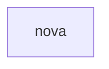

# Whole-System Architecture

_Batch: `caa20451a7b7df151b4ddbaab06f92e6857e74a6` — 2026-10-20_

## System Overview

The system comprises a single component (`nova`) representing the core subsystems of the OpenStack Compute service, now extracted across four batches to 327 files. The component spans: the REST API layer (`api/`) implementing the WSGI framework, request dispatch, authentication middleware, API versioning, metadata service, JSON schema validation, and the full OpenStack Compute REST API (servers, flavors, keypairs, and more); the accelerator integration layer (`accelerator/`) brokering communication with the Cyborg accelerator management service; exception and internationalisation utilities (`exception.py`, `i18n.py`, `service_auth.py`, `utils.py`); the versioned object layer (`objects/`) defining Nova's domain entities; the database access layer (`db/`) providing Alembic-managed schemas for both the API and main databases with a full SQLAlchemy query API; the network integration layer (`network/`) providing the Neutron client, network model, and security group API; and the scheduler subsystem (`scheduler/`) implementing placement-aware host selection, filtering, weighing, and Placement resource-provider management.

Sources: `docs/components/nova.md` (Overview), `docs/components/index.md`.

---

## Component Inventory

Line counts are sums of the code lines stated in each Component document's File Inventory, taken from KB `lines` fields.

| Component | Language(s) | File count | Code lines |
|-----------|-------------|------------|------------|
| `nova`    | Python      | 327        | 58,276     |

Sources: `docs/components/nova.md` (File Inventory); Verification Summary `.aee/verification-summary.md`: "81,517 total / 58,276 code verified against sum of all 327 KB records".

---

## Cross-Component Dependency Map

The Link Graph (`.aee/link-graph.json`, commit `667e0d4`) records 1,060 file edges and zero cross-component edges (`summary.crossComponentEdges: 0`; Link Summary `.aee/link-summary.md`: "All 1060 file edges are intra-component (within the `nova` component)"). There is one component in the system; no cross-component directed edges exist. No cross-component seams were found (`crossComponentSeams: []`, `summary.seams: 0`).

The graph is built from static imports and shared literals and may miss other coupling.

---

## System-Wide Data Flow

Data enters the system through the public interfaces of the `nova` component. Entry points span multiple subsystems (sources: `docs/components/nova.md`, Local Data Flow > Entry Points; KB `securitySurface` arrays):

- **HTTP API requests** — inbound WSGI requests enter through `api/` routing; `api/auth.py` applies keystoneauth1 token verification middleware on each request.
- **Metadata proxy requests** — enter `api/metadata/handler.py` at the `@webob.dec.wsgify`-decorated entry (line 97); HMAC validation against `CONF.neutron.metadata_proxy_shared_secret` is applied when the secret is configured (lines 276–280).
- **Accelerator parameters** — `context`, `dp_name`, `instance_uuid`, `arq_uuid`, `bindings` accepted by `accelerator/cyborg.py` module-level functions and forwarded to the Cyborg REST API.
- **Scheduler hints** — user-controlled JSON strings accepted via `spec_obj.get_scheduler_hint('query')` at `scheduler/filters/json_filter.py:135` and dispatched through `JsonFilter._parse_string` (lines 93–112).

Data flows through the following subsystems:

- **API path:** inbound requests are dispatched through `api/openstack/` routers to compute resource handlers; response serialisers in `api/openstack/compute/views/` format outbound data.
- **Accelerator path:** caller-supplied parameters flow through `_CyborgClient` (cyborg.py:112–419) and exit via seven outbound HTTP calls to the Cyborg REST API; `network/neutron.py` calls `get_client()` at line 673, `get_arq_pci_device_profile` at line 1715, and `get_device_amount_of_dp_groups` at line 2369.
- **Metadata path:** `api/metadata/handler.py` issues HTTP calls to the metadata service backend; when shared-secret is absent, provider identity headers are accepted without HMAC validation (finding 4, CWE-306).
- **Objects/DB path:** OVO objects (`objects/*.py`) issue SQLAlchemy sessions against `db/api/` and `db/main/` (165+ network-class side effects total); `db/main/api.py` (4,967 lines) provides the complete query API.
- **Network path:** `network/neutron.py` (3,989 lines) issues 80+ outbound Neutron REST API calls (port CRUD, security groups, floating IP, network listing).
- **Scheduler path:** `scheduler/manager.py` orchestrates host selection; `scheduler/client/report.py` issues HTTP calls to the OpenStack Placement API (line 279).
- **Auth path:** `service_auth.py` constructs service-user keystoneauth1 auth plugins and sessions (lines 56, 70) consumed by `accelerator/cyborg.py` and `utils.py`.

Sources: `docs/components/nova.md` (Local Data Flow, Side Effects); KB records under `.aee/kb/src/nova/`.

---

## External Dependencies

Third-party and standard-library packages imported across the 327 files. Source: `docs/components/nova.md` (External Dependencies table).

### Most widely used (by file count)

| Package | Files importing |
|---------|----------------|
| `oslo_utils` | 100 |
| `webob` | 86 |
| `oslo_log` | 79 |
| `sqlalchemy` | 56 |
| `oslo_serialization` | 35 |
| `oslo_db` | 27 |
| `alembic` | 18 |
| `keystoneauth1` | 9 |
| `netaddr` | 7 |
| `oslo_versionedobjects` | 6 |
| `oslo_config` | 5 |
| `os_resource_classes` | 5 |
| `oslo_messaging` | 4 |
| `os_traits` | 4 |

Additional packages (fewer files): `cursive`, `eventlet`, `jsonschema`, `openstack`, `os_service_types`, `oslo_concurrency`, `oslo_i18n`, `oslo_middleware`, `oslo_service`, `osc_lib`, `retrying`. Total unique external packages: 58.

### Unresolved internal nova imports

287 unresolved imports across 14 symbol roots (Link Summary `.aee/link-summary.md`). Dominant gaps:

| Symbol root | Refs | Notes |
|-------------|------|-------|
| `nova` | 73 | bare generic import |
| `nova.compute` | 66 | compute service layer — not yet extracted |
| `nova.policies` | 58 | policy layer — not yet extracted; introduced by batch 4 API layer |
| `nova.conf` | 53 | configuration layer — not yet extracted |
| `nova.virt` | 11 | virt driver layer — not yet extracted |

`nova.network` (3 refs in prior batch) is now fully resolved — `nova/network/` was extracted in Batch 4.
