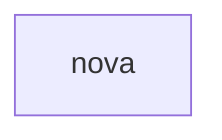

# Whole-System Architecture

_Batch: `10997c0ea56f02ffec4fd9f8c917d68241ae9ea9` — 2026-10-20_

## System Overview

The system comprises a single component (`nova`) representing the core subsystems of the OpenStack Compute service, extracted across seven batches to 532 files. The component spans: the REST API layer (`api/`) implementing the WSGI framework, request dispatch, authentication middleware, API versioning, metadata service, JSON schema validation, and the full OpenStack Compute REST API (servers, flavors, keypairs, and more); the accelerator integration layer (`accelerator/`) brokering communication with the Cyborg accelerator management service; the CLI entry points (`cmd/`) providing nine service launcher scripts plus the `nova-manage` administration command; the compute service (`compute/`) implementing the public compute API and per-hypervisor compute manager for instance lifecycle; the conductor service (`conductor/`) coordinating multi-node operations (build, migrate, evacuate, unshelve); the configuration layer (`conf/`) declaring oslo.config option groups for all Nova sub-systems; the console subsystem (`console/`) providing VNC/RFB, serial, and SPICE console proxy infrastructure; exception and internationalisation utilities (`exception.py`, `i18n.py`, `service_auth.py`, `utils.py`); code-style enforcement (`hacking/`); the Glance image client (`image/`) with cryptographic signature verification; the key-manager wrapper (`keymgr/`); quota-limit enforcement (`limit/`); oslo.messaging versioned notification objects for all Nova events (`notifications/`); PCI device specification, tracking, pooling, and whitelist management (`pci/`); RBAC policy rule definitions for every Nova API action (`policies/`, 56 files); oslo.privsep privilege-separation wrappers executing in a root-privileged subprocess (`privsep/`); the versioned object layer (`objects/`) defining Nova's domain entities; the database access layer (`db/`) providing Alembic-managed schemas for both the API and main databases with a full SQLAlchemy query API; the network integration layer (`network/`) providing the Neutron client, network model, and security group API; and the scheduler subsystem (`scheduler/`) implementing placement-aware host selection, filtering, weighing, and Placement resource-provider management.

Sources: `docs/components/nova.md` (Overview), `docs/components/index.md`.

---

## Component Inventory

Line counts are sums of the code lines stated in each Component document's File Inventory, taken from KB `lines` fields.

| Component | Language(s) | File count | Code lines |
|-----------|-------------|------------|------------|
| `nova`    | Python      | 532        | 105,633    |

Sources: `docs/components/nova.md` (File Inventory); Verification Summary `.aee/verification-summary.md`: "KB aggregate totals (147,963 total / 105,633 code) computed and verified ✓".

---

## Cross-Component Dependency Map

The Link Graph (`.aee/link-summary.md`, batch `10997c0e`) records 1,882 file edges and zero cross-component edges (`summary.crossComponentEdges: 0`; "All 1882 file edges are intra-component (within the `nova` component)"). There is one component in the system; no cross-component directed edges exist. No cross-component seams were found (`summary.seams: 0`).

The graph is built from static imports and shared literals and may miss other coupling. Two known blind spots: (1) scheduler filters are loaded dynamically by name from configuration; (2) `privsep/` functions execute via oslo.privsep IPC dispatch — neither call pattern produces static import edges (`docs/components/nova.md`, Side Effects; `.aee/security-chains.json`, `evaluatedFindings`).

---

## System-Wide Data Flow

Data enters the system through the public interfaces of the `nova` component. Entry points span multiple subsystems (sources: `docs/components/nova.md`, Side Effects and Defined Symbols; KB `securitySurface` arrays):

- **HTTP API requests** — inbound WSGI requests enter through `api/` routing; `api/auth.py` applies keystoneauth1 token verification middleware on each request; RBAC enforcement is applied via `policies/` (`oslo_policy.DocumentedRuleDefault`) rules for each API action.
- **Metadata proxy requests** — enter `api/metadata/handler.py` at the `@webob.dec.wsgify`-decorated entry (line 97); HMAC validation against `CONF.neutron.metadata_proxy_shared_secret` is applied when the secret is configured (lines 276–280).
- **Accelerator parameters** — `context`, `dp_name`, `instance_uuid`, `arq_uuid`, `bindings` accepted by `accelerator/cyborg.py` module-level functions and forwarded to the Cyborg REST API.
- **Scheduler hints** — user-controlled JSON strings accepted via `spec_obj.get_scheduler_hint('query')` at `scheduler/filters/json_filter.py:135` and dispatched through `JsonFilter._parse_string` (lines 93–112).
- **CLI arguments** — nine service launcher scripts each call `config.parse_args(sys.argv)` as their primary entry point (`docs/components/nova.md`, Defined Symbols > cmd/).
- **Console connections** — `console/serial.py` opens a raw network socket (entry point at L83); `console/rfb/authvencrypt.py` performs the VeNCrypt TLS handshake to the QEMU VNC backend.
- **Privsep IPC** — `privsep/` functions are called via oslo.privsep IPC from privileged context; 16 `securitySurface` entries in `privsep/libvirt.py` are all of kind `privilege` (privsep entrypoint). This path does not produce static import edges in the link graph.

Data flows through the following subsystems:

- **API path:** inbound requests are dispatched through `api/openstack/` routers; JSON schema validation applied by `api/validation/__init__.py`; RBAC enforced via `policies/` rule definitions; response serialisers in `api/openstack/compute/views/` format outbound data.
- **Compute/Conductor path:** `compute/api.py` is the public compute service interface; `conductor/manager.py` coordinates cross-node operations; `compute/manager.py` issues 50+ RPC calls to conductor, scheduler, and network services.
- **Notification path:** `notifications/base.py` emits versioned oslo.messaging notifications on instance lifecycle, flavor, service, and scheduler events.
- **Accelerator path:** parameters flow through `_CyborgClient` (`cyborg.py:L118–L419`) and exit via HTTP calls to the Cyborg REST API.
- **Metadata path:** `api/metadata/handler.py` issues HTTP calls to the metadata service backend; when shared-secret is absent, provider identity headers are accepted without HMAC validation (Finding 1, CWE-306).
- **Image path:** `image/glance.py` issues 43 outbound HTTP calls to the Glance image service; `_verify_and_write` (CCN 17) streams image data to local files while verifying cryptographic signatures.
- **Limit/Quota path:** `limit/local.py` enforces API-side quotas; `limit/placement.py` enforces Placement-side resource quotas; `limit/utils.py` queries Keystone via the `openstack` SDK.
- **Privsep path:** `privsep/` entry points execute in a root-privileged subprocess via oslo.privsep IPC dispatch; operations include filesystem ops (`privsep/fs.py`), libvirt helpers (`privsep/libvirt.py`), network device configuration (`privsep/linux_net.py`), QEMU image conversion (`privsep/qemu.py`), path helpers (`privsep/path.py`), and uid/gid shifting (`privsep/idmapshift.py`). 58 `process-spawn` side-effect records (`docs/components/nova.md`, Side Effects).
- **Objects/DB path:** OVO objects issue SQLAlchemy sessions against `db/api/` and `db/main/`; `db/main/api.py` (4,967 lines, 3,535 LOC) provides the complete query API.
- **Network path:** `network/neutron.py` (3,989 lines) issues 80+ outbound Neutron REST API calls.
- **Scheduler path:** `scheduler/manager.py` orchestrates host selection; `scheduler/client/report.py` issues HTTP calls to the OpenStack Placement API.
- **Auth path:** `service_auth.py` constructs keystoneauth1 service-user sessions consumed by `accelerator/cyborg.py` and `utils.py`.
- **Console path:** `console/websocketproxy.py` serves as WebSocket proxy base; `console/rfb/authvencrypt.py` performs outbound TLS negotiation (L151–L152).
- **Key management path:** `keymgr/conf_key_mgr.py` stores and retrieves encryption keys via oslo.castellan.
- **PCI path:** `pci/manager.py` tracks PCI devices per compute node; `pci/stats.py` maintains pool-based statistics; `pci/whitelist.py` enforces device-spec matching.

Sources: `docs/components/nova.md` (Overview, Side Effects, Defined Symbols); KB records under `.aee/kb/src/nova/`.

---

## External Dependencies

Third-party and standard-library packages imported across the 532 files. Source: `docs/components/nova.md` (External Dependencies table).

### Most widely used (by file count)

| Package | Files importing |
|---------|----------------|
| `oslo_utils` | 144 |
| `oslo_log` | 124 |
| `webob` | 86 |
| `copy` | 74 |
| `oslo_config` | 63 |
| `sqlalchemy` | 59 |
| `oslo_policy` | 55 |
| `oslo_serialization` | 47 |
| `oslo_db` | 30 |
| `collections` | 28 |
| `keystoneauth1` | 26 |
| `functools` | 25 |
| `alembic` | 18 |
| `re` | 17 |
| `sys` | 15 |
| `oslo_messaging` | 14 |
| `os` | 14 |
| `typing` | 13 |
| `itertools` | 11 |
| `oslo_privsep` | 7 |

Additional packages (fewer files): `abc`, `ast`, `binascii`, `castellan`, `contextlib`, `cryptography`, `cursive`, `errno`, `eventlet`, `fcntl`, `glanceclient`, `greenlet`, `hacking`, `hashlib`, `inspect`, `jsonschema`, `mmap`, `netaddr`, `openstack`, `os_resource_classes`, `os_service_types`, `os_traits`, `oslo_concurrency`, `oslo_i18n`, `oslo_limit`, `oslo_middleware`, `oslo_service`, `oslo_versionedobjects`, `osc_lib`, `random`, `retrying`, `shutil`, `stat`, `string`, `tempfile`, `time`, `traceback`, and standard-library modules. Total unique external packages: 97+.

New packages added in batch 7: `oslo_policy` (55 files — all `policies/` files), `oslo_privsep` (`privsep/` subsystem), `abc`, `contextlib`, `errno`, `fcntl`, `mmap`, `shutil`, `string`, `tempfile`, `traceback`.

### Unresolved internal nova imports

196 unresolved imports across 10 symbol roots (Link Summary `.aee/link-summary.md`). Dominant gaps:

| Symbol root | Refs | Notes |
|-------------|------|-------|
| `nova` | 151 | bare generic import; top-level package access patterns |
| `nova.virt` | 23 | hypervisor abstraction layer — not yet extracted |
| `nova.volume` | 9 | Cinder volume integration — not yet extracted |
| `nova.context` | 4 | request context module — not yet extracted |
| `nova.share` | 3 | Manila share integration — not yet extracted |

Resolved since batch 6: `nova.policies` (was 60 refs), `nova.notifications.objects` (was 17 refs), `nova.pci` (was 13 refs) — all fully extracted in Batch 7.
