# Whole-System Architecture

_Regenerated from batch: `c7e94e29eea2e3abd5797fc0759b0d98232c7830` — 2026-10-22 (component synthesis updated)_

## System Overview

The system comprises 30 components representing the full OpenStack Compute service codebase (1,509 files, 473,713 code lines). The Synthesizer updated the component model on 2026-10-22: a single monolithic `nova` component was replaced by 30 per-subsystem components spanning 25 production subsystems, 4 test subsystems, and 1 top-level utility package. The link graph was simultaneously regenerated, revealing 4,660 cross-component file edges across 213 distinct component pairs.

**Production components:** `accelerator` — Cyborg accelerator device client; `api` — OpenStack Compute REST API layer; `cmd` — service entry-point scripts; `compute` — compute manager (instance lifecycle, migration, resource monitors); `conductor` — async compute task orchestration; `conf` — oslo.config option schema; `console` — VNC/SPICE/serial console proxy; `db` — SQLAlchemy persistence layer; `hacking` — Nova-specific flake8/hacking checks; `image` — Glance image client; `keymgr` — Barbican secret store integration; `limit` — Keystone-backed unified quota enforcement; `network` — Neutron port, floating-IP, and security-group helpers; `notifications` — versioned Oslo Messaging notification payloads; `nova` — top-level package (context propagation, exception hierarchy, policy enforcement, quota accounting, RPC routing, service lifecycle, shared utilities; 29 files); `objects` — Oslo versionedobjects domain model; `pci` — PCI device management; `policies` — oslo.policy RBAC rule definitions; `privsep` — oslo.privsep privilege-separated filesystem/networking entrypoints; `scheduler` — filter scheduler with host selection pipeline; `servicegroup` — heartbeat-based service aliveness tracking; `share` — Manila shared-filesystem attachment helpers; `storage` — ephemeral disk and snapshot utilities; `virt` — hypervisor driver implementations (libvirt, VMware, Ironic, zVM) and disk/image/network helpers; `volume` — Cinder volume attachment and lifecycle; `wsgi` — eventlet-based WSGI server wrapper.

**Test components:** `tests` — base test-case classes; `tests-fixtures` — reusable Nova test fixtures; `tests-functional` — end-to-end in-process API and compute flow tests; `tests-unit` — per-module unit tests.

Sources: `docs/components/index.md`, component documents under `docs/components/`.

---

## Component Inventory

Line counts are taken from the Component Index (`docs/components/index.md`), which sums the code lines from each Component document's File Inventory (taken from KB `lines`).

| Component | Language(s) | File count | Code lines |
|-----------|-------------|------------|------------|
| `accelerator` | Python | 2 | 324 |
| `api` | Python | 199 | 25,055 |
| `cmd` | Python | 12 | 3,684 |
| `compute` | Python | 25 | 21,361 |
| `conductor` | Python | 9 | 4,002 |
| `conf` | Python | 48 | 7,490 |
| `console` | Python | 12 | 651 |
| `db` | Python | 26 | 7,492 |
| `hacking` | Python | 2 | 817 |
| `image` | Python | 2 | 919 |
| `keymgr` | Python | 2 | 95 |
| `limit` | Python | 4 | 421 |
| `network` | Python | 6 | 4,239 |
| `notifications` | Python | 18 | 1,729 |
| `nova` | Python | 29 | 7,921 |
| `objects` | Python | 49 | 12,412 |
| `pci` | Python | 7 | 1,979 |
| `policies` | Python | 56 | 3,427 |
| `privsep` | Python | 8 | 782 |
| `scheduler` | Python | 41 | 6,326 |
| `servicegroup` | Python | 6 | 216 |
| `share` | Python | 2 | 301 |
| `storage` | Python | 2 | 386 |
| `virt` | Python | 91 | 38,153 |
| `volume` | Python | 2 | 712 |
| `wsgi` | Python | 3 | 22 |
| `tests` | Python | 2 | 37 |
| `tests-fixtures` | Python | 16 | 8,539 |
| `tests-functional` | Python | 314 | 57,800 |
| `tests-unit` | Python | 514 | 250,431 |
| **Total** | | **1,509** | **473,713** |

Sources: `docs/components/index.md`.

---

## Cross-Component Dependency Map

```mermaid
graph LR
    accelerator["accelerator"]
    api["api"]
    cmd["cmd"]
    compute["compute"]
    conductor["conductor"]
    conf["conf"]
    console["console"]
    db["db"]
    hacking["hacking"]
    image["image"]
    keymgr["keymgr"]
    limit["limit"]
    network["network"]
    notifications["notifications"]
    nova["nova"]
    objects["objects"]
    pci["pci"]
    policies["policies"]
    privsep["privsep"]
    scheduler["scheduler"]
    servicegroup["servicegroup"]
    share["share"]
    storage["storage"]
    virt["virt"]
    volume["volume"]
    wsgi["wsgi"]
    tests["tests"]
    tests-fixtures["tests-fixtures"]
    tests-functional["tests-functional"]
    tests-unit["tests-unit"]
    accelerator -->|"10"| nova
    accelerator -->|"2"| objects
    accelerator -->|"2"| scheduler
    api -->|"101"| compute
    api -->|"2"| conductor
    api -->|"21"| conf
    api -->|"8"| image
    api -->|"6"| limit
    api -->|"34"| network
    api -->|"2"| notifications
    api -->|"277"| nova
    api -->|"108"| objects
    api -->|"2"| pci
    api -->|"57"| policies
    api -->|"2"| scheduler
    api -->|"6"| servicegroup
    api -->|"2"| share
    api -->|"8"| virt
    api -->|"6"| volume
    cmd -->|"9"| compute
    cmd -->|"3"| conductor
    cmd -->|"21"| conf
    cmd -->|"4"| console
    cmd -->|"15"| db
    cmd -->|"2"| limit
    cmd -->|"5"| network
    cmd -->|"121"| nova
    cmd -->|"66"| objects
    cmd -->|"2"| policies
    cmd -->|"7"| scheduler
    cmd -->|"6"| virt
    cmd -->|"4"| volume
    compute -->|"7"| accelerator
    compute -->|"4"| conductor
    compute -->|"14"| conf
    compute -->|"13"| db
    compute -->|"4"| image
    compute -->|"7"| limit
    compute -->|"15"| network
    compute -->|"60"| notifications
    compute -->|"323"| nova
    compute -->|"212"| objects
    compute -->|"13"| pci
    compute -->|"2"| policies
    compute -->|"16"| scheduler
    compute -->|"2"| servicegroup
    compute -->|"2"| share
    compute -->|"45"| virt
    compute -->|"4"| volume
    conductor -->|"3"| accelerator
    conductor -->|"35"| compute
    conductor -->|"4"| conf
    conductor -->|"6"| image
    conductor -->|"4"| limit
    conductor -->|"7"| network
    conductor -->|"2"| notifications
    conductor -->|"67"| nova
    conductor -->|"68"| objects
    conductor -->|"27"| scheduler
    conductor -->|"2"| servicegroup
    conductor -->|"4"| volume
    conf -->|"1"| virt
    console -->|"2"| compute
    console -->|"2"| conf
    console -->|"27"| nova
    console -->|"3"| objects
    db -->|"2"| compute
    db -->|"2"| conf
    db -->|"58"| nova
    db -->|"4"| objects
    image -->|"3"| conf
    image -->|"22"| nova
    image -->|"4"| objects
    image -->|"2"| storage
    keymgr -->|"1"| conf
    keymgr -->|"5"| nova
    limit -->|"3"| conf
    limit -->|"9"| nova
    limit -->|"6"| objects
    limit -->|"4"| scheduler
    network -->|"4"| accelerator
    network -->|"2"| compute
    network -->|"1"| conf
    network -->|"85"| nova
    network -->|"20"| objects
    network -->|"6"| pci
    network -->|"1"| policies
    notifications -->|"2"| conf
    notifications -->|"2"| image
    notifications -->|"10"| nova
    notifications -->|"125"| objects
    nova -->|"3"| api
    nova -->|"3"| compute
    nova -->|"2"| conductor
    nova -->|"16"| conf
    nova -->|"13"| db
    nova -->|"7"| limit
    nova -->|"6"| notifications
    nova -->|"37"| objects
    nova -->|"2"| pci
    nova -->|"2"| policies
    nova -->|"5"| scheduler
    nova -->|"2"| servicegroup
    nova -->|"26"| tests-fixtures
    nova -->|"2"| tests-unit
    nova -->|"11"| virt
    objects -->|"14"| compute
    objects -->|"2"| conductor
    objects -->|"6"| conf
    objects -->|"248"| db
    objects -->|"6"| network
    objects -->|"12"| notifications
    objects -->|"170"| nova
    objects -->|"2"| scheduler
    objects -->|"2"| share
    objects -->|"7"| virt
    pci -->|"2"| conf
    pci -->|"1"| network
    pci -->|"27"| nova
    pci -->|"17"| objects
    privsep -->|"1"| conf
    privsep -->|"7"| nova
    scheduler -->|"12"| compute
    scheduler -->|"23"| conf
    scheduler -->|"2"| network
    scheduler -->|"91"| nova
    scheduler -->|"57"| objects
    scheduler -->|"4"| pci
    scheduler -->|"4"| servicegroup
    scheduler -->|"25"| virt
    servicegroup -->|"3"| conf
    servicegroup -->|"7"| nova
    share -->|"1"| conf
    share -->|"10"| nova
    storage -->|"1"| conf
    storage -->|"10"| nova
    tests-fixtures -->|"4"| api
    tests-fixtures -->|"4"| compute
    tests-fixtures -->|"11"| conf
    tests-fixtures -->|"7"| db
    tests-fixtures -->|"3"| network
    tests-fixtures -->|"45"| nova
    tests-fixtures -->|"9"| objects
    tests-fixtures -->|"2"| policies
    tests-fixtures -->|"1"| privsep
    tests-fixtures -->|"2"| scheduler
    tests-fixtures -->|"2"| tests-functional
    tests-fixtures -->|"1"| tests-unit
    tests-fixtures -->|"42"| virt
    tests-functional -->|"8"| api
    tests-functional -->|"9"| cmd
    tests-functional -->|"70"| compute
    tests-functional -->|"2"| conductor
    tests-functional -->|"34"| conf
    tests-functional -->|"73"| db
    tests-functional -->|"1"| image
    tests-functional -->|"2"| limit
    tests-functional -->|"17"| network
    tests-functional -->|"616"| nova
    tests-functional -->|"421"| objects
    tests-functional -->|"2"| pci
    tests-functional -->|"11"| policies
    tests-functional -->|"17"| scheduler
    tests-functional -->|"2"| tests
    tests-functional -->|"625"| tests-fixtures
    tests-functional -->|"78"| tests-unit
    tests-functional -->|"52"| virt
    tests-functional -->|"4"| volume
    tests-unit -->|"8"| accelerator
    tests-unit -->|"428"| api
    tests-unit -->|"30"| cmd
    tests-unit -->|"319"| compute
    tests-unit -->|"33"| conductor
    tests-unit -->|"68"| conf
    tests-unit -->|"37"| console
    tests-unit -->|"300"| db
    tests-unit -->|"14"| hacking
    tests-unit -->|"34"| image
    tests-unit -->|"2"| keymgr
    tests-unit -->|"29"| limit
    tests-unit -->|"176"| network
    tests-unit -->|"30"| notifications
    tests-unit -->|"2232"| nova
    tests-unit -->|"1752"| objects
    tests-unit -->|"59"| pci
    tests-unit -->|"71"| policies
    tests-unit -->|"69"| privsep
    tests-unit -->|"206"| scheduler
    tests-unit -->|"13"| servicegroup
    tests-unit -->|"3"| share
    tests-unit -->|"9"| storage
    tests-unit -->|"3"| tests
    tests-unit -->|"246"| tests-fixtures
    tests-unit -->|"795"| virt
    tests-unit -->|"18"| volume
    virt -->|"10"| api
    virt -->|"47"| compute
    virt -->|"62"| conf
    virt -->|"18"| console
    virt -->|"10"| image
    virt -->|"17"| network
    virt -->|"468"| nova
    virt -->|"108"| objects
    virt -->|"20"| pci
    virt -->|"96"| privsep
    virt -->|"4"| scheduler
    virt -->|"2"| servicegroup
    virt -->|"6"| storage
    virt -->|"2"| volume
    volume -->|"1"| conf
    volume -->|"21"| nova
    wsgi -->|"4"| api
    wsgi -->|"4"| nova
```

The graph is built from static imports and shared literals and may miss other coupling. Edge labels are the sum of resolved reference counts for each `(fromComponent, toComponent)` pair from the Link Graph (`.aee/link-summary.md`, batch `c7e94e29`); edge kinds are not broken down per pair in the available summary. No cross-component seams were found (`summary.seams: 0`). Three known blind spots: (1) scheduler filters loaded dynamically by name from configuration; (2) `privsep/` functions called via oslo.privsep IPC dispatch — neither produces static import edges; (3) local-variable dispatch patterns are invisible to static analysis.

---

## System-Wide Data Flow

Data enters the system through entry points spanning multiple production components (sources: component documents under `docs/components/`, KB `securitySurface` arrays):

- **HTTP API requests** — inbound WSGI requests enter through `wsgi/` bootstrapping → `api/` routing and authentication middleware → RBAC enforced by `nova/policy.py` (PolicyEngine) using rules from `policies/`.
- **Metadata proxy requests** — enter `api/metadata/handler.py` at line 97; HMAC validation applied when `CONF.neutron.metadata_proxy_shared_secret` is configured (lines 276–280).
- **Compute API calls** — `api/` delegates to `compute/api.py` → `compute/manager.py` for instance lifecycle, calling `conductor/` for async cross-service coordination; `virt/` drivers execute host-level hypervisor operations.
- **Scheduler hint evaluation** — user-controlled JSON strings dispatched through `scheduler/filters/json_filter.py` (lines 93–112); scheduler filters are loaded via `nova/loadables.py` dynamic class loader.
- **Accelerator operations** — `accelerator/cyborg.py` provides the Cyborg API client; `compute/` and `conductor/` call `cyborg.get_client()` for accelerator request management.
- **CLI arguments** — service launcher scripts in `cmd/`; `nova/service.py` reads `os.path.basename(sys.argv[0])` (L329); `nova/monkey_patch.py` reads `sys.argv[1:]` and `OS_NOVA_DISABLE_EVENTLET_PATCHING`.
- **Console connections** — `console/serial.py` raw socket; `console/rfb/authvencrypt.py` VeNCrypt TLS handshake; `virt/` sends console URLs to `console/`.
- **Privsep IPC** — `privsep/` functions dispatched via oslo.privsep to a root-privileged subprocess; called primarily by `virt/` (96 resolved refs).
- **Storage operations** — `storage/` provides ephemeral disk utilities; `image/` uses `storage/` (2 refs); `virt/` invokes `storage/` (6 refs).
- **Volume operations** — `volume/cinder.py` wraps cinderclient; called by `virt/` (2 refs), `compute/` (4 refs), `conductor/` (4 refs), `cmd/` (4 refs), `tests-functional/` (4 refs).
- **Share and key management** — `share/manila.py` called by `compute/` (2 refs) and `objects/` (2 refs); `keymgr/` called by `tests-unit/` (2 refs).
- **Service heartbeat** — `servicegroup/` drivers called by `compute/` (2 refs), `conductor/` (2 refs), `scheduler/` (4 refs), and `nova/` (2 refs).
- **Request context propagation** — `nova/context.py` `RequestContext` flows through all subsystems; `nova/rpc.py` sets up oslo.messaging transport; collectively the `nova` top-level package receives 2,232 resolved refs from `tests-unit/` and 616 from `tests-functional/`.

Sources: `docs/components/nova.md`, `docs/components/virt.md`, `docs/components/compute.md`, `.aee/link-summary.md`.

---

## External Dependencies

Third-party and standard-library packages imported across the 1,509 files. Source: `docs/components/nova.md` (External Dependencies table, confirmed by Verification Summary `.aee/verification-summary.md`).

| Package | Files importing |
|---------|----------------|
| `oslo_utils` | 698 |
| `unittest` | 433 |
| `oslo_log` | 230 |
| `oslo_serialization` | 172 |
| `webob` | 165 |
| `copy` | 162 |
| `fixtures` | 143 |
| `oslo_config` | 123 |
| `os` | 106 |
| `collections` | 86 |
| `oslo_policy` | 55 |
| `keystoneauth1` | 52 |

Additional packages (batches 9–10): `oslo_vmware` (`virt/vmwareapi/`), `os_brick` (`virt/libvirt/volume/`), `cinderclient` (`volume/`), `guestfs` (`virt/disk/`), `libvirt` (`virt/libvirt/`), `zvmsdk` (`virt/zvm/`), `dogpile` (`nova/cache_utils.py`), `osprofiler` (`nova/profiler.py`), `pbr` (`nova/version.py`). Total unique external packages: 156.

Note: `unittest` (433 files) and `fixtures` (143 files) are test-framework packages used by `tests-unit/` and `tests-functional/` only.

### Unresolved internal imports

10 unresolved imports — bare `nova` package in test files mapping to `src/nova/__init__.py`, which does not exist in the repository. Source: `.aee/link-summary.md`.
