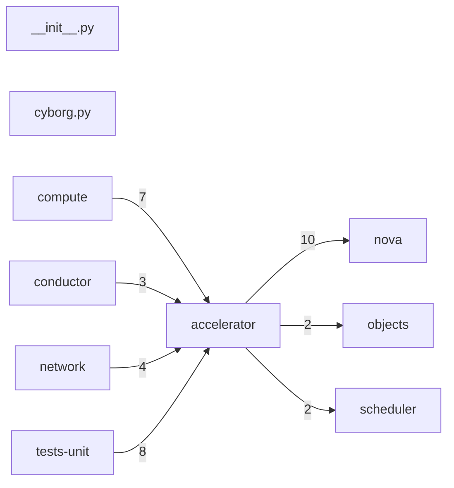

# Component: accelerator

## Overview

Cyborg accelerator device client: request specification lifecycle and device attachment to compute instances.
2 files (0.1% of 1509 source files), 324 code lines (0.1% of 473,713 total).
Main neighbours: **nova** (→10 edges); **tests-unit** (←8 edges); **compute** (←7 edges); **network** (←4 edges); **conductor** (←3 edges).

## File Inventory

### (top-level)/

| File | Code Lines | Top CCN |
|------|-----------|---------|
| `__init__.py` | 0 | — |
| `cyborg.py` | 324 | 6 |

**Top 5 Functions by CCN**

| Function | Kind | CCN | File | Line Range |
|----------|------|-----|------|------------|
| `get_device_request_groups` | method | 6 | `cyborg.py` | L179–L201 |
| `get_arqs_for_instance` | method | 6 | `cyborg.py` | L291–L335 |
| `get_device_amount_of_dp_groups` | function | 5 | `cyborg.py` | L94–L109 |
| `bind_arqs` | method | 4 | `cyborg.py` | L255–L289 |
| `_call_cyborg` | method | 3 | `cyborg.py` | L136–L147 |

## Defined Symbols

Total: 33

| Kind | Count |
|------|-------|
| method | 16 |
| import | 7 |
| function | 5 |
| constant | 3 |
| class | 1 |
| property | 1 |

## External Dependencies

| Package | Files Importing |
|---------|----------------|
| `oslo_log` | 1 |

## Side Effects

| Kind | Count |
|------|-------|
| network | 7 |
| global-mutation | 1 |

## Component Diagram

## Local Data Flow

**Entry points** (5 total):

- **http-param** (5): `cyborg.py`

**Sinks** (7 total):

- **network-send** (7)

**Privileged operations**: 1 entries recorded.

_The KB records do not include sanitisation annotations; cross-file data-flow tracing requires the resolved link graph._

## Cross-Component Interfaces

| Component | Dir | File Edges | Summed Count | Kinds |
|-----------|-----|-----------|-------------|-------|
| **compute** | ← | 3 | 7 | call, import |
| **conductor** | ← | 1 | 3 | call, import |
| **network** | ← | 1 | 4 | call, import |
| **nova** | → | 4 | 10 | call, import |
| **objects** | → | 1 | 2 | call, import |
| **scheduler** | → | 1 | 2 | call, import |
| **tests-unit** | ← | 3 | 8 | call, import |

No cross-component seams recorded in the link graph.
