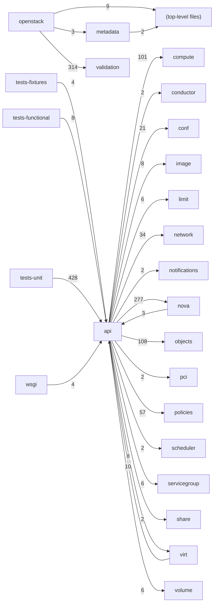

# Component: api

## Overview

OpenStack Compute REST API layer: request routing, input validation, OpenStack v2.1 controllers, and the EC2/metadata service endpoints.
199 files (13.2% of 1509 source files), 25,055 code lines (5.3% of 473,713 total).
Main neighbours: **tests-unit** (←428 edges); **nova** (→277/←3 edges); **objects** (→108 edges); **compute** (→101 edges); **policies** (→57 edges).

## File Inventory

### (top-level)/

| File | Code Lines | Top CCN |
|------|-----------|---------|
| `__init__.py` | 0 | — |
| `auth.py` | 62 | 4 |
| `compute_req_id.py` | 13 | — |
| `wsgi.py` | 178 | 5 |

### metadata/

| File | Code Lines | Top CCN |
|------|-----------|---------|
| `metadata/__init__.py` | 7 | — |
| `metadata/base.py` | 535 | 25 |
| `metadata/handler.py` | 245 | 10 |
| `metadata/password.py` | 56 | 8 |
| `metadata/vendordata.py` | 10 | 1 |
| `metadata/vendordata_dynamic.py` | 84 | 8 |
| `metadata/vendordata_json.py` | 33 | 5 |

### openstack/

| File | Code Lines | Top CCN |
|------|-----------|---------|
| `openstack/__init__.py` | 158 | 8 |
| `openstack/api_version_request.py` | 357 | 6 |
| `openstack/common.py` | 437 | 7 |
| `openstack/compute/__init__.py` | 1 | — |
| `openstack/compute/admin_actions.py` | 65 | 2 |
| `openstack/compute/admin_password.py` | 38 | 4 |
| `openstack/compute/agents.py` | 37 | 1 |
| `openstack/compute/aggregates.py` | 246 | 6 |
| `openstack/compute/assisted_volume_snapshots.py` | 62 | 5 |
| `openstack/compute/attach_interfaces.py` | 189 | 13 |
| `openstack/compute/availability_zone.py` | 94 | 7 |
| `openstack/compute/baremetal_nodes.py` | 106 | 3 |
| `openstack/compute/cells.py` | 68 | 1 |
| `openstack/compute/certificates.py` | 27 | 1 |
| `openstack/compute/cloudpipe.py` | 34 | 1 |
| `openstack/compute/console_auth_tokens.py` | 62 | 7 |
| `openstack/compute/console_output.py` | 39 | 4 |
| `openstack/compute/consoles.py` | 38 | 1 |
| `openstack/compute/create_backup.py` | 63 | 6 |
| `openstack/compute/deferred_delete.py` | 50 | 3 |
| `openstack/compute/evacuate.py` | 132 | 16 |
| `openstack/compute/extension_info.py` | 859 | 4 |
| `openstack/compute/fixed_ips.py` | 32 | 1 |
| `openstack/compute/flavor_access.py` | 80 | 5 |
| `openstack/compute/flavors.py` | 191 | 10 |
| `openstack/compute/flavors_extraspecs.py` | 111 | 5 |
| `openstack/compute/floating_ip_dns.py` | 50 | 1 |
| `openstack/compute/floating_ip_pools.py` | 32 | 2 |
| `openstack/compute/floating_ips.py` | 245 | 17 |
| `openstack/compute/floating_ips_bulk.py` | 36 | 1 |
| `openstack/compute/fping.py` | 24 | 1 |
| `openstack/compute/helpers.py` | 70 | 9 |
| `openstack/compute/hosts.py` | 258 | 6 |
| `openstack/compute/hypervisors.py` | 414 | 21 |
| `openstack/compute/image_metadata.py` | 111 | 3 |
| `openstack/compute/images.py` | 114 | 6 |
| `openstack/compute/instance_actions.py` | 154 | 12 |
| `openstack/compute/instance_usage_audit_log.py` | 92 | 7 |
| `openstack/compute/ips.py` | 41 | 2 |
| `openstack/compute/keypairs.py` | 167 | 6 |
| `openstack/compute/limits.py` | 47 | 4 |
| `openstack/compute/lock_server.py` | 47 | 3 |
| `openstack/compute/migrate_server.py` | 153 | 11 |
| `openstack/compute/migrations.py` | 154 | 15 |
| `openstack/compute/multinic.py` | 49 | 2 |
| `openstack/compute/networks.py` | 92 | 5 |
| `openstack/compute/networks_associate.py` | 34 | 1 |
| `openstack/compute/pause_server.py` | 58 | 5 |
| `openstack/compute/quota_classes.py` | 100 | 9 |
| `openstack/compute/quota_sets.py` | 180 | 9 |
| `openstack/compute/remote_consoles.py` | 147 | 6 |
| `openstack/compute/rescue.py` | 78 | 8 |
| `openstack/compute/routes.py` | 730 | 5 |
| `openstack/compute/schemas/__init__.py` | 0 | — |
| `openstack/compute/schemas/admin_actions.py` | 34 | — |
| `openstack/compute/schemas/admin_password.py` | 19 | — |
| `openstack/compute/schemas/agents.py` | 7 | — |
| `openstack/compute/schemas/aggregate_images.py` | 23 | — |
| `openstack/compute/schemas/aggregates.py` | 209 | — |
| `openstack/compute/schemas/assisted_volume_snapshots.py` | 66 | — |
| `openstack/compute/schemas/attach_interfaces.py` | 109 | — |
| `openstack/compute/schemas/availability_zone.py` | 65 | — |
| `openstack/compute/schemas/baremetal_nodes.py` | 72 | — |
| `openstack/compute/schemas/cells.py` | 17 | — |
| `openstack/compute/schemas/certificates.py` | 4 | — |
| `openstack/compute/schemas/cloudpipe.py` | 6 | — |
| `openstack/compute/schemas/console_auth_tokens.py` | 34 | — |
| `openstack/compute/schemas/console_output.py` | 26 | — |
| `openstack/compute/schemas/consoles.py` | 7 | — |
| `openstack/compute/schemas/create_backup.py` | 37 | — |
| `openstack/compute/schemas/deferred_delete.py` | 22 | — |
| `openstack/compute/schemas/evacuate.py` | 40 | — |
| `openstack/compute/schemas/extension_info.py` | 63 | — |
| `openstack/compute/schemas/fixed_ips.py` | 6 | — |
| `openstack/compute/schemas/flavor_access.py` | 65 | — |
| `openstack/compute/schemas/flavors.py` | 281 | — |
| `openstack/compute/schemas/flavors_extraspecs.py` | 48 | — |
| `openstack/compute/schemas/floating_ip_dns.py` | 7 | — |
| `openstack/compute/schemas/floating_ip_pools.py` | 26 | — |
| `openstack/compute/schemas/floating_ips.py` | 88 | — |
| `openstack/compute/schemas/floating_ips_bulk.py` | 8 | — |
| `openstack/compute/schemas/fping.py` | 4 | — |
| `openstack/compute/schemas/hosts.py` | 108 | — |
| `openstack/compute/schemas/hypervisors.py` | 293 | — |
| `openstack/compute/schemas/image_metadata.py` | 47 | — |
| `openstack/compute/schemas/images.py` | 195 | — |
| `openstack/compute/schemas/instance_actions.py` | 174 | — |
| `openstack/compute/schemas/instance_usage_audit_log.py` | 76 | — |
| `openstack/compute/schemas/ips.py` | 59 | — |
| `openstack/compute/schemas/keypairs.py` | 213 | — |
| `openstack/compute/schemas/limits.py` | 125 | — |
| `openstack/compute/schemas/lock_server.py` | 38 | — |
| `openstack/compute/schemas/migrate_server.py` | 54 | — |
| `openstack/compute/schemas/migrations.py` | 109 | — |
| `openstack/compute/schemas/multinic.py` | 40 | — |
| `openstack/compute/schemas/networks.py` | 79 | — |
| `openstack/compute/schemas/networks_associate.py` | 6 | — |
| `openstack/compute/schemas/pause_server.py` | 22 | — |
| `openstack/compute/schemas/quota_classes.py` | 130 | — |
| `openstack/compute/schemas/quota_sets.py` | 228 | — |
| `openstack/compute/schemas/remote_consoles.py` | 189 | — |
| `openstack/compute/schemas/rescue.py` | 36 | — |
| `openstack/compute/schemas/security_group_default_rules.py` | 7 | — |
| `openstack/compute/schemas/security_groups.py` | 203 | — |
| `openstack/compute/schemas/server_diagnostics.py` | 138 | — |
| `openstack/compute/schemas/server_external_events.py` | 116 | — |
| `openstack/compute/schemas/server_groups.py` | 182 | — |
| `openstack/compute/schemas/server_metadata.py` | 66 | — |
| `openstack/compute/schemas/server_migrations.py` | 118 | — |
| `openstack/compute/schemas/server_password.py` | 17 | — |
| `openstack/compute/schemas/server_shares.py` | 62 | — |
| `openstack/compute/schemas/server_tags.py` | 62 | — |
| `openstack/compute/schemas/server_topology.py` | 46 | — |
| `openstack/compute/schemas/servers.py` | 1,823 | — |
| `openstack/compute/schemas/services.py` | 158 | — |
| `openstack/compute/schemas/shelve.py` | 68 | — |
| `openstack/compute/schemas/simple_tenant_usage.py` | 141 | — |
| `openstack/compute/schemas/snapshots.py` | 112 | — |
| `openstack/compute/schemas/suspend_server.py` | 22 | — |
| `openstack/compute/schemas/tenant_networks.py` | 39 | — |
| `openstack/compute/schemas/versions.py` | 111 | — |
| `openstack/compute/schemas/virtual_interfaces.py` | 2 | — |
| `openstack/compute/schemas/volume_attachments.py` | 184 | — |
| `openstack/compute/schemas/volumes.py` | 180 | — |
| `openstack/compute/security_group_default_rules.py` | 36 | 1 |
| `openstack/compute/security_groups.py` | 376 | 12 |
| `openstack/compute/server_diagnostics.py` | 39 | 5 |
| `openstack/compute/server_external_events.py` | 116 | 7 |
| `openstack/compute/server_groups.py` | 205 | 11 |
| `openstack/compute/server_metadata.py` | 128 | 4 |
| `openstack/compute/server_migrations.py` | 158 | 5 |
| `openstack/compute/server_password.py` | 40 | 2 |
| `openstack/compute/server_shares.py` | 211 | 8 |
| `openstack/compute/server_tags.py` | 182 | 6 |
| `openstack/compute/server_topology.py` | 53 | 6 |
| `openstack/compute/servers.py` | 1,331 | 37 |
| `openstack/compute/services.py` | 347 | 13 |
| `openstack/compute/shelve.py` | 119 | 9 |
| `openstack/compute/simple_tenant_usage.py` | 269 | 11 |
| `openstack/compute/snapshots.py` | 117 | 3 |
| `openstack/compute/suspend_server.py` | 56 | 5 |
| `openstack/compute/tenant_networks.py` | 84 | 3 |
| `openstack/compute/versions.py` | 94 | 2 |
| `openstack/compute/versionsV21.py` | 18 | 3 |
| `openstack/compute/views/__init__.py` | 0 | — |
| `openstack/compute/views/flavors.py` | 76 | 8 |
| `openstack/compute/views/hypervisors.py` | 8 | 2 |
| `openstack/compute/views/images.py` | 129 | 6 |
| `openstack/compute/views/instance_actions.py` | 6 | 1 |
| `openstack/compute/views/ips.py` | 31 | 2 |
| `openstack/compute/views/keypairs.py` | 42 | 5 |
| `openstack/compute/views/limits.py` | 66 | 9 |
| `openstack/compute/views/migrations.py` | 6 | 1 |
| `openstack/compute/views/server_diagnostics.py` | 40 | 7 |
| `openstack/compute/views/server_shares.py` | 27 | 2 |
| `openstack/compute/views/server_tags.py` | 11 | 1 |
| `openstack/compute/views/servers.py` | 593 | 50 |
| `openstack/compute/views/usages.py` | 9 | 2 |
| `openstack/compute/views/versions.py` | 64 | 3 |
| `openstack/compute/virtual_interfaces.py` | 19 | 1 |
| `openstack/compute/volume_attachments.py` | 342 | 11 |
| `openstack/compute/volumes.py` | 156 | 7 |
| `openstack/compute/volumes_boot.py` | 202 | 1 |
| `openstack/identity.py` | 46 | 6 |
| `openstack/requestlog.py` | 63 | 3 |
| `openstack/urlmap.py` | 202 | 17 |
| `openstack/wsgi.py` | 637 | 22 |
| `openstack/wsgi_app.py` | 91 | 6 |

### validation/

| File | Code Lines | Top CCN |
|------|-----------|---------|
| `validation/__init__.py` | 298 | 10 |
| `validation/extra_specs/__init__.py` | 0 | — |
| `validation/extra_specs/accel.py` | 17 | 1 |
| `validation/extra_specs/aggregate_instance_extra_specs.py` | 47 | 1 |
| `validation/extra_specs/base.py` | 82 | 6 |
| `validation/extra_specs/capabilities.py` | 75 | 1 |
| `validation/extra_specs/hw.py` | 626 | 1 |
| `validation/extra_specs/hw_rng.py` | 37 | 1 |
| `validation/extra_specs/hw_video.py` | 19 | 1 |
| `validation/extra_specs/null.py` | 35 | 1 |
| `validation/extra_specs/os.py` | 21 | 1 |
| `validation/extra_specs/pci_passthrough.py` | 23 | 1 |
| `validation/extra_specs/quota.py` | 155 | 1 |
| `validation/extra_specs/resources.py` | 43 | 1 |
| `validation/extra_specs/traits.py` | 51 | 1 |
| `validation/extra_specs/validators.py` | 47 | 7 |
| `validation/extra_specs/vmware.py` | 29 | 1 |
| `validation/parameter_types.py` | 372 | 8 |
| `validation/response_types.py` | 51 | — |
| `validation/validators.py` | 235 | 13 |

**Top 5 Functions by CCN**

| Function | Kind | CCN | File | Line Range |
|----------|------|-----|------|------------|
| `show` | method | 50 | `openstack/compute/views/servers.py` | L263–L472 |
| `_get_servers` | method | 37 | `openstack/compute/servers.py` | L193–L367 |
| `create` | method | 27 | `openstack/compute/servers.py` | L717–L923 |
| `_get_device_metadata` | method | 25 | `metadata/base.py` | L371–L449 |
| `_rebuild` | method | 25 | `openstack/compute/servers.py` | L1264–L1423 |

## Defined Symbols

Total: 2,226

| Kind | Count |
|------|-------|
| variable | 1,036 |
| method | 666 |
| constant | 151 |
| function | 151 |
| class | 135 |
| field | 49 |
| staticmethod | 30 |
| property | 4 |
| classmethod | 4 |

## External Dependencies

| Package | Files Importing |
|---------|----------------|
| `webob` | 73 |
| `copy` | 48 |
| `oslo_log` | 29 |
| `oslo_utils` | 23 |
| `oslo_serialization` | 9 |
| `re` | 9 |
| `itertools` | 5 |
| `os` | 4 |
| `collections` | 4 |
| `urllib` | 4 |
| `functools` | 4 |
| `keystoneauth1` | 3 |
| `typing` | 3 |
| `datetime` | 3 |
| `paste` | 3 |
| `sys` | 2 |
| `routes` | 2 |
| `oslo_db` | 2 |
| `jsonschema` | 2 |
| `oslo_middleware` | 1 |
| `posixpath` | 1 |
| `hashlib` | 1 |
| `hmac` | 1 |
| `errno` | 1 |
| `openstack` | 1 |
| `oslo_messaging` | 1 |
| `time` | 1 |
| `microversion_parse` | 1 |
| `oslo_config` | 1 |
| `oslo_reports` | 1 |
| `oslo_service` | 1 |
| `dataclasses` | 1 |
| `os_resource_classes` | 1 |
| `os_traits` | 1 |
| `stevedore` | 1 |
| `unicodedata` | 1 |
| `netaddr` | 1 |
| `rfc3986` | 1 |

## Side Effects

| Kind | Count |
|------|-------|
| network | 287 |
| global-mutation | 150 |
| file-io | 8 |

## Component Diagram

## Local Data Flow

**Entry points** (31 total):

- **http-param** (29): `auth.py`, `metadata/handler.py`, `openstack/__init__.py`, `openstack/api_version_request.py`, `openstack/common.py`, … (6 more)
- **env** (1): `openstack/wsgi_app.py`
- **cli-args** (1): `openstack/wsgi_app.py`

**Sinks** (242 total):

- **db-write** (242)

**Privileged operations**: 4 entries recorded.

_The KB records do not include sanitisation annotations; cross-file data-flow tracing requires the resolved link graph._

## Cross-Component Interfaces

| Component | Dir | File Edges | Summed Count | Kinds |
|-----------|-----|-----------|-------------|-------|
| **compute** | → | 53 | 101 | call, import |
| **conductor** | → | 1 | 2 | call, import |
| **conf** | → | 21 | 21 | import |
| **image** | → | 4 | 8 | call, import |
| **limit** | → | 3 | 6 | call, import |
| **network** | → | 10 | 34 | call, import |
| **notifications** | → | 1 | 2 | call, import |
| **nova** | → | 151 | 277 | call, import |
| **nova** | ← | 1 | 3 | call, import |
| **objects** | → | 34 | 108 | call, import |
| **pci** | → | 1 | 2 | call, import |
| **policies** | → | 57 | 57 | import |
| **scheduler** | → | 1 | 2 | call, import |
| **servicegroup** | → | 3 | 6 | call, import |
| **share** | → | 1 | 2 | call, import |
| **tests-fixtures** | ← | 2 | 4 | call, import |
| **tests-functional** | ← | 5 | 8 | call, import |
| **tests-unit** | ← | 204 | 428 | call, import, inherit |
| **virt** | → | 3 | 8 | call, import |
| **virt** | ← | 5 | 10 | call, import |
| **volume** | → | 3 | 6 | call, import |
| **wsgi** | ← | 2 | 4 | call, import |

No cross-component seams recorded in the link graph.
