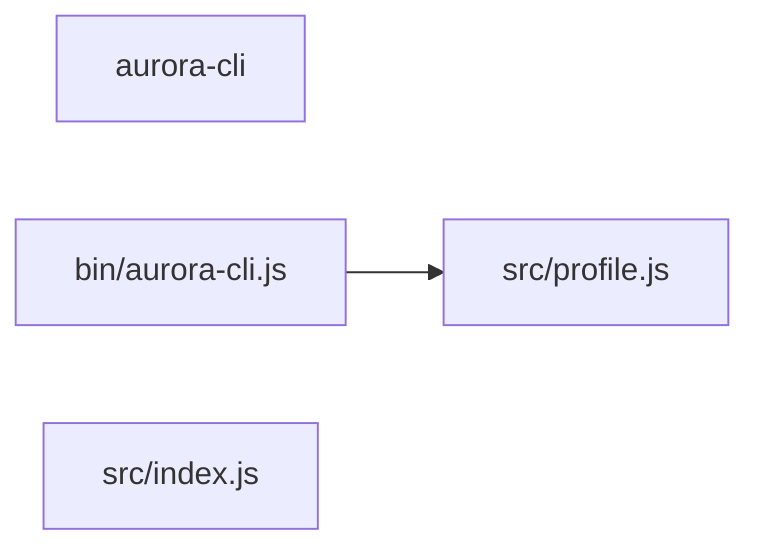

# Component: aurora-cli

## Overview

_Purpose not yet written._
3 files (1.5% of 198 source files), 52 code lines (0.8% of 6,745 total).

## File Inventory

### bin/

| File | Code Lines | Top CCN |
|---|---:|---:|
| `bin/aurora-cli.js` | 17 | 2 |

### src/

| File | Code Lines | Top CCN |
|---|---:|---:|
| `src/index.js` | 17 | 1 |
| `src/profile.js` | 18 | 1 |

**Top 5 Functions by CCN**

| Function | Kind | CCN | File | Line Range |
|---|---|---:|---|---|
| `main` | function | 2 | `bin/aurora-cli.js` | L12–L21 |
| `loadProfile` | function | 1 | `src/index.js` | L9–L11 |
| `applyFilter` | function | 1 | `src/index.js` | L13–L17 |
| `formatTable` | function | 1 | `src/index.js` | L19–L23 |
| `profileApply` | function | 1 | `src/profile.js` | L10–L19 |

## Defined Symbols

Total: 14 (imports not counted)

| Kind | Count |
|---|---:|
| constant | 8 |
| function | 6 |

## External Dependencies

| Package | Kind | Files Importing |
|---|---|---:|
| `axios` | third-party | 1 |
| `fs` | third-party | 1 |
| `js-yaml` | third-party | 1 |
| `minimist` | third-party | 1 |

## Side Effects

None recorded by the Fact Extractor's pattern rules (Python, JavaScript, Go, Java, C and C++ only; a record's `warnings` say when a language has no rules), so this is not evidence that there are none.

## Component Diagram

## Call Flow

> Static call flow of resolved cross-file calls. Not a data flow: no parameters, no taint, no sanitisation.

### Summary

- Files: 3; symbols in call edges: 0
- Cross-file calls: 0 inside the component, 0 to other components, 0 from other components
- Boundary calls: none

No resolved cross-file calls touch this component.

## Cross-Component Interfaces

No cross-component file edges.

| Component A | Component B | Kind | Literal | Site A | Site B |
|---|---|---|---|---|---|
| aurora-cli | aurora-compute | env-var | `AURORA_ADMIN_TOKEN` | `src/aurora/aurora-cli/src/profile.js:16` | `src/aurora/aurora-compute/api/routes.go:20` |
| aurora-cli | aurora-compute | http-endpoint | `/v1/profile/apply` | `src/aurora/aurora-cli/src/profile.js:14` | `src/aurora/aurora-compute/api/routes.go:13` |
| aurora-cli | aurora-compute | http-endpoint | `/v1/profile/list` | `src/aurora/aurora-cli/src/profile.js:22` | `src/aurora/aurora-compute/api/routes.go:14` |

A missing edge means no edge was found, never that there is no coupling (dynamic dispatch, calls on local variables and generated clients are not seen).
