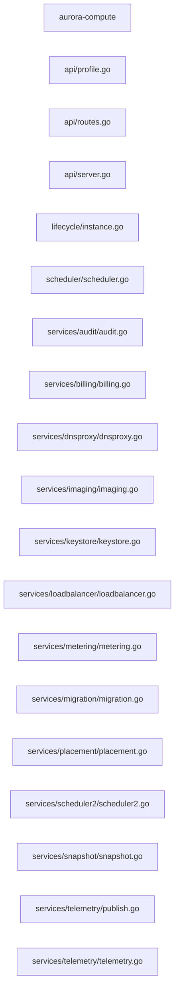

# Component: aurora-compute

## Overview

_Purpose not yet written._
18 files (9.1% of 198 source files), 753 code lines (11.2% of 6,745 total).

## File Inventory

### api/

| File | Code Lines | Top CCN |
|---|---:|---:|
| `api/profile.go` | 22 | 2 |
| `api/routes.go` | 23 | 1 |
| `api/server.go` | 22 | 1 |

### lifecycle/

| File | Code Lines | Top CCN |
|---|---:|---:|
| `lifecycle/instance.go` | 30 | 6 |

### scheduler/

| File | Code Lines | Top CCN |
|---|---:|---:|
| `scheduler/scheduler.go` | 34 | 6 |

### services/

| File | Code Lines | Top CCN |
|---|---:|---:|
| `services/audit/audit.go` | 50 | 3 |
| `services/billing/billing.go` | 50 | 3 |
| `services/dnsproxy/dnsproxy.go` | 50 | 3 |
| `services/imaging/imaging.go` | 50 | 3 |
| `services/keystore/keystore.go` | 50 | 3 |
| `services/loadbalancer/loadbalancer.go` | 50 | 3 |
| `services/metering/metering.go` | 50 | 3 |
| `services/migration/migration.go` | 50 | 3 |
| `services/placement/placement.go` | 50 | 3 |
| `services/scheduler2/scheduler2.go` | 50 | 3 |
| `services/snapshot/snapshot.go` | 50 | 3 |
| `services/telemetry/publish.go` | 22 | 2 |
| `services/telemetry/telemetry.go` | 50 | 3 |

**Top 5 Functions by CCN**

| Function | Kind | CCN | File | Line Range |
|---|---|---:|---|---|
| `Transition` | method | 6 | `lifecycle/instance.go` | L24–L35 |
| `Select` | function | 6 | `scheduler/scheduler.go` | L26–L43 |
| `ByProject` | method | 3 | `services/audit/audit.go` | L41–L49 |
| `ByProject` | method | 3 | `services/billing/billing.go` | L41–L49 |
| `ByProject` | method | 3 | `services/dnsproxy/dnsproxy.go` | L41–L49 |

## Defined Symbols

Total: 146 (imports not counted)

| Kind | Count |
|---|---:|
| method | 61 |
| function | 35 |
| type | 31 |
| variable | 13 |
| constant | 6 |

## External Dependencies

| Package | Kind | Files Importing |
|---|---|---:|
| `errors` | stdlib | 13 |
| `strings` | stdlib | 12 |
| `net` | stdlib | 3 |
| `os` | stdlib | 2 |
| `C` | stdlib | 1 |
| `crypto` | stdlib | 1 |
| `encoding` | stdlib | 1 |
| `fmt` | stdlib | 1 |
| `gopkg.in` | third-party | 1 |
| `sort` | stdlib | 1 |
| `time` | stdlib | 1 |
| `unsafe` | stdlib | 1 |

## Side Effects

| Kind | Count |
|---|---:|
| network | 3 |
| process-spawn | 1 |

## Component Diagram

## Call Flow

> Static call flow of resolved cross-file calls. Not a data flow: no parameters, no taint, no sanitisation.

### Summary

- Files: 18; symbols in call edges: 0
- Cross-file calls: 0 inside the component, 0 to other components, 0 from other components
- Boundary calls: none

No resolved cross-file calls touch this component.

## Cross-Component Interfaces

No cross-component file edges.

| Component A | Component B | Kind | Literal | Site A | Site B |
|---|---|---|---|---|---|
| aurora-cli | aurora-compute | env-var | `AURORA_ADMIN_TOKEN` | `src/aurora/aurora-cli/src/profile.js:16` | `src/aurora/aurora-compute/api/routes.go:20` |
| aurora-cli | aurora-compute | http-endpoint | `/v1/profile/apply` | `src/aurora/aurora-cli/src/profile.js:14` | `src/aurora/aurora-compute/api/routes.go:13` |
| aurora-cli | aurora-compute | http-endpoint | `/v1/profile/list` | `src/aurora/aurora-cli/src/profile.js:22` | `src/aurora/aurora-compute/api/routes.go:14` |
| aurora-compute | aurora-network | native-symbol | `aurora_profile_label` | `src/aurora/aurora-compute/api/profile.go:32` | `src/aurora/aurora-network/src/profile_label.c:25` |

A missing edge means no edge was found, never that there is no coupling (dynamic dispatch, calls on local variables and generated clients are not seen).
