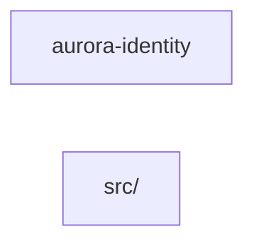

# Component: aurora-identity

## Overview

_Purpose not yet written._
52 files (26.3% of 198 source files), 1,267 code lines (18.8% of 6,745 total).

## File Inventory

### src/

| File | Code Lines | Top CCN |
|---|---:|---:|
| `src/main/java/cloud/aurora/identity/AccountService.java` | 25 | 3 |
| `src/main/java/cloud/aurora/identity/AlarmService.java` | 25 | 3 |
| `src/main/java/cloud/aurora/identity/BackupService.java` | 25 | 3 |
| `src/main/java/cloud/aurora/identity/CatalogService.java` | 25 | 3 |
| `src/main/java/cloud/aurora/identity/ClusterService.java` | 25 | 3 |
| `src/main/java/cloud/aurora/identity/ConfigService.java` | 25 | 3 |
| `src/main/java/cloud/aurora/identity/ConsoleService.java` | 25 | 3 |
| `src/main/java/cloud/aurora/identity/CryptoUtil.java` | 15 | 1 |
| `src/main/java/cloud/aurora/identity/DeviceService.java` | 25 | 3 |
| `src/main/java/cloud/aurora/identity/DomainService.java` | 25 | 3 |
| `src/main/java/cloud/aurora/identity/EventService.java` | 25 | 3 |
| `src/main/java/cloud/aurora/identity/ExportService.java` | 25 | 3 |
| `src/main/java/cloud/aurora/identity/FirewallService.java` | 25 | 3 |
| `src/main/java/cloud/aurora/identity/GatewayService.java` | 25 | 3 |
| `src/main/java/cloud/aurora/identity/HealthService.java` | 25 | 3 |
| `src/main/java/cloud/aurora/identity/ImageService.java` | 25 | 3 |
| `src/main/java/cloud/aurora/identity/InventoryService.java` | 25 | 3 |
| `src/main/java/cloud/aurora/identity/JobService.java` | 25 | 3 |
| `src/main/java/cloud/aurora/identity/KeypairService.java` | 25 | 3 |
| `src/main/java/cloud/aurora/identity/LabelService.java` | 25 | 3 |
| `src/main/java/cloud/aurora/identity/LimitService.java` | 25 | 3 |
| `src/main/java/cloud/aurora/identity/LockService.java` | 25 | 3 |
| `src/main/java/cloud/aurora/identity/MeterService.java` | 25 | 3 |
| `src/main/java/cloud/aurora/identity/NetworkService.java` | 25 | 3 |
| `src/main/java/cloud/aurora/identity/NodeService.java` | 25 | 3 |
| `src/main/java/cloud/aurora/identity/ObjectService.java` | 25 | 3 |
| `src/main/java/cloud/aurora/identity/PolicyService.java` | 25 | 3 |
| `src/main/java/cloud/aurora/identity/PortService.java` | 25 | 3 |
| `src/main/java/cloud/aurora/identity/ProfileService.java` | 25 | 3 |
| `src/main/java/cloud/aurora/identity/QueueService.java` | 25 | 3 |
| `src/main/java/cloud/aurora/identity/QuotaService.java` | 25 | 3 |
| `src/main/java/cloud/aurora/identity/RegionAssignmentDao.java` | 18 | 1 |
| `src/main/java/cloud/aurora/identity/RegionPolicy.java` | 16 | 2 |
| `src/main/java/cloud/aurora/identity/RegionService.java` | 25 | 3 |
| `src/main/java/cloud/aurora/identity/RouteService.java` | 25 | 3 |
| `src/main/java/cloud/aurora/identity/ScheduleService.java` | 25 | 3 |
| `src/main/java/cloud/aurora/identity/SecretService.java` | 25 | 3 |
| `src/main/java/cloud/aurora/identity/ServerService.java` | 25 | 3 |
| `src/main/java/cloud/aurora/identity/SessionService.java` | 25 | 3 |
| `src/main/java/cloud/aurora/identity/ShareService.java` | 25 | 3 |
| `src/main/java/cloud/aurora/identity/Snapshot2Service.java` | 25 | 3 |
| `src/main/java/cloud/aurora/identity/SubnetService.java` | 25 | 3 |
| `src/main/java/cloud/aurora/identity/TagService.java` | 25 | 3 |
| `src/main/java/cloud/aurora/identity/TaskService.java` | 25 | 3 |
| `src/main/java/cloud/aurora/identity/TenantService.java` | 25 | 3 |
| `src/main/java/cloud/aurora/identity/TokenService.java` | 22 | 2 |
| `src/main/java/cloud/aurora/identity/TrunkService.java` | 25 | 3 |
| `src/main/java/cloud/aurora/identity/UsageService.java` | 25 | 3 |
| `src/main/java/cloud/aurora/identity/UserRepository.java` | 21 | 2 |
| `src/main/java/cloud/aurora/identity/VolumeService.java` | 25 | 3 |
| `src/main/java/cloud/aurora/identity/WorkerService.java` | 25 | 3 |
| `src/main/java/cloud/aurora/identity/ZoneService.java` | 25 | 3 |

**Top 5 Functions by CCN**

| Function | Kind | CCN | File | Line Range |
|---|---|---:|---|---|
| `AccountService.add` | method | 3 | `src/main/java/cloud/aurora/identity/AccountService.java` | L22–L27 |
| `AlarmService.add` | method | 3 | `src/main/java/cloud/aurora/identity/AlarmService.java` | L22–L27 |
| `BackupService.add` | method | 3 | `src/main/java/cloud/aurora/identity/BackupService.java` | L22–L27 |
| `CatalogService.add` | method | 3 | `src/main/java/cloud/aurora/identity/CatalogService.java` | L22–L27 |
| `ClusterService.add` | method | 3 | `src/main/java/cloud/aurora/identity/ClusterService.java` | L22–L27 |

## Defined Symbols

Total: 351 (imports not counted)

| Kind | Count |
|---|---:|
| method | 247 |
| class | 52 |
| field | 50 |
| constant | 2 |

## External Dependencies

| Package | Kind | Files Importing |
|---|---|---:|
| `java.util` | stdlib | 49 |
| `java.sql` | stdlib | 2 |
| `java.security` | stdlib | 1 |
| `javax.crypto` | stdlib | 1 |

## Side Effects

| Kind | Count |
|---|---:|
| network | 6 |

## Component Diagram

More than 40 files: one node per subfolder; edges shown where the summed count is at least 5, or the strongest 3 of a subfolder with none.

## Call Flow

> Static call flow of resolved cross-file calls. Not a data flow: no parameters, no taint, no sanitisation.

### Summary

- Files: 52; symbols in call edges: 0
- Cross-file calls: 0 inside the component, 0 to other components, 0 from other components
- Boundary calls: none

No resolved cross-file calls touch this component.

## Cross-Component Interfaces

No cross-component file edges.

| Component A | Component B | Kind | Literal | Site A | Site B |
|---|---|---|---|---|---|
| aurora-identity | aurora-portal | db-table | `tenant_region_assignment` | `src/aurora/aurora-identity/src/main/java/cloud/aurora/identity/RegionAssignmentDao.java:19` | `src/aurora/aurora-portal/aurora_portal/region_lookup.py:6` |

A missing edge means no edge was found, never that there is no coupling (dynamic dispatch, calls on local variables and generated clients are not seen).
