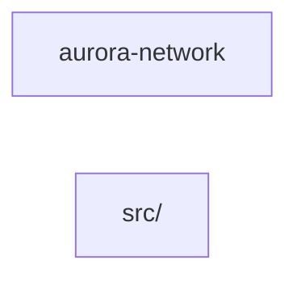
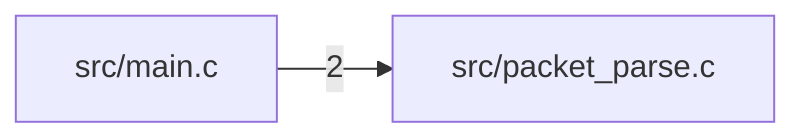
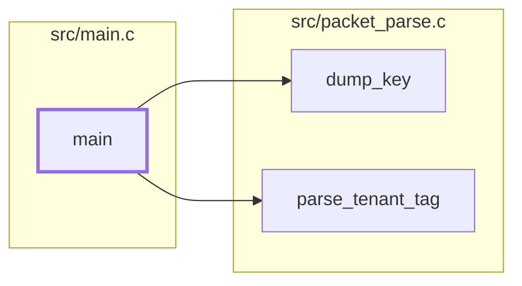
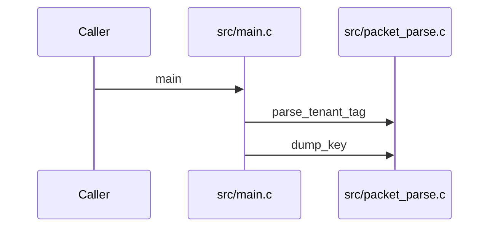

# Component: aurora-network

## Overview

_Purpose not yet written._
56 files (28.3% of 198 source files), 2,582 code lines (38.3% of 6,745 total).

## File Inventory

### src/

| File | Code Lines | Top CCN |
|---|---:|---:|
| `src/account_ops.c` | 50 | 3 |
| `src/acl.c` | 36 | 4 |
| `src/alarm_ops.c` | 50 | 3 |
| `src/backup_ops.c` | 50 | 3 |
| `src/catalog_ops.c` | 50 | 3 |
| `src/cluster_ops.c` | 50 | 3 |
| `src/config_ops.c` | 50 | 3 |
| `src/console_ops.c` | 50 | 3 |
| `src/device_ops.c` | 50 | 3 |
| `src/domain_ops.c` | 50 | 3 |
| `src/event_ops.c` | 50 | 3 |
| `src/export_ops.c` | 50 | 3 |
| `src/firewall_ops.c` | 50 | 3 |
| `src/flow_table.c` | 57 | 3 |
| `src/gateway_ops.c` | 50 | 3 |
| `src/health_ops.c` | 50 | 3 |
| `src/image_ops.c` | 50 | 3 |
| `src/inventory_ops.c` | 50 | 3 |
| `src/job_ops.c` | 50 | 3 |
| `src/keypair_ops.c` | 50 | 3 |
| `src/label_ops.c` | 50 | 3 |
| `src/limit_ops.c` | 50 | 3 |
| `src/lock_ops.c` | 50 | 3 |
| `src/main.c` | 15 | 2 |
| `src/meter_ops.c` | 50 | 3 |
| `src/network_ops.c` | 50 | 3 |
| `src/node_ops.c` | 50 | 3 |
| `src/object_ops.c` | 50 | 3 |
| `src/packet.h` | 15 | — |
| `src/packet_parse.c` | 33 | 2 |
| `src/policy_ops.c` | 50 | 3 |
| `src/port_ops.c` | 50 | 3 |
| `src/profile_label.c` | 28 | 3 |
| `src/profile_label.h` | 4 | — |
| `src/profile_ops.c` | 50 | 3 |
| `src/queue_ops.c` | 50 | 3 |
| `src/quota_ops.c` | 50 | 3 |
| `src/region_ops.c` | 50 | 3 |
| `src/route_ops.c` | 50 | 3 |
| `src/schedule_ops.c` | 50 | 3 |
| `src/secret_ops.c` | 50 | 3 |
| `src/server_ops.c` | 50 | 3 |
| `src/session_ops.c` | 50 | 3 |
| `src/share_ops.c` | 50 | 3 |
| `src/snapshot2_ops.c` | 50 | 3 |
| `src/stats.c` | 20 | 1 |
| `src/subnet_ops.c` | 50 | 3 |
| `src/tag_ops.c` | 50 | 3 |
| `src/task_ops.c` | 50 | 3 |
| `src/tenant_ops.c` | 50 | 3 |
| `src/trunk_ops.c` | 50 | 3 |
| `src/tunnel.c` | 24 | 3 |
| `src/usage_ops.c` | 50 | 3 |
| `src/volume_ops.c` | 50 | 3 |
| `src/worker_ops.c` | 50 | 3 |
| `src/zone_ops.c` | 50 | 3 |

**Top 5 Functions by CCN**

| Function | Kind | CCN | File | Line Range |
|---|---|---:|---|---|
| `acl_check` | function | 4 | `src/acl.c` | L36–L45 |
| `account_add` | function | 3 | `src/account_ops.c` | L26–L38 |
| `account_find` | function | 3 | `src/account_ops.c` | L40–L49 |
| `account_total` | function | 3 | `src/account_ops.c` | L51–L61 |
| `alarm_add` | function | 3 | `src/alarm_ops.c` | L26–L38 |

## Defined Symbols

Total: 571 (imports not counted)

| Kind | Count |
|---|---:|
| function | 211 |
| field | 157 |
| variable | 100 |
| type | 52 |
| constant | 51 |

## External Dependencies

| Package | Kind | Files Importing |
|---|---|---:|
| `string.h` | system | 54 |
| `stdio.h` | system | 53 |
| `stdlib.h` | system | 50 |
| `stddef.h` | system | 1 |

## Side Effects

| Kind | Count |
|---|---:|
| process-spawn | 3 |

## Component Diagram

More than 40 files: one node per subfolder; edges shown where the summed count is at least 5, or the strongest 3 of a subfolder with none.

## Call Flow

> Static call flow of resolved cross-file calls. Not a data flow: no parameters, no taint, no sanitisation.

### Summary

- Files: 56; symbols in call edges: 3
- Cross-file calls: 2 inside the component, 0 to other components, 0 from other components
- Boundary calls: none

### Entry points

Symbols no other symbol of this component calls (or that other components call).

| Entry | Reaches | Called from other components |
|---|---|---|
| src/main.c::main | 2 | 0 |

### File-level graph

Dashed border: called from another component. Dotted edge: calls into an external module.

### Symbol-level graph

Files are boxes; thick border: entry point reaching two or more symbols. Boundary calls are attributed to the file.

### Sequences

The 1 entry point(s) reaching the most symbols, depth 3, messages ordered by call-site line.

#### src/main.c::main

## Cross-Component Interfaces

No cross-component file edges.

| Component A | Component B | Kind | Literal | Site A | Site B |
|---|---|---|---|---|---|
| aurora-compute | aurora-network | native-symbol | `aurora_profile_label` | `src/aurora/aurora-compute/api/profile.go:32` | `src/aurora/aurora-network/src/profile_label.c:25` |

A missing edge means no edge was found, never that there is no coupling (dynamic dispatch, calls on local variables and generated clients are not seen).
