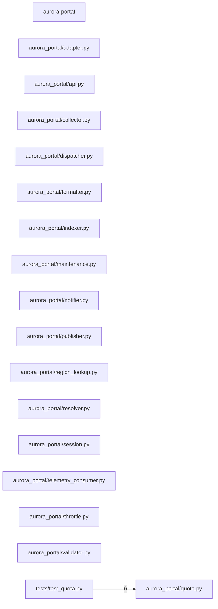
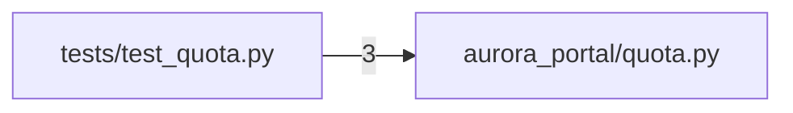
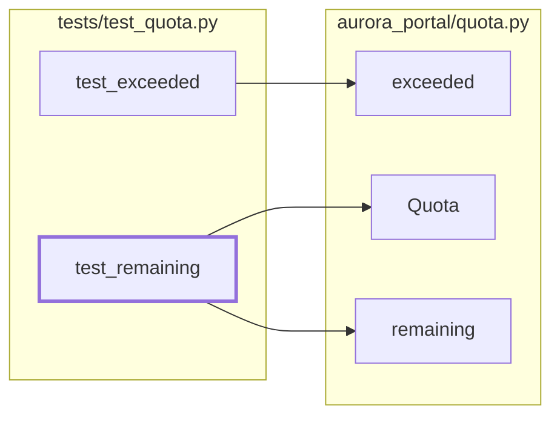
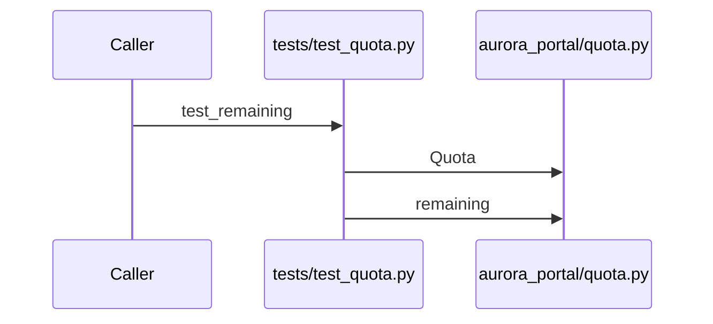

# Component: aurora-portal

## Overview

_Purpose not yet written._
17 files (8.6% of 198 source files), 325 code lines (4.8% of 6,745 total).

## File Inventory

### aurora_portal/

| File | Code Lines | Top CCN |
|---|---:|---:|
| `aurora_portal/adapter.py` | 21 | 4 |
| `aurora_portal/api.py` | 27 | 2 |
| `aurora_portal/collector.py` | 21 | 4 |
| `aurora_portal/dispatcher.py` | 21 | 4 |
| `aurora_portal/formatter.py` | 21 | 4 |
| `aurora_portal/indexer.py` | 21 | 4 |
| `aurora_portal/maintenance.py` | 20 | 1 |
| `aurora_portal/notifier.py` | 21 | 4 |
| `aurora_portal/publisher.py` | 21 | 4 |
| `aurora_portal/quota.py` | 21 | 2 |
| `aurora_portal/region_lookup.py` | 8 | 2 |
| `aurora_portal/resolver.py` | 21 | 4 |
| `aurora_portal/session.py` | 15 | 3 |
| `aurora_portal/telemetry_consumer.py` | 13 | 2 |
| `aurora_portal/throttle.py` | 21 | 4 |
| `aurora_portal/validator.py` | 21 | 4 |

### tests/

| File | Code Lines | Top CCN |
|---|---:|---:|
| `tests/test_quota.py` | 11 | 1 |

**Top 5 Functions by CCN**

| Function | Kind | CCN | File | Line Range |
|---|---|---:|---|---|
| `Adapter.transform` | method | 4 | `aurora_portal/adapter.py` | L20–L25 |
| `Collector.transform` | method | 4 | `aurora_portal/collector.py` | L20–L25 |
| `Dispatcher.transform` | method | 4 | `aurora_portal/dispatcher.py` | L20–L25 |
| `Formatter.transform` | method | 4 | `aurora_portal/formatter.py` | L20–L25 |
| `Indexer.transform` | method | 4 | `aurora_portal/indexer.py` | L20–L25 |

## Defined Symbols

Total: 88 (imports not counted)

| Kind | Count |
|---|---:|
| method | 40 |
| function | 27 |
| class | 11 |
| constant | 6 |
| field | 4 |

## External Dependencies

| Package | Kind | Files Importing |
|---|---|---:|
| `subprocess` | stdlib | 2 |
| `yaml` | third-party | 2 |
| `dataclasses` | stdlib | 1 |
| `hashlib` | stdlib | 1 |
| `os` | stdlib | 1 |
| `random` | stdlib | 1 |
| `requests` | third-party | 1 |
| `string` | stdlib | 1 |

## Side Effects

| Kind | Count |
|---|---:|
| process-spawn | 4 |
| file-io | 2 |
| network | 2 |

Calls into external modules, by category (from the KB references):

| Category | Calls | Modules |
|---|---:|---|
| crypto | 1 | `hashlib` |
| network | 1 | `requests` |
| process | 3 | `subprocess` |
| serialization | 2 | `yaml` |

## Component Diagram

## Call Flow

> Static call flow of resolved cross-file calls. Not a data flow: no parameters, no taint, no sanitisation.

### Summary

- Files: 17; symbols in call edges: 5
- Cross-file calls: 3 inside the component, 0 to other components, 0 from other components
- Boundary calls: crypto x1, network x1, process x3, serialization x2

### Entry points

Symbols no other symbol of this component calls (or that other components call).

| Entry | Reaches | Called from other components |
|---|---|---|
| tests/test_quota.py::test_remaining | 2 | 0 |
| tests/test_quota.py::test_exceeded | 1 | 0 |

### File-level graph

Dashed border: called from another component. Dotted edge: calls into an external module.

### Symbol-level graph

Files are boxes; thick border: entry point reaching two or more symbols. Boundary calls are attributed to the file.

### Sequences

The 1 entry point(s) reaching the most symbols, depth 3, messages ordered by call-site line.

#### tests/test_quota.py::test_remaining

## Cross-Component Interfaces

No cross-component file edges.

| Component A | Component B | Kind | Literal | Site A | Site B |
|---|---|---|---|---|---|
| aurora-identity | aurora-portal | db-table | `tenant_region_assignment` | `src/aurora/aurora-identity/src/main/java/cloud/aurora/identity/RegionAssignmentDao.java:19` | `src/aurora/aurora-portal/aurora_portal/region_lookup.py:6` |
| aurora-portal | deploy | env-var | `AURORA_DB_PASSWORD` | `src/aurora/aurora-portal/.env.example:3` | `src/aurora/deploy/k8s/portal.yaml:22` |

A missing edge means no edge was found, never that there is no coupling (dynamic dispatch, calls on local variables and generated clients are not seen).
