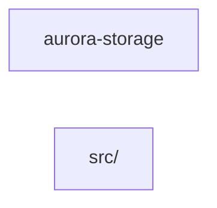

# Component: aurora-storage

## Overview

_Purpose not yet written._
50 files (25.3% of 198 source files), 1,737 code lines (25.8% of 6,745 total).

## File Inventory

### src/

| File | Code Lines | Top CCN |
|---|---:|---:|
| `src/account_handler.cpp` | 35 | 2 |
| `src/alarm_handler.cpp` | 35 | 2 |
| `src/backup_handler.cpp` | 35 | 2 |
| `src/catalog_handler.cpp` | 35 | 2 |
| `src/chunk.cpp` | 26 | 1 |
| `src/cluster_handler.cpp` | 35 | 2 |
| `src/config_handler.cpp` | 35 | 2 |
| `src/console_handler.cpp` | 35 | 2 |
| `src/device_handler.cpp` | 35 | 2 |
| `src/domain_handler.cpp` | 35 | 2 |
| `src/event_handler.cpp` | 35 | 2 |
| `src/export_handler.cpp` | 35 | 2 |
| `src/firewall_handler.cpp` | 35 | 2 |
| `src/gateway_handler.cpp` | 35 | 2 |
| `src/health_handler.cpp` | 35 | 2 |
| `src/image_handler.cpp` | 35 | 2 |
| `src/inventory_handler.cpp` | 35 | 2 |
| `src/job_handler.cpp` | 35 | 2 |
| `src/keypair_handler.cpp` | 35 | 2 |
| `src/label_handler.cpp` | 35 | 2 |
| `src/limit_handler.cpp` | 35 | 2 |
| `src/lock_handler.cpp` | 35 | 2 |
| `src/meter_handler.cpp` | 35 | 2 |
| `src/network_handler.cpp` | 35 | 2 |
| `src/node_handler.cpp` | 35 | 2 |
| `src/object_handler.cpp` | 35 | 2 |
| `src/object_store.cpp` | 40 | 2 |
| `src/policy_handler.cpp` | 35 | 2 |
| `src/port_handler.cpp` | 35 | 2 |
| `src/profile_handler.cpp` | 35 | 2 |
| `src/queue_handler.cpp` | 35 | 2 |
| `src/quota_handler.cpp` | 35 | 2 |
| `src/region_handler.cpp` | 35 | 2 |
| `src/replication.cpp` | 26 | 2 |
| `src/route_handler.cpp` | 35 | 2 |
| `src/schedule_handler.cpp` | 35 | 2 |
| `src/secret_handler.cpp` | 35 | 2 |
| `src/server_handler.cpp` | 35 | 2 |
| `src/session_handler.cpp` | 35 | 2 |
| `src/share_handler.cpp` | 35 | 2 |
| `src/snapshot2_handler.cpp` | 35 | 2 |
| `src/subnet_handler.cpp` | 35 | 2 |
| `src/tag_handler.cpp` | 35 | 2 |
| `src/task_handler.cpp` | 35 | 2 |
| `src/tenant_handler.cpp` | 35 | 2 |
| `src/trunk_handler.cpp` | 35 | 2 |
| `src/usage_handler.cpp` | 35 | 2 |
| `src/volume_handler.cpp` | 35 | 2 |
| `src/worker_handler.cpp` | 35 | 2 |
| `src/zone_handler.cpp` | 35 | 2 |

**Top 5 Functions by CCN**

| Function | Kind | CCN | File | Line Range |
|---|---|---:|---|---|
| `aurora.account.Handler.get` | method | 2 | `src/account_handler.cpp` | L25–L33 |
| `aurora.account.Handler.keys` | method | 2 | `src/account_handler.cpp` | L35–L43 |
| `aurora.alarm.Handler.get` | method | 2 | `src/alarm_handler.cpp` | L25–L33 |
| `aurora.alarm.Handler.keys` | method | 2 | `src/alarm_handler.cpp` | L35–L43 |
| `aurora.backup.Handler.get` | method | 2 | `src/backup_handler.cpp` | L25–L33 |

## Defined Symbols

Total: 400 (imports not counted)

| Kind | Count |
|---|---:|
| method | 193 |
| module | 97 |
| field | 55 |
| class | 48 |
| function | 5 |
| type | 2 |

## External Dependencies

| Package | Kind | Files Importing |
|---|---|---:|
| `string` | system | 50 |
| `vector` | system | 49 |
| `map` | system | 48 |
| `algorithm` | system | 1 |
| `cstdlib` | system | 1 |
| `cstring` | system | 1 |
| `fstream` | system | 1 |
| `mutex` | system | 1 |

## Side Effects

| Kind | Count |
|---|---:|
| file-io | 2 |

## Component Diagram

More than 40 files: one node per subfolder; edges shown where the summed count is at least 5, or the strongest 3 of a subfolder with none.

## Call Flow

> Static call flow of resolved cross-file calls. Not a data flow: no parameters, no taint, no sanitisation.

### Summary

- Files: 50; symbols in call edges: 0
- Cross-file calls: 0 inside the component, 0 to other components, 0 from other components
- Boundary calls: none

No resolved cross-file calls touch this component.

## Cross-Component Interfaces

No cross-component file edges.

No cross-component seams recorded in the link graph.

A missing edge means no edge was found, never that there is no coupling (dynamic dispatch, calls on local variables and generated clients are not seen).
