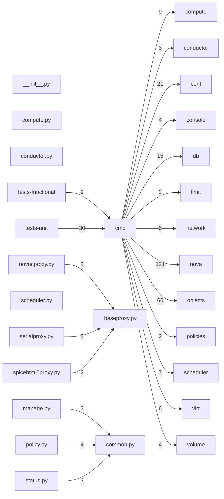

# Component: cmd

## Overview

Service entry-point scripts: CLI starters for the compute, conductor, scheduler, API, and manage sub-commands.
12 files (0.8% of 1509 source files), 3,684 code lines (0.8% of 473,713 total).
Main neighbours: **nova** (→121 edges); **objects** (→66 edges); **tests-unit** (←30 edges); **conf** (→21 edges); **db** (→15 edges).

## File Inventory

### (top-level)/

| File | Code Lines | Top CCN |
|------|-----------|---------|
| `__init__.py` | 0 | — |
| `baseproxy.py` | 54 | 6 |
| `common.py` | 128 | 7 |
| `compute.py` | 44 | 3 |
| `conductor.py` | 28 | 2 |
| `manage.py` | 2,970 | 28 |
| `novncproxy.py` | 20 | 1 |
| `policy.py` | 138 | 5 |
| `scheduler.py` | 28 | 2 |
| `serialproxy.py` | 19 | 1 |
| `spicehtml5proxy.py` | 17 | 1 |
| `status.py` | 238 | 7 |

**Top 5 Functions by CCN**

| Function | Kind | CCN | File | Line Range |
|----------|------|-----|------|------------|
| `heal_allocations` | method | 28 | `manage.py` | L2216–L2380 |
| `archive_deleted_rows` | method | 22 | `manage.py` | L296–L425 |
| `update_cell` | method | 20 | `manage.py` | L1350–L1420 |
| `_heal_allocations_for_instance` | method | 18 | `manage.py` | L1935–L2089 |
| `_create_unified_limits` | method | 16 | `manage.py` | L3451–L3560 |

## Defined Symbols

Total: 173

| Kind | Count |
|------|-------|
| method | 84 |
| function | 31 |
| constant | 19 |
| variable | 13 |
| staticmethod | 13 |
| class | 10 |
| field | 3 |

## External Dependencies

| Package | Files Importing |
|---------|----------------|
| `sys` | 10 |
| `oslo_log` | 6 |
| `oslo_reports` | 4 |
| `os` | 3 |
| `atexit` | 3 |
| `functools` | 3 |
| `oslo_config` | 3 |
| `logging` | 3 |
| `os_brick` | 2 |
| `oslo_concurrency` | 2 |
| `traceback` | 2 |
| `keystoneauth1` | 2 |
| `sqlalchemy` | 2 |
| `multiprocessing` | 1 |
| `argparse` | 1 |
| `inspect` | 1 |
| `shlex` | 1 |
| `os_vif` | 1 |
| `oslo_privsep` | 1 |
| `oslo_service` | 1 |
| `collections` | 1 |
| `contextlib` | 1 |
| `re` | 1 |
| `textwrap` | 1 |
| `time` | 1 |
| `typing` | 1 |
| `urllib` | 1 |
| `dateutil` | 1 |
| `neutronclient` | 1 |
| `os_resource_classes` | 1 |
| `oslo_db` | 1 |
| `oslo_messaging` | 1 |
| `oslo_serialization` | 1 |
| `oslo_utils` | 1 |
| `prettytable` | 1 |
| `pdb` | 1 |
| `microversion_parse` | 1 |
| `oslo_upgradecheck` | 1 |

## Side Effects

| Kind | Count |
|------|-------|
| global-mutation | 20 |
| network | 5 |
| file-io | 4 |
| syscall | 2 |

## Component Diagram

## Local Data Flow

**Entry points** (13 total):

- **cli-args** (10): `common.py`, `compute.py`, `conductor.py`, `manage.py`, `novncproxy.py`, … (5 more)
- **env** (3): `policy.py`

**Sinks** (31 total):

- **db-write** (28)
- **file-write** (3)

**Privileged operations**: 4 entries recorded.

_The KB records do not include sanitisation annotations; cross-file data-flow tracing requires the resolved link graph._

## Cross-Component Interfaces

| Component | Dir | File Edges | Summed Count | Kinds |
|-----------|-----|-----------|-------------|-------|
| **compute** | → | 5 | 9 | call, import |
| **conductor** | → | 2 | 3 | call, import |
| **conf** | → | 16 | 21 | call, import |
| **console** | → | 2 | 4 | call, import |
| **db** | → | 8 | 15 | call, import |
| **limit** | → | 2 | 2 | import |
| **network** | → | 2 | 5 | call, import |
| **nova** | → | 48 | 121 | call, import |
| **objects** | → | 18 | 66 | call, import |
| **policies** | → | 1 | 2 | call, import |
| **scheduler** | → | 3 | 7 | call, import |
| **tests-functional** | ← | 3 | 9 | call, import |
| **tests-unit** | ← | 7 | 30 | call, import, inherit |
| **virt** | → | 2 | 6 | call, import |
| **volume** | → | 2 | 4 | call, import |

No cross-component seams recorded in the link graph.
