# Component: compute

## Overview

Compute manager: instance lifecycle operations, resource claim management, migration handling, and on-host resource monitors.
25 files (1.7% of 1509 source files), 21,361 code lines (4.5% of 473,713 total).
Main neighbours: **nova** (→323/←3 edges); **tests-unit** (←319 edges); **objects** (→212/←14 edges); **api** (←101 edges); **virt** (→45/←47 edges).

## File Inventory

### (top-level)/

| File | Code Lines | Top CCN |
|------|-----------|---------|
| `__init__.py` | 0 | — |
| `api.py` | 5,092 | 43 |
| `build_results.py` | 10 | — |
| `claims.py` | 174 | 7 |
| `flavors.py` | 127 | 8 |
| `instance_actions.py` | 50 | — |
| `instance_list.py` | 108 | 5 |
| `manager.py` | 8,837 | 40 |
| `migration_list.py` | 53 | 4 |
| `multi_cell_list.py` | 279 | 14 |
| `pci_placement_translator.py` | 524 | 10 |
| `power_state.py` | 18 | — |
| `provider_config.py` | 299 | 6 |
| `provider_tree.py` | 617 | 12 |
| `resource_tracker.py` | 1,527 | 17 |
| `rpcapi.py` | 1,410 | 8 |
| `share_management.py` | 598 | 10 |
| `stats.py` | 97 | 4 |
| `task_states.py` | 59 | — |
| `utils.py` | 1,287 | 13 |
| `vm_states.py` | 34 | 3 |

### monitors/

| File | Code Lines | Top CCN |
|------|-----------|---------|
| `monitors/__init__.py` | 52 | 8 |
| `monitors/base.py` | 48 | 1 |
| `monitors/cpu/__init__.py` | 0 | — |
| `monitors/cpu/virt_driver.py` | 61 | 2 |

**Top 5 Functions by CCN**

| Function | Kind | CCN | File | Line Range |
|----------|------|-----|------|------------|
| `_validate_bdm` | method | 43 | `api.py` | L1977–L2111 |
| `_init_instance` | method | 40 | `manager.py` | L1013–L1273 |
| `_delete` | method | 29 | `api.py` | L2464–L2649 |
| `resize` | method | 28 | `api.py` | L4295–L4498 |
| `get_all` | method | 25 | `api.py` | L3086–L3292 |

## Defined Symbols

Total: 1,338

| Kind | Count |
|------|-------|
| method | 849 |
| function | 198 |
| constant | 180 |
| class | 38 |
| staticmethod | 36 |
| property | 19 |
| variable | 13 |
| field | 4 |
| classmethod | 1 |

## External Dependencies

| Package | Files Importing |
|---------|----------------|
| `oslo_log` | 12 |
| `oslo_utils` | 9 |
| `copy` | 7 |
| `os_traits` | 6 |
| `collections` | 5 |
| `functools` | 4 |
| `oslo_serialization` | 4 |
| `oslo_messaging` | 3 |
| `time` | 3 |
| `keystoneauth1` | 3 |
| `re` | 2 |
| `typing` | 2 |
| `contextlib` | 2 |
| `inspect` | 2 |
| `math` | 2 |
| `traceback` | 2 |
| `abc` | 2 |
| `os_resource_classes` | 2 |
| `oslo_concurrency` | 2 |
| `castellan` | 1 |
| `base64` | 1 |
| `binascii` | 1 |
| `sys` | 1 |
| `threading` | 1 |
| `cinderclient` | 1 |
| `cursive` | 1 |
| `oslo_service` | 1 |
| `stevedore` | 1 |
| `heapq` | 1 |
| `glob` | 1 |
| `jsonschema` | 1 |
| `logging` | 1 |
| `microversion_parse` | 1 |
| `os` | 1 |
| `yaml` | 1 |
| `retrying` | 1 |
| `openstack` | 1 |
| `itertools` | 1 |
| `socket` | 1 |
| `psutil` | 1 |

## Side Effects

| Kind | Count |
|------|-------|
| global-mutation | 185 |
| network | 14 |
| file-io | 3 |

## Component Diagram

```mermaid
graph LR
    hub-compute["compute"]
    f-init["__init__.py"]
    f-api-py["api.py"]
    f-build-results-py["build_results.py"]
    f-claims-py["claims.py"]
    f-flavors-py["flavors.py"]
    f-instance-actions-py["instance_actions.py"]
    f-instance-list-py["instance_list.py"]
    f-manager-py["manager.py"]
    f-migration-list-py["migration_list.py"]
    f-monitors-init["monitors/__init__.py"]
    f-monitors-base-py["monitors/base.py"]
    f-monitors-cpu-init["monitors/cpu/__init__.py"]
    f-monitors-cpu-virt-driver-py["monitors/cpu/virt_driver.py"]
    f-multi-cell-list-py["multi_cell_list.py"]
    f-pci-placement-translator-py["pci_placement_translator.py"]
    f-power-state-py["power_state.py"]
    f-provider-config-py["provider_config.py"]
    f-provider-tree-py["provider_tree.py"]
    f-resource-tracker-py["resource_tracker.py"]
    f-rpcapi-py["rpcapi.py"]
    f-share-management-py["share_management.py"]
    f-stats-py["stats.py"]
    f-task-states-py["task_states.py"]
    f-utils-py["utils.py"]
    f-vm-states-py["vm_states.py"]
    n-accelerator["accelerator"]
    n-api["api"]
    n-cmd["cmd"]
    n-conductor["conductor"]
    n-conf["conf"]
    n-console["console"]
    n-db["db"]
    n-image["image"]
    n-limit["limit"]
    n-network["network"]
    n-notifications["notifications"]
    n-nova["nova"]
    n-objects["objects"]
    n-pci["pci"]
    n-policies["policies"]
    n-scheduler["scheduler"]
    n-servicegroup["servicegroup"]
    n-share["share"]
    n-tests-fixtures["tests-fixtures"]
    n-tests-functional["tests-functional"]
    n-tests-unit["tests-unit"]
    n-virt["virt"]
    n-volume["volume"]
    f-api-py -->|"2"| f-flavors-py
    f-api-py -->|"1"| f-instance-actions-py
    f-api-py -->|"2"| f-instance-list-py
    f-api-py -->|"2"| f-migration-list-py
    f-api-py -->|"1"| f-power-state-py
    f-api-py -->|"2"| f-rpcapi-py
    f-api-py -->|"1"| f-task-states-py
    f-api-py -->|"23"| f-utils-py
    f-api-py -->|"1"| f-vm-states-py
    f-instance-list-py -->|"3"| f-multi-cell-list-py
    f-manager-py -->|"2"| f-api-py
    f-manager-py -->|"1"| f-build-results-py
    f-manager-py -->|"1"| f-claims-py
    f-manager-py -->|"1"| f-power-state-py
    f-manager-py -->|"2"| f-resource-tracker-py
    f-manager-py -->|"3"| f-rpcapi-py
    f-manager-py -->|"2"| f-share-management-py
    f-manager-py -->|"1"| f-task-states-py
    f-manager-py -->|"29"| f-utils-py
    f-manager-py -->|"1"| f-vm-states-py
    f-migration-list-py -->|"3"| f-multi-cell-list-py
    f-monitors-cpu-virt-driver-py -->|"2"| f-monitors-base-py
    f-pci-placement-translator-py -->|"11"| f-provider-tree-py
    f-resource-tracker-py -->|"3"| f-claims-py
    f-resource-tracker-py -->|"2"| f-monitors-init
    f-resource-tracker-py -->|"2"| f-pci-placement-translator-py
    f-resource-tracker-py -->|"2"| f-provider-config-py
    f-resource-tracker-py -->|"1"| f-stats-py
    f-resource-tracker-py -->|"1"| f-task-states-py
    f-resource-tracker-py -->|"3"| f-utils-py
    f-resource-tracker-py -->|"2"| f-vm-states-py
    f-share-management-py -->|"2"| f-utils-py
    f-share-management-py -->|"1"| f-vm-states-py
    f-stats-py -->|"1"| f-task-states-py
    f-stats-py -->|"2"| f-vm-states-py
    f-utils-py -->|"1"| f-power-state-py
    f-utils-py -->|"1"| f-task-states-py
    f-utils-py -->|"1"| f-vm-states-py
    f-vm-states-py -->|"1"| f-task-states-py
    hub-compute -->|"7"| n-accelerator
    hub-compute -->|"4"| n-conductor
    hub-compute -->|"14"| n-conf
    hub-compute -->|"13"| n-db
    hub-compute -->|"4"| n-image
    hub-compute -->|"7"| n-limit
    hub-compute -->|"15"| n-network
    hub-compute -->|"60"| n-notifications
    hub-compute -->|"323"| n-nova
    hub-compute -->|"212"| n-objects
    hub-compute -->|"13"| n-pci
    hub-compute -->|"2"| n-policies
    hub-compute -->|"16"| n-scheduler
    hub-compute -->|"2"| n-servicegroup
    hub-compute -->|"2"| n-share
    hub-compute -->|"45"| n-virt
    hub-compute -->|"4"| n-volume
    n-api -->|"101"| hub-compute
    n-cmd -->|"9"| hub-compute
    n-conductor -->|"35"| hub-compute
    n-console -->|"2"| hub-compute
    n-db -->|"2"| hub-compute
    n-network -->|"2"| hub-compute
    n-nova -->|"3"| hub-compute
    n-objects -->|"14"| hub-compute
    n-scheduler -->|"12"| hub-compute
    n-tests-fixtures -->|"4"| hub-compute
    n-tests-functional -->|"70"| hub-compute
    n-tests-unit -->|"319"| hub-compute
    n-virt -->|"47"| hub-compute
```

## Local Data Flow

**Sinks** (105 total):

- **db-write** (105)

**Privileged operations**: 4 entries recorded.

_The KB records do not include sanitisation annotations; cross-file data-flow tracing requires the resolved link graph._

## Cross-Component Interfaces

| Component | Dir | File Edges | Summed Count | Kinds |
|-----------|-----|-----------|-------------|-------|
| **accelerator** | → | 3 | 7 | call, import |
| **api** | ← | 53 | 101 | call, import |
| **cmd** | ← | 5 | 9 | call, import |
| **conductor** | → | 2 | 4 | call, import |
| **conductor** | ← | 13 | 35 | call, import |
| **conf** | → | 12 | 14 | call, import |
| **console** | ← | 1 | 2 | call, import |
| **db** | → | 5 | 13 | call, import |
| **db** | ← | 2 | 2 | import |
| **image** | → | 2 | 4 | call, import |
| **limit** | → | 3 | 7 | call, import |
| **network** | → | 6 | 15 | call, import |
| **network** | ← | 1 | 2 | call, import |
| **notifications** | → | 14 | 60 | call, import |
| **nova** | → | 58 | 323 | call, import, inherit |
| **nova** | ← | 2 | 3 | call, import |
| **objects** | → | 39 | 212 | call, import |
| **objects** | ← | 6 | 14 | call, import |
| **pci** | → | 7 | 13 | call, import |
| **policies** | → | 2 | 2 | import |
| **scheduler** | → | 7 | 16 | call, import |
| **scheduler** | ← | 4 | 12 | call, import |
| **servicegroup** | → | 1 | 2 | call, import |
| **share** | → | 1 | 2 | call, import |
| **tests-fixtures** | ← | 2 | 4 | call, import |
| **tests-functional** | ← | 58 | 70 | call, import, inherit |
| **tests-unit** | ← | 199 | 319 | call, import, inherit |
| **virt** | → | 12 | 45 | call, import, inherit |
| **virt** | ← | 31 | 47 | call, import |
| **volume** | → | 2 | 4 | call, import |

No cross-component seams recorded in the link graph.
