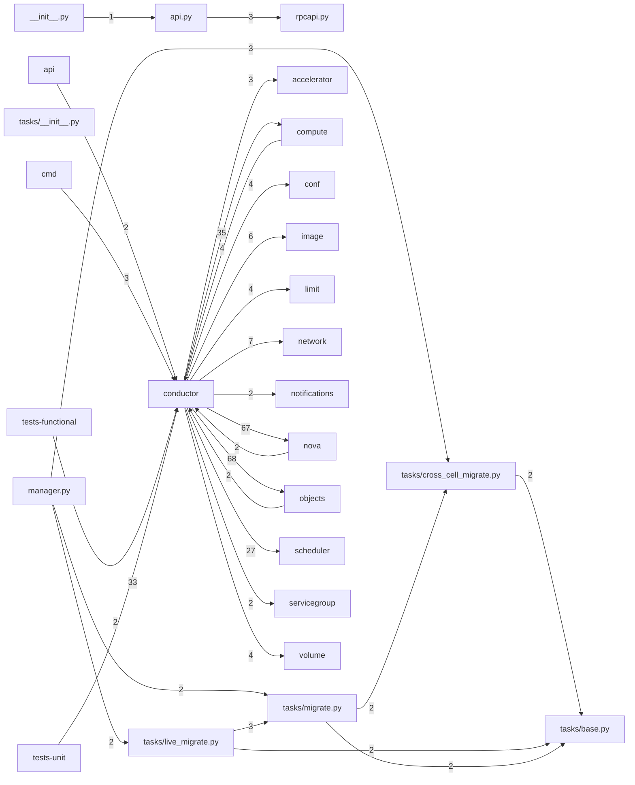

# Component: conductor

## Overview

Conductor service: async compute task orchestration, live-migration workflows, and cross-service coordination.
9 files (0.6% of 1509 source files), 4,002 code lines (0.8% of 473,713 total).
Main neighbours: **objects** (→68/←2 edges); **nova** (→67/←2 edges); **compute** (→35/←4 edges); **tests-unit** (←33 edges); **scheduler** (→27 edges).

## File Inventory

### (top-level)/

| File | Code Lines | Top CCN |
|------|-----------|---------|
| `__init__.py` | 3 | — |
| `api.py` | 144 | 5 |
| `manager.py` | 1,721 | 34 |
| `rpcapi.py` | 447 | 7 |

### tasks/

| File | Code Lines | Top CCN |
|------|-----------|---------|
| `tasks/__init__.py` | 0 | — |
| `tasks/base.py` | 33 | 1 |
| `tasks/cross_cell_migrate.py` | 987 | 8 |
| `tasks/live_migrate.py` | 414 | 10 |
| `tasks/migrate.py` | 253 | 9 |

**Top 5 Functions by CCN**

| Function | Kind | CCN | File | Line Range |
|----------|------|-----|------|------------|
| `build_instances` | method | 34 | `manager.py` | L671–L929 |
| `rebuild_instance` | method | 21 | `manager.py` | L1233–L1443 |
| `schedule_and_build_instances` | method | 18 | `manager.py` | L1675–L1868 |
| `_bury_in_cell0` | method | 15 | `manager.py` | L1578–L1673 |
| `unshelve_instance` | method | 12 | `manager.py` | L1033–L1188 |

## Defined Symbols

Total: 216

| Kind | Count |
|------|-------|
| method | 161 |
| function | 17 |
| class | 16 |
| constant | 13 |
| staticmethod | 5 |
| field | 2 |
| variable | 1 |
| property | 1 |

## External Dependencies

| Package | Files Importing |
|---------|----------------|
| `oslo_log` | 5 |
| `oslo_messaging` | 5 |
| `oslo_utils` | 4 |
| `oslo_serialization` | 3 |
| `collections` | 2 |
| `copy` | 2 |
| `functools` | 2 |
| `concurrent` | 1 |
| `contextlib` | 1 |
| `sys` | 1 |
| `threading` | 1 |
| `keystoneauth1` | 1 |
| `oslo_config` | 1 |
| `oslo_db` | 1 |
| `oslo_limit` | 1 |
| `oslo_versionedobjects` | 1 |
| `abc` | 1 |

## Side Effects

| Kind | Count |
|------|-------|
| network | 40 |
| global-mutation | 13 |

## Component Diagram

## Local Data Flow

**Sinks** (18 total):

- **db-write** (18)

**Privileged operations**: 2 entries recorded.

_The KB records do not include sanitisation annotations; cross-file data-flow tracing requires the resolved link graph._

## Cross-Component Interfaces

| Component | Dir | File Edges | Summed Count | Kinds |
|-----------|-----|-----------|-------------|-------|
| **accelerator** | → | 1 | 3 | call, import |
| **api** | ← | 1 | 2 | call, import |
| **cmd** | ← | 2 | 3 | call, import |
| **compute** | → | 13 | 35 | call, import |
| **compute** | ← | 2 | 4 | call, import |
| **conf** | → | 4 | 4 | import |
| **image** | → | 3 | 6 | call, import |
| **limit** | → | 2 | 4 | call, import |
| **network** | → | 4 | 7 | call, import |
| **notifications** | → | 1 | 2 | call, import |
| **nova** | → | 24 | 67 | call, import, inherit |
| **nova** | ← | 1 | 2 | call, import |
| **objects** | → | 9 | 68 | call, import |
| **objects** | ← | 1 | 2 | call, import |
| **scheduler** | → | 7 | 27 | call, import |
| **servicegroup** | → | 1 | 2 | call, import |
| **tests-functional** | ← | 2 | 2 | import |
| **tests-unit** | ← | 12 | 33 | call, import, inherit |
| **volume** | → | 2 | 4 | call, import |

No cross-component seams recorded in the link graph.
