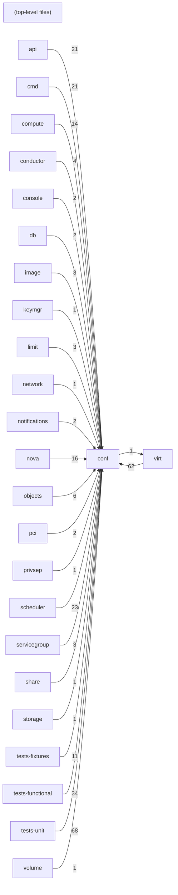

# Component: conf

## Overview

Configuration schema: oslo.config option groups and defaults for every Nova sub-system.
48 files (3.2% of 1509 source files), 7,490 code lines (1.6% of 473,713 total).
Main neighbours: **tests-unit** (←68 edges); **virt** (→1/←62 edges); **tests-functional** (←34 edges); **scheduler** (←23 edges); **cmd** (←21 edges).

## File Inventory

### (top-level)/

| File | Code Lines | Top CCN |
|------|-----------|---------|
| `__init__.py` | 92 | — |
| `api.py` | 338 | 1 |
| `availability_zone.py` | 39 | 1 |
| `base.py` | 169 | 1 |
| `cache.py` | 5 | 1 |
| `cinder.py` | 91 | 1 |
| `compute.py` | 1,258 | 1 |
| `conductor.py` | 38 | 1 |
| `configdrive.py` | 65 | 1 |
| `console.py` | 60 | 1 |
| `consoleauth.py` | 32 | 1 |
| `cyborg.py` | 21 | 1 |
| `database.py` | 32 | 1 |
| `devices.py` | 75 | 2 |
| `ephemeral_storage.py` | 46 | 1 |
| `glance.py` | 164 | 1 |
| `guestfs.py` | 33 | 1 |
| `imagecache.py` | 80 | 1 |
| `ironic.py` | 102 | 1 |
| `key_manager.py` | 28 | 3 |
| `keystone.py` | 23 | 1 |
| `libvirt.py` | 1,398 | 1 |
| `manila.py` | 34 | 1 |
| `mks.py` | 36 | 1 |
| `netconf.py` | 63 | 1 |
| `neutron.py` | 123 | 2 |
| `notifications.py` | 97 | 1 |
| `novnc.py` | 50 | 1 |
| `opts.py` | 51 | 4 |
| `paths.py` | 42 | 1 |
| `pci.py` | 305 | 1 |
| `placement.py` | 21 | 1 |
| `quota.py` | 288 | 4 |
| `rpc.py` | 26 | 1 |
| `scheduler.py` | 783 | 1 |
| `serial_console.py` | 86 | 1 |
| `service.py` | 54 | 1 |
| `service_token.py` | 42 | 1 |
| `servicegroup.py` | 25 | 1 |
| `spice.py` | 189 | 1 |
| `upgrade_levels.py` | 72 | 1 |
| `utils.py` | 55 | 3 |
| `vendordata.py` | 22 | 1 |
| `vmware.py` | 230 | 1 |
| `vnc.py` | 140 | 1 |
| `workarounds.py` | 360 | 1 |
| `wsgi.py` | 51 | 1 |
| `zvm.py` | 56 | 1 |

**Top 5 Functions by CCN**

| Function | Kind | CCN | File | Line Range |
|----------|------|-----|------|------------|
| `_list_module_names` | function | 4 | `opts.py` | L50–L58 |
| `__call__` | method | 4 | `quota.py` | L35–L46 |
| `list_opts` | function | 3 | `key_manager.py` | L47–L64 |
| `_import_modules` | function | 3 | `opts.py` | L61–L72 |
| `_append_config_options` | function | 3 | `opts.py` | L75–L79 |

## Defined Symbols

Total: 259

| Kind | Count |
|------|-------|
| variable | 116 |
| function | 107 |
| constant | 33 |
| class | 1 |
| field | 1 |
| method | 1 |

## External Dependencies

| Package | Files Importing |
|---------|----------------|
| `oslo_config` | 46 |
| `keystoneauth1` | 11 |
| `socket` | 2 |
| `os` | 2 |
| `oslo_service` | 1 |
| `oslo_cache` | 1 |
| `copy` | 1 |
| `oslo_db` | 1 |
| `castellan` | 1 |
| `itertools` | 1 |
| `oslo_utils` | 1 |
| `collections` | 1 |
| `importlib` | 1 |
| `pkgutil` | 1 |
| `re` | 1 |
| `os_resource_classes` | 1 |

## Side Effects

| Kind | Count |
|------|-------|
| global-mutation | 33 |
| network | 14 |
| file-io | 4 |

## Component Diagram

## Local Data Flow

**Sinks** (18 total):

- **db-write** (18)

**Privileged operations**: 16 entries recorded.

_The KB records do not include sanitisation annotations; cross-file data-flow tracing requires the resolved link graph._

## Cross-Component Interfaces

| Component | Dir | File Edges | Summed Count | Kinds |
|-----------|-----|-----------|-------------|-------|
| **api** | ← | 21 | 21 | import |
| **cmd** | ← | 16 | 21 | call, import |
| **compute** | ← | 12 | 14 | call, import |
| **conductor** | ← | 4 | 4 | import |
| **console** | ← | 2 | 2 | import |
| **db** | ← | 2 | 2 | import |
| **image** | ← | 1 | 3 | call, import |
| **keymgr** | ← | 1 | 1 | import |
| **limit** | ← | 3 | 3 | import |
| **network** | ← | 1 | 1 | import |
| **notifications** | ← | 2 | 2 | import |
| **nova** | ← | 16 | 16 | import |
| **objects** | ← | 6 | 6 | import |
| **pci** | ← | 2 | 2 | import |
| **privsep** | ← | 1 | 1 | import |
| **scheduler** | ← | 23 | 23 | import |
| **servicegroup** | ← | 3 | 3 | import |
| **share** | ← | 1 | 1 | import |
| **storage** | ← | 1 | 1 | import |
| **tests-fixtures** | ← | 7 | 11 | call, import |
| **tests-functional** | ← | 31 | 34 | call, import |
| **tests-unit** | ← | 58 | 68 | call, import |
| **virt** | → | 1 | 1 | import |
| **virt** | ← | 49 | 62 | call, import |
| **volume** | ← | 1 | 1 | import |

No cross-component seams recorded in the link graph.
