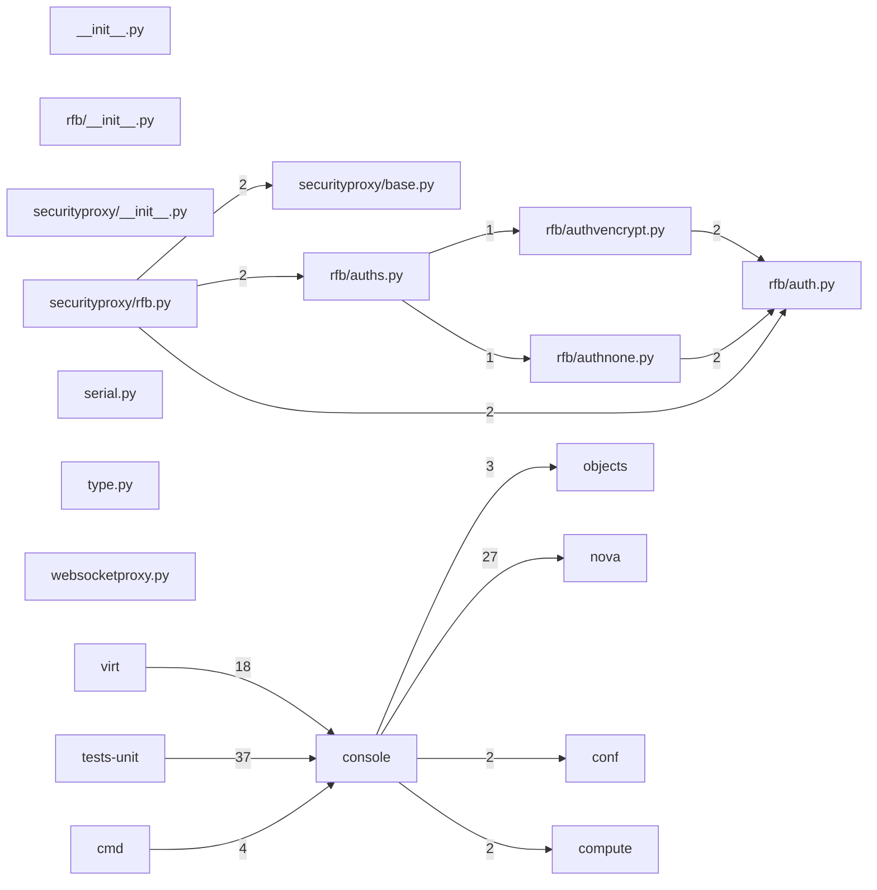

# Component: console

## Overview

Console proxy: VNC/SPICE/serial console token management and the RFB security proxy.
12 files (0.8% of 1509 source files), 651 code lines (0.1% of 473,713 total).
Main neighbours: **tests-unit** (←37 edges); **nova** (→27 edges); **virt** (←18 edges); **cmd** (←4 edges); **objects** (→3 edges).

## File Inventory

### (top-level)/

| File | Code Lines | Top CCN |
|------|-----------|---------|
| `__init__.py` | 8 | — |
| `serial.py` | 53 | 4 |
| `type.py` | 21 | 1 |
| `websocketproxy.py` | 221 | 22 |

### rfb/

| File | Code Lines | Top CCN |
|------|-----------|---------|
| `rfb/__init__.py` | 0 | — |
| `rfb/auth.py` | 38 | 1 |
| `rfb/authnone.py` | 6 | 1 |
| `rfb/auths.py` | 27 | 5 |
| `rfb/authvencrypt.py` | 109 | 10 |

### securityproxy/

| File | Code Lines | Top CCN |
|------|-----------|---------|
| `securityproxy/__init__.py` | 0 | — |
| `securityproxy/base.py` | 21 | 1 |
| `securityproxy/rfb.py` | 147 | 11 |

**Top 5 Functions by CCN**

| Function | Kind | CCN | File | Line Range |
|----------|------|-----|------|------------|
| `new_websocket_client` | method | 22 | `websocketproxy.py` | L167–L285 |
| `connect` | method | 11 | `securityproxy/rfb.py` | L82–L221 |
| `security_handshake` | method | 10 | `rfb/authvencrypt.py` | L62–L162 |
| `find_scheme` | method | 5 | `rfb/auths.py` | L39–L53 |
| `recv` | method | 5 | `websocketproxy.py` | L63–L79 |

## Defined Symbols

Total: 94

| Kind | Count |
|------|-------|
| constant | 36 |
| method | 33 |
| class | 16 |
| function | 6 |
| staticmethod | 2 |
| property | 1 |

## External Dependencies

| Package | Files Importing |
|---------|----------------|
| `oslo_log` | 4 |
| `abc` | 2 |
| `enum` | 2 |
| `oslo_config` | 2 |
| `struct` | 2 |
| `socket` | 2 |
| `ssl` | 1 |
| `copy` | 1 |
| `http` | 1 |
| `os` | 1 |
| `urllib` | 1 |
| `oslo_utils` | 1 |
| `websockify` | 1 |
| `threading` | 1 |

## Side Effects

| Kind | Count |
|------|-------|
| global-mutation | 36 |
| file-io | 1 |

## Component Diagram

## Local Data Flow

**Entry points** (1 total):

- **network-socket** (1): `serial.py`

_The KB records do not include sanitisation annotations; cross-file data-flow tracing requires the resolved link graph._

## Cross-Component Interfaces

| Component | Dir | File Edges | Summed Count | Kinds |
|-----------|-----|-----------|-------------|-------|
| **cmd** | ← | 2 | 4 | call, import |
| **compute** | → | 1 | 2 | call, import |
| **conf** | → | 2 | 2 | import |
| **nova** | → | 11 | 27 | call, import |
| **objects** | → | 1 | 3 | call, import |
| **tests-unit** | ← | 18 | 37 | call, import |
| **virt** | ← | 5 | 18 | call, import |

No cross-component seams recorded in the link graph.
