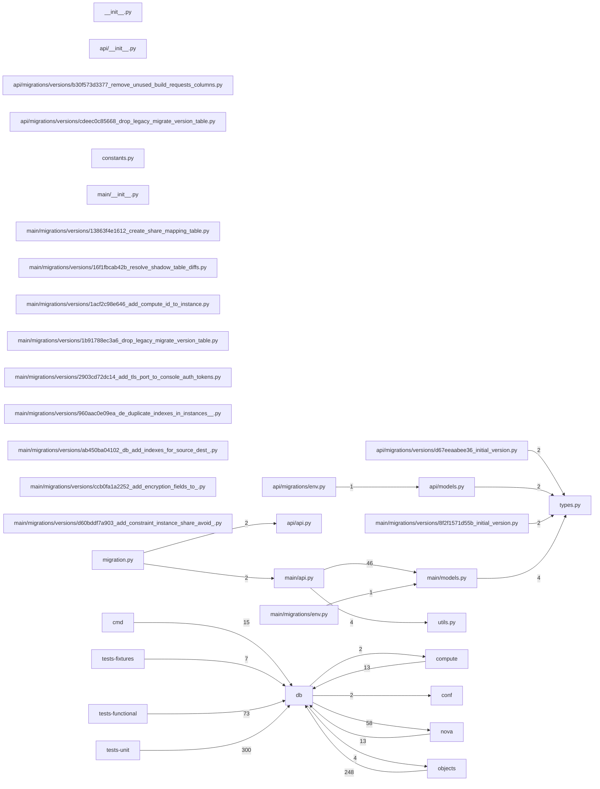

# Component: db

## Overview

Database API: SQLAlchemy-based persistence layer wrappers for the main and API databases, plus schema migration utilities.
26 files (1.7% of 1509 source files), 7,492 code lines (1.6% of 473,713 total).
Main neighbours: **tests-unit** (←300 edges); **objects** (→4/←248 edges); **tests-functional** (←73 edges); **nova** (→58/←13 edges); **compute** (→2/←13 edges).

## File Inventory

### (top-level)/

| File | Code Lines | Top CCN |
|------|-----------|---------|
| `__init__.py` | 0 | — |
| `constants.py` | 4 | — |
| `migration.py` | 51 | 4 |
| `types.py` | 48 | 3 |
| `utils.py` | 108 | 12 |

### api/

| File | Code Lines | Top CCN |
|------|-----------|---------|
| `api/__init__.py` | 0 | — |
| `api/api.py` | 23 | 4 |
| `api/migrations/env.py` | 80 | 3 |
| `api/migrations/versions/b30f573d3377_remove_unused_build_requests_columns.py` | 27 | 1 |
| `api/migrations/versions/cdeec0c85668_drop_legacy_migrate_version_table.py` | 17 | 2 |
| `api/migrations/versions/d67eeaabee36_initial_version.py` | 544 | 2 |
| `api/models.py` | 371 | 4 |

### main/

| File | Code Lines | Top CCN |
|------|-----------|---------|
| `main/__init__.py` | 0 | — |
| `main/api.py` | 3,535 | 24 |
| `main/migrations/env.py` | 82 | 4 |
| `main/migrations/versions/13863f4e1612_create_share_mapping_table.py` | 43 | 1 |
| `main/migrations/versions/16f1fbcab42b_resolve_shadow_table_diffs.py` | 29 | 2 |
| `main/migrations/versions/1acf2c98e646_add_compute_id_to_instance.py` | 29 | 4 |
| `main/migrations/versions/1b91788ec3a6_drop_legacy_migrate_version_table.py` | 17 | 2 |
| `main/migrations/versions/2903cd72dc14_add_tls_port_to_console_auth_tokens.py` | 14 | 1 |
| `main/migrations/versions/8f2f1571d55b_initial_version.py` | 1,436 | 24 |
| `main/migrations/versions/960aac0e09ea_de_duplicate_indexes_in_instances__.py` | 15 | 1 |
| `main/migrations/versions/ab450ba04102_db_add_indexes_for_source_dest_.py` | 22 | 1 |
| `main/migrations/versions/ccb0fa1a2252_add_encryption_fields_to_.py` | 41 | 2 |
| `main/migrations/versions/d60bddf7a903_add_constraint_instance_share_avoid_.py` | 56 | 1 |
| `main/models.py` | 900 | 5 |

**Top 5 Functions by CCN**

| Function | Kind | CCN | File | Line Range |
|----------|------|-----|------|------------|
| `instance_get_all_by_filters_sort` | function | 24 | `main/api.py` | L1636–L1862 |
| `_create_shadow_tables` | function | 24 | `main/migrations/versions/8f2f1571d55b_initial_version.py` | L55–L185 |
| `migration_get_all_by_filters` | function | 20 | `main/api.py` | L3364–L3433 |
| `_archive_deleted_rows_for_table` | function | 20 | `main/api.py` | L4321–L4504 |
| `_instance_update` | function | 18 | `main/api.py` | L2299–L2417 |

## Defined Symbols

Total: 987

| Kind | Count |
|------|-------|
| field | 544 |
| function | 274 |
| variable | 62 |
| class | 57 |
| method | 22 |
| constant | 18 |
| property | 10 |

## External Dependencies

| Package | Files Importing |
|---------|----------------|
| `sqlalchemy` | 17 |
| `alembic` | 16 |
| `oslo_db` | 4 |
| `oslo_utils` | 4 |
| `oslo_log` | 3 |
| `logging` | 2 |
| `collections` | 2 |
| `functools` | 2 |
| `inspect` | 2 |
| `copy` | 1 |
| `datetime` | 1 |
| `traceback` | 1 |
| `oslo_config` | 1 |
| `os` | 1 |
| `netaddr` | 1 |

## Side Effects

| Kind | Count |
|------|-------|
| network | 42 |
| global-mutation | 18 |
| file-io | 2 |

## Component Diagram

## Local Data Flow

**Sinks** (217 total):

- **db-write** (217)

_The KB records do not include sanitisation annotations; cross-file data-flow tracing requires the resolved link graph._

## Cross-Component Interfaces

| Component | Dir | File Edges | Summed Count | Kinds |
|-----------|-----|-----------|-------------|-------|
| **cmd** | ← | 8 | 15 | call, import |
| **compute** | → | 2 | 2 | import |
| **compute** | ← | 5 | 13 | call, import |
| **conf** | → | 2 | 2 | import |
| **nova** | → | 10 | 58 | call, import |
| **nova** | ← | 8 | 13 | call, import |
| **objects** | → | 3 | 4 | call, import |
| **objects** | ← | 56 | 248 | call, import |
| **tests-fixtures** | ← | 3 | 7 | call, import |
| **tests-functional** | ← | 24 | 73 | call, import |
| **tests-unit** | ← | 70 | 300 | call, import |

No cross-component seams recorded in the link graph.
