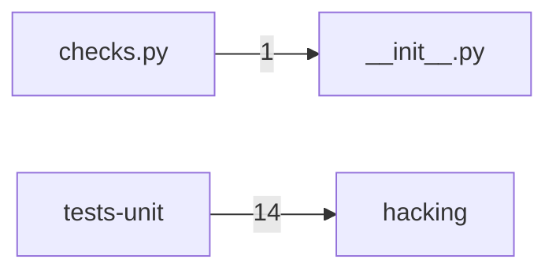

# Component: hacking

## Overview

Code-style hacking rules: Nova-specific flake8/hacking checks enforcing project import conventions and API usage constraints.
2 files (0.1% of 1509 source files), 817 code lines (0.2% of 473,713 total).
Main neighbours: **tests-unit** (←14 edges).

## File Inventory

### (top-level)/

| File | Code Lines | Top CCN |
|------|-----------|---------|
| `__init__.py` | 0 | — |
| `checks.py` | 817 | 6 |

**Top 5 Functions by CCN**

| Function | Kind | CCN | File | Line Range |
|----------|------|-----|------|------------|
| `capital_cfg_help` | function | 6 | `checks.py` | L291–L299 |
| `visit_BinOp` | method | 6 | `checks.py` | L433–L440 |
| `visit_FunctionDef` | method | 6 | `checks.py` | L493–L514 |
| `check_explicit_underscore_import` | function | 5 | `checks.py` | L371–L388 |
| `use_jsonutils` | function | 5 | `checks.py` | L392–L404 |

## Defined Symbols

Total: 121

| Kind | Count |
|------|-------|
| variable | 51 |
| function | 50 |
| method | 9 |
| class | 4 |
| field | 4 |
| constant | 3 |

## External Dependencies

| Package | Files Importing |
|---------|----------------|
| `ast` | 1 |
| `os` | 1 |
| `re` | 1 |
| `hacking` | 1 |

## Side Effects

| Kind | Count |
|------|-------|
| global-mutation | 3 |
| file-io | 2 |

## Component Diagram

## Local Data Flow

_No security-surface entries recorded in the KB for this component._

## Cross-Component Interfaces

| Component | Dir | File Edges | Summed Count | Kinds |
|-----------|-----|-----------|-------------|-------|
| **tests-unit** | ← | 1 | 14 | call, import |

No cross-component seams recorded in the link graph.
