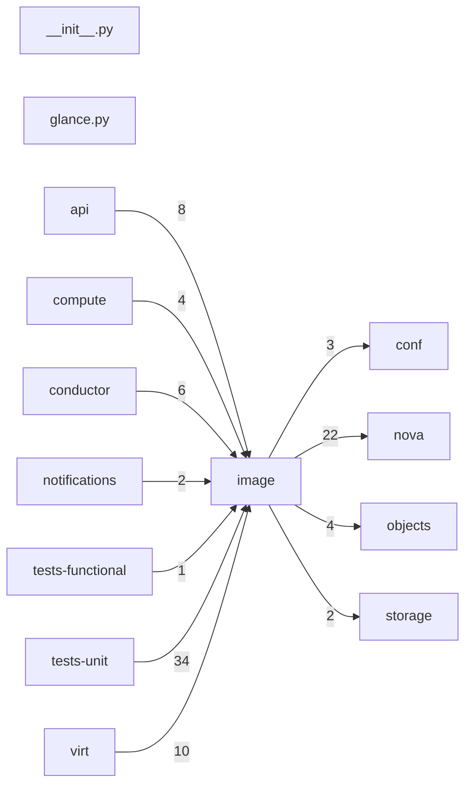

# Component: image

## Overview

Image service client: Glance image metadata retrieval and download helpers for the compute host.
2 files (0.1% of 1509 source files), 919 code lines (0.2% of 473,713 total).
Main neighbours: **tests-unit** (←34 edges); **nova** (→22 edges); **virt** (←10 edges); **api** (←8 edges); **conductor** (←6 edges).

## File Inventory

### (top-level)/

| File | Code Lines | Top CCN |
|------|-----------|---------|
| `__init__.py` | 0 | — |
| `glance.py` | 919 | 17 |

**Top 5 Functions by CCN**

| Function | Kind | CCN | File | Line Range |
|----------|------|-----|------|------------|
| `_verify_and_write` | method | 17 | `glance.py` | L389–L460 |
| `_convert_to_v2` | function | 13 | `glance.py` | L862–L890 |
| `call` | method | 10 | `glance.py` | L144–L195 |
| `_is_image_available` | function | 10 | `glance.py` | L814–L852 |
| `_get_verifier` | method | 9 | `glance.py` | L462–L520 |

## Defined Symbols

Total: 68

| Kind | Count |
|------|-------|
| method | 34 |
| function | 26 |
| class | 3 |
| constant | 2 |
| staticmethod | 2 |
| variable | 1 |

## External Dependencies

| Package | Files Importing |
|---------|----------------|
| `copy` | 1 |
| `inspect` | 1 |
| `itertools` | 1 |
| `os` | 1 |
| `random` | 1 |
| `re` | 1 |
| `stat` | 1 |
| `sys` | 1 |
| `time` | 1 |
| `urllib` | 1 |
| `cryptography` | 1 |
| `cursive` | 1 |
| `glanceclient` | 1 |
| `oslo_log` | 1 |
| `oslo_serialization` | 1 |
| `oslo_utils` | 1 |

## Side Effects

| Kind | Count |
|------|-------|
| network | 43 |
| file-io | 3 |
| global-mutation | 3 |

## Component Diagram

## Local Data Flow

**Sinks** (8 total):

- **db-write** (6)
- **file-write** (2)

**Privileged operations**: 2 entries recorded.

_The KB records do not include sanitisation annotations; cross-file data-flow tracing requires the resolved link graph._

## Cross-Component Interfaces

| Component | Dir | File Edges | Summed Count | Kinds |
|-----------|-----|-----------|-------------|-------|
| **api** | ← | 4 | 8 | call, import |
| **compute** | ← | 2 | 4 | call, import |
| **conductor** | ← | 3 | 6 | call, import |
| **conf** | → | 1 | 3 | call, import |
| **notifications** | ← | 1 | 2 | call, import |
| **nova** | → | 4 | 22 | call, import |
| **objects** | → | 2 | 4 | call, import |
| **storage** | → | 1 | 2 | call, import |
| **tests-functional** | ← | 1 | 1 | import |
| **tests-unit** | ← | 11 | 34 | call, import |
| **virt** | ← | 5 | 10 | call, import |

No cross-component seams recorded in the link graph.
