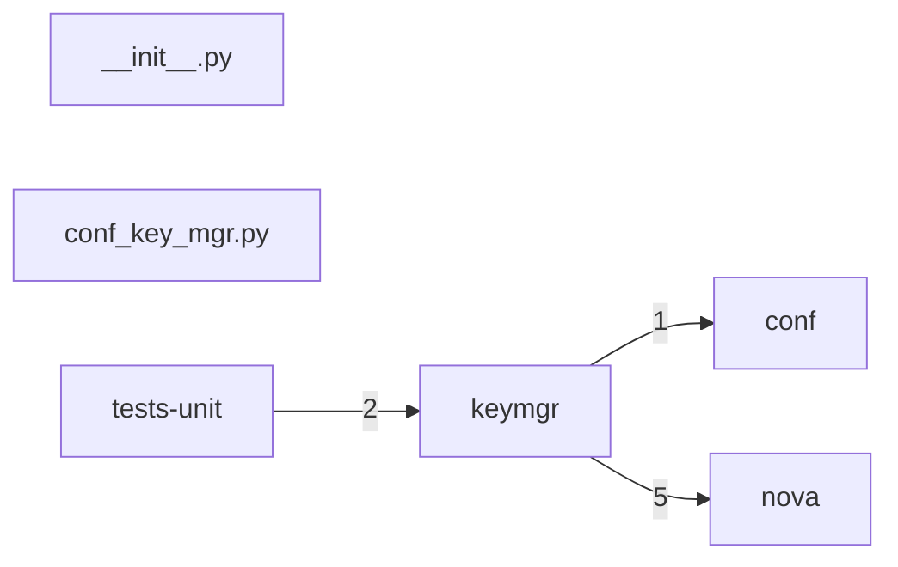

# Component: keymgr

## Overview

Key management client: Barbican secret store integration for volume encryption key lifecycle.
2 files (0.1% of 1509 source files), 95 code lines (0.0% of 473,713 total).
Main neighbours: **nova** (→5 edges); **tests-unit** (←2 edges); **conf** (→1 edges).

## File Inventory

### (top-level)/

| File | Code Lines | Top CCN |
|------|-----------|---------|
| `__init__.py` | 0 | — |
| `conf_key_mgr.py` | 95 | 3 |

**Top 5 Functions by CCN**

| Function | Kind | CCN | File | Line Range |
|----------|------|-----|------|------------|
| `__init__` | method | 3 | `conf_key_mgr.py` | L57–L69 |
| `store` | method | 3 | `conf_key_mgr.py` | L91–L100 |
| `get` | method | 3 | `conf_key_mgr.py` | L102–L115 |
| `delete` | method | 3 | `conf_key_mgr.py` | L117–L131 |
| `create_key` | method | 2 | `conf_key_mgr.py` | L75–L85 |

## Defined Symbols

Total: 12

| Kind | Count |
|------|-------|
| method | 9 |
| constant | 2 |
| class | 1 |

## External Dependencies

| Package | Files Importing |
|---------|----------------|
| `binascii` | 1 |
| `castellan` | 1 |
| `oslo_log` | 1 |

## Side Effects

| Kind | Count |
|------|-------|
| global-mutation | 2 |

## Component Diagram

## Local Data Flow

_No security-surface entries recorded in the KB for this component._

## Cross-Component Interfaces

| Component | Dir | File Edges | Summed Count | Kinds |
|-----------|-----|-----------|-------------|-------|
| **conf** | → | 1 | 1 | import |
| **nova** | → | 2 | 5 | call, import |
| **tests-unit** | ← | 1 | 2 | call, import |

No cross-component seams recorded in the link graph.
