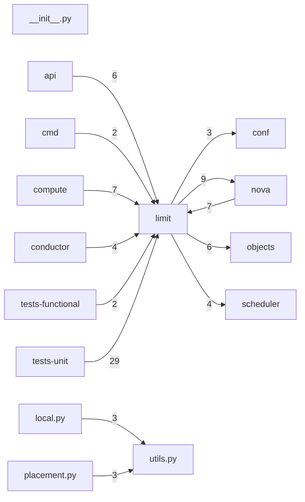

# Component: limit

## Overview

Unified limits: Keystone-backed resource quota enforcement via oslo.limit.
4 files (0.3% of 1509 source files), 421 code lines (0.1% of 473,713 total).
Main neighbours: **tests-unit** (←29 edges); **nova** (→9/←7 edges); **compute** (←7 edges); **objects** (→6 edges); **api** (←6 edges).

## File Inventory

### (top-level)/

| File | Code Lines | Top CCN |
|------|-----------|---------|
| `__init__.py` | 0 | — |
| `local.py` | 162 | 7 |
| `placement.py` | 164 | 16 |
| `utils.py` | 95 | 12 |

**Top 5 Functions by CCN**

| Function | Kind | CCN | File | Line Range |
|----------|------|-----|------|------------|
| `_get_usage` | function | 16 | `placement.py` | L45–L113 |
| `should_enforce` | function | 12 | `utils.py` | L91–L181 |
| `enforce_num_instances_and_resources` | function | 10 | `placement.py` | L152–L212 |
| `_identity_client` | function | 9 | `utils.py` | L52–L88 |
| `enforce_db_limit` | function | 7 | `local.py` | L148–L195 |

## Defined Symbols

Total: 50

| Kind | Count |
|------|-------|
| constant | 22 |
| function | 22 |
| field | 3 |
| method | 2 |
| class | 1 |

## External Dependencies

| Package | Files Importing |
|---------|----------------|
| `oslo_limit` | 3 |
| `oslo_log` | 3 |
| `typing` | 2 |
| `functools` | 1 |
| `os_resource_classes` | 1 |
| `openstack` | 1 |

## Side Effects

| Kind | Count |
|------|-------|
| global-mutation | 23 |
| network | 1 |

## Component Diagram

## Local Data Flow

**Sinks** (1 total):

- **db-write** (1)

_The KB records do not include sanitisation annotations; cross-file data-flow tracing requires the resolved link graph._

## Cross-Component Interfaces

| Component | Dir | File Edges | Summed Count | Kinds |
|-----------|-----|-----------|-------------|-------|
| **api** | ← | 3 | 6 | call, import |
| **cmd** | ← | 2 | 2 | import |
| **compute** | ← | 3 | 7 | call, import |
| **conductor** | ← | 2 | 4 | call, import |
| **conf** | → | 3 | 3 | import |
| **nova** | → | 4 | 9 | call, import |
| **nova** | ← | 2 | 7 | call, import |
| **objects** | → | 2 | 6 | call, import |
| **scheduler** | → | 2 | 4 | call, import |
| **tests-functional** | ← | 2 | 2 | import |
| **tests-unit** | ← | 16 | 29 | call, import |

No cross-component seams recorded in the link graph.
