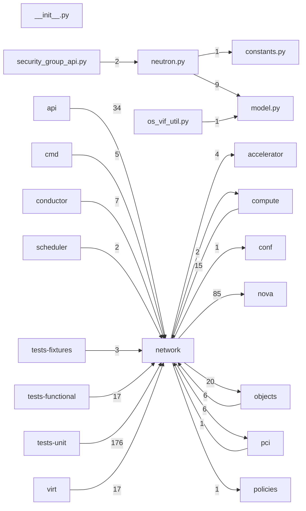

# Component: network

## Overview

Network service client: Neutron port, floating-IP, and security-group helpers plus network model translation.
6 files (0.4% of 1509 source files), 4,239 code lines (0.9% of 473,713 total).
Main neighbours: **tests-unit** (←176 edges); **nova** (→85 edges); **api** (←34 edges); **objects** (→20/←6 edges); **compute** (→2/←15 edges).

## File Inventory

### (top-level)/

| File | Code Lines | Top CCN |
|------|-----------|---------|
| `__init__.py` | 0 | — |
| `constants.py` | 20 | — |
| `model.py` | 423 | 6 |
| `neutron.py` | 2,876 | 28 |
| `os_vif_util.py` | 396 | 11 |
| `security_group_api.py` | 524 | 27 |

**Top 5 Functions by CCN**

| Function | Kind | CCN | File | Line Range |
|----------|------|-----|------|------------|
| `_ports_needed_per_instance` | method | 28 | `neutron.py` | L2522–L2629 |
| `_new_ingress_rule` | function | 27 | `security_group_api.py` | L106–L178 |
| `_build_network_info_model` | method | 20 | `neutron.py` | L3443–L3597 |
| `create_resource_requests` | method | 19 | `neutron.py` | L2307–L2467 |
| `_unbind_ports` | method | 17 | `neutron.py` | L611–L711 |

## Defined Symbols

Total: 354

| Kind | Count |
|------|-------|
| method | 170 |
| constant | 96 |
| function | 64 |
| class | 13 |
| classmethod | 6 |
| staticmethod | 5 |

## External Dependencies

| Package | Files Importing |
|---------|----------------|
| `oslo_log` | 3 |
| `functools` | 2 |
| `netaddr` | 2 |
| `neutronclient` | 2 |
| `oslo_utils` | 2 |
| `oslo_serialization` | 1 |
| `copy` | 1 |
| `inspect` | 1 |
| `time` | 1 |
| `typing` | 1 |
| `collections` | 1 |
| `oslo_concurrency` | 1 |
| `os_vif` | 1 |
| `oslo_config` | 1 |
| `urllib` | 1 |
| `webob` | 1 |

## Side Effects

| Kind | Count |
|------|-------|
| global-mutation | 97 |
| network | 2 |

## Component Diagram

## Local Data Flow

**Sinks** (26 total):

- **db-write** (26)

**Privileged operations**: 2 entries recorded.

_The KB records do not include sanitisation annotations; cross-file data-flow tracing requires the resolved link graph._

## Cross-Component Interfaces

| Component | Dir | File Edges | Summed Count | Kinds |
|-----------|-----|-----------|-------------|-------|
| **accelerator** | → | 1 | 4 | call, import |
| **api** | ← | 10 | 34 | call, import |
| **cmd** | ← | 2 | 5 | call, import |
| **compute** | → | 1 | 2 | call, import |
| **compute** | ← | 6 | 15 | call, import |
| **conductor** | ← | 4 | 7 | call, import |
| **conf** | → | 1 | 1 | import |
| **nova** | → | 14 | 85 | call, import |
| **objects** | → | 3 | 20 | call, import |
| **objects** | ← | 3 | 6 | call, import |
| **pci** | → | 3 | 6 | call, import |
| **pci** | ← | 1 | 1 | import |
| **policies** | → | 1 | 1 | import |
| **scheduler** | ← | 1 | 2 | call, import |
| **tests-fixtures** | ← | 2 | 3 | call, import |
| **tests-functional** | ← | 12 | 17 | call, import |
| **tests-unit** | ← | 50 | 176 | call, import |
| **virt** | ← | 10 | 17 | call, import |

No cross-component seams recorded in the link graph.
