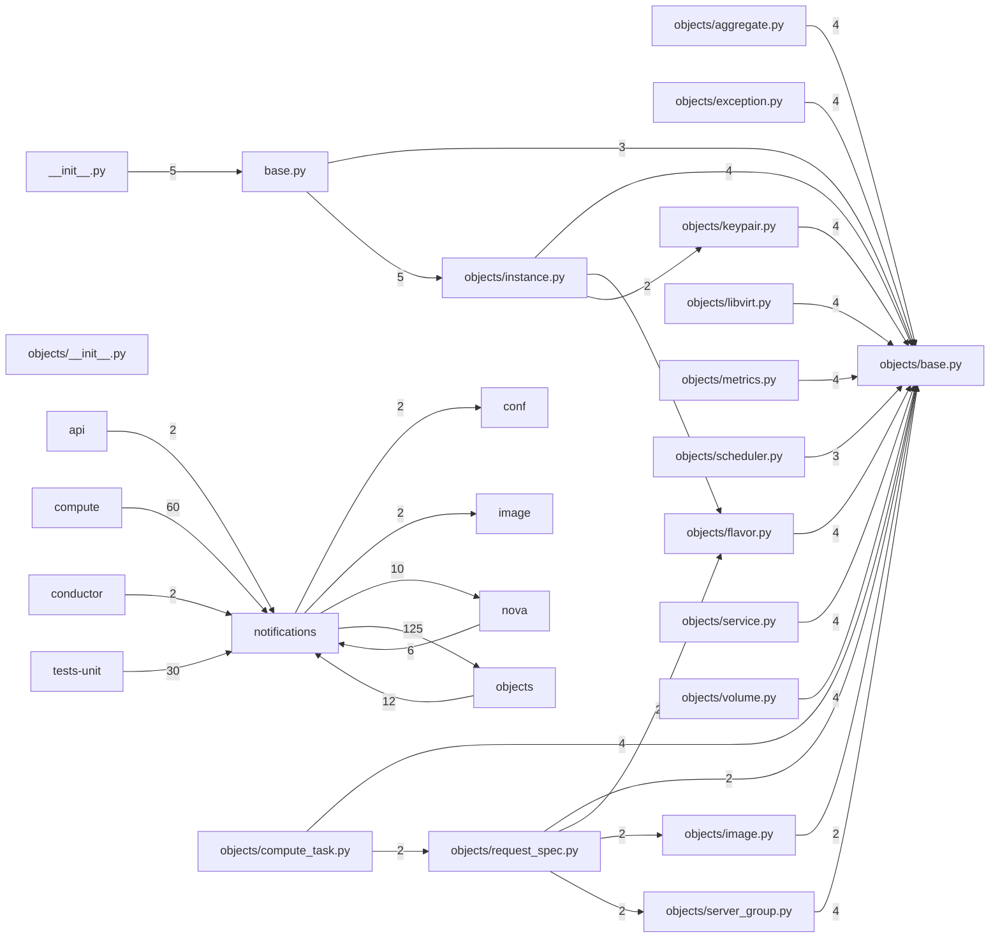

# Component: notifications

## Overview

Notification payloads: versioned Oslo Messaging notification objects for instance lifecycle and other Nova events.
18 files (1.2% of 1509 source files), 1,729 code lines (0.4% of 473,713 total).
Main neighbours: **objects** (→125/←12 edges); **compute** (←60 edges); **tests-unit** (←30 edges); **nova** (→10/←6 edges); **image** (→2 edges).

## File Inventory

### (top-level)/

| File | Code Lines | Top CCN |
|------|-----------|---------|
| `__init__.py` | 5 | — |
| `base.py` | 256 | 9 |

### objects/

| File | Code Lines | Top CCN |
|------|-----------|---------|
| `objects/__init__.py` | 0 | — |
| `objects/aggregate.py` | 74 | 1 |
| `objects/base.py` | 120 | 5 |
| `objects/compute_task.py` | 30 | 2 |
| `objects/exception.py` | 48 | 3 |
| `objects/flavor.py` | 53 | 2 |
| `objects/image.py` | 71 | 1 |
| `objects/instance.py` | 550 | 4 |
| `objects/keypair.py` | 35 | 1 |
| `objects/libvirt.py` | 21 | 1 |
| `objects/metrics.py` | 55 | 2 |
| `objects/request_spec.py` | 273 | 18 |
| `objects/scheduler.py` | 11 | — |
| `objects/server_group.py` | 43 | 1 |
| `objects/service.py` | 44 | 1 |
| `objects/volume.py` | 40 | 1 |

**Top 5 Functions by CCN**

| Function | Kind | CCN | File | Line Range |
|----------|------|-----|------|------------|
| `__init__` | method | 18 | `objects/request_spec.py` | L66–L115 |
| `send_update` | function | 9 | `base.py` | L44–L92 |
| `send_update_with_states` | function | 9 | `base.py` | L95–L135 |
| `info_from_instance` | function | 8 | `base.py` | L282–L399 |
| `__init__` | method | 7 | `objects/request_spec.py` | L294–L305 |

## Defined Symbols

Total: 310

| Kind | Count |
|------|-------|
| constant | 95 |
| class | 68 |
| field | 66 |
| method | 58 |
| function | 13 |
| classmethod | 10 |

## External Dependencies

| Package | Files Importing |
|---------|----------------|
| `oslo_log` | 2 |
| `oslo_utils` | 2 |
| `datetime` | 1 |
| `keystoneauth1` | 1 |
| `oslo_versionedobjects` | 1 |
| `inspect` | 1 |
| `traceback` | 1 |
| `copy` | 1 |

## Side Effects

| Kind | Count |
|------|-------|
| global-mutation | 95 |
| network | 2 |

## Component Diagram

## Local Data Flow

**Sinks** (16 total):

- **db-write** (16)

**Privileged operations**: 1 entries recorded.

_The KB records do not include sanitisation annotations; cross-file data-flow tracing requires the resolved link graph._

## Cross-Component Interfaces

| Component | Dir | File Edges | Summed Count | Kinds |
|-----------|-----|-----------|-------------|-------|
| **api** | ← | 1 | 2 | call, import |
| **compute** | ← | 14 | 60 | call, import |
| **conductor** | ← | 1 | 2 | call, import |
| **conf** | → | 2 | 2 | import |
| **image** | → | 1 | 2 | call, import |
| **nova** | → | 6 | 10 | call, import |
| **nova** | ← | 2 | 6 | call, import |
| **objects** | → | 32 | 125 | call, import, inherit |
| **objects** | ← | 5 | 12 | call, import |
| **tests-unit** | ← | 10 | 30 | call, import, inherit |

No cross-component seams recorded in the link graph.
