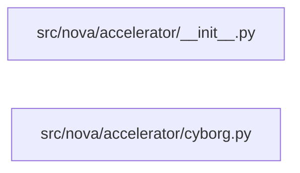

# Component: nova

## Overview

The `nova` component comprises the accelerator subsystem that brokers communication between the Nova compute service and the Cyborg accelerator management service. It exposes a thin public API of module-level functions and an internal HTTP client class (`_CyborgClient`) that wraps the Cyborg REST API.

---

## File Inventory

| File | Lines (total) | Lines (code) | Comments | Blanks |
|------|--------------|--------------|----------|--------|
| `src/nova/accelerator/__init__.py` | 0 | 0 | 0 | 0 |
| `src/nova/accelerator/cyborg.py` | 419 | 324 | 26 | 69 |
| **Total** | **419** | **324** | **26** | **69** |

Sources: KB records `.aee/kb/src/nova/accelerator/__init__.py.json` and `.aee/kb/src/nova/accelerator/cyborg.py.json`.

### Top 5 Functions by Cyclomatic Complexity

| Rank | Symbol | Scope | CCN | Lines |
|------|--------|-------|-----|-------|
| 1 | `get_device_request_groups` | `_CyborgClient` | 6 | 179–201 |
| 2 | `get_arqs_for_instance` | `_CyborgClient` | 6 | 291–335 |
| 3 | `get_device_amount_of_dp_groups` | module | 5 | 94–109 |
| 4 | `bind_arqs` | `_CyborgClient` | 4 | 255–289 |
| 5 | `_call_cyborg` | `_CyborgClient` | 3 | 136–147 |

Source: KB record `.aee/kb/src/nova/accelerator/cyborg.py.json`, symbol `ccn` fields.

---

## Defined Symbols

### `src/nova/accelerator/__init__.py`

No symbols defined. File is empty (KB record `.aee/kb/src/nova/accelerator/__init__.py.json`, lines 0).

### `src/nova/accelerator/cyborg.py`

#### Module-level

| Symbol | Kind | Exported | Lines | CCN |
|--------|------|----------|-------|-----|
| `LOG` | constant | yes | 53–53 | — |
| `get_client` | function | yes | 56–57 | 1 |
| `get_device_profile_group_requester_id` | function | yes | 60–72 | 2 |
| `get_arq_pci_device_profile` | function | yes | 75–85 | 1 |
| `get_device_profile_request_groups` | function | yes | 88–91 | 1 |
| `get_device_amount_of_dp_groups` | function | yes | 94–109 | 5 |

#### Class `_CyborgClient` (lines 112–419, not exported)

| Symbol | Kind | Visibility | Lines | CCN |
|--------|------|-----------|-------|-----|
| `DEVICE_PROFILE_URL` | constant | public | 113–113 | — |
| `ARQ_URL` | constant | public | 114–114 | — |
| `__init__` | method | public | 116–118 | 1 |
| `_client` | property | private | 120–134 | — |
| `_client` (getter) | method | private | 121–134 | 2 |
| `_call_cyborg` | method | private | 136–147 | 3 |
| `_get_device_profile_list` | method | private | 149–159 | 2 |
| `get_device_profile_groups` | method | public | 161–177 | 3 |
| `get_device_request_groups` | method | public | 179–201 | 6 |
| `_create_arqs` | method | private | 203–211 | 2 |
| `create_arqs` | method | public | 213–220 | 2 |
| `create_arqs_and_match_resource_providers` | method | public | 222–241 | 2 |
| `get_arq_device_rp_uuid` | method | public | 243–253 | 1 |
| `bind_arqs` | method | public | 255–289 | 4 |
| `get_arqs_for_instance` | method | public | 291–335 | 6 |
| `get_arq_by_uuid` | method | public | 337–368 | 2 |
| `delete_arqs_for_instance` | method | public | 370–383 | 2 |
| `delete_arqs_by_uuid` | method | public | 385–410 | 2 |
| `get_arq_uuids_for_instance` | method | public | 412–419 | 2 |

Source: KB record `.aee/kb/src/nova/accelerator/cyborg.py.json`, `symbols` array.

---

## External Dependencies

All dependencies are from `src/nova/accelerator/cyborg.py`. `src/nova/accelerator/__init__.py` declares no dependencies.

| Module | Names imported | Lines |
|--------|----------------|-------|
| `oslo_log` | `log` (as `logging`) | 44 |
| `nova` | `exception` | 46 |
| `nova.i18n` | `_` | 47 |
| `nova` | `objects` | 48 |
| `nova.scheduler` | `utils` (as `schedutils`) | 49 |
| `nova` | `service_auth` | 50 |
| `nova` | `utils` | 51 |

All six `nova.*` imports are flagged as `module-not-found` by the link graph (`.aee/link-graph.json`, `unresolved` array), indicating they resolve to modules outside the repository boundary. `oslo_log` is the sole third-party external dependency (link-graph `summary.externalImports: 1`).

---

## Side Effects

All side effects are from `src/nova/accelerator/cyborg.py` (KB record `.aee/kb/src/nova/accelerator/cyborg.py.json`, `sideEffects`).

| Kind | Target | Lines |
|------|--------|-------|
| global-mutation | `LOG` — module-level logger instance | 53 |
| network | Cyborg REST API `GET /device_profiles` | 153–154 |
| network | Cyborg REST API `POST /accelerator_requests` | 205 |
| network | Cyborg REST API `PATCH /accelerator_requests` | 282–283 |
| network | Cyborg REST API `GET /accelerator_requests` | 318 |
| network | Cyborg REST API `GET /accelerator_requests/{arq_uuid}` | 358–359 |
| network | Cyborg REST API `DELETE /accelerator_requests` (by instance) | 378–379 |
| network | Cyborg REST API `DELETE /accelerator_requests` (by UUID list) | 406–407 |

---

## Component Diagram

No intra-component file edges were found (`fileEdges: []` in `.aee/link-graph.json`). No cross-component seams were found (`crossComponentSeams: []`).

---

## Local Data Flow

Source: KB record `.aee/kb/src/nova/accelerator/cyborg.py.json`, `securitySurface` array.

### Entry Points

| Entry point | Parameter | Where accepted | Lines |
|-------------|-----------|----------------|-------|
| `context` | caller authentication/session state | `get_client`, `_CyborgClient.__init__` | 56 |
| `dp_name` | device profile name from caller | `get_device_profile_request_groups`, forwarded to `_get_device_profile_list`, `_create_arqs` | 88 |
| `instance_uuid` | instance UUID from caller | `get_arqs_for_instance`, `delete_arqs_for_instance` | 291 |
| `arq_uuid` | ARQ UUID from caller | `get_arq_by_uuid` | 337 |
| `bindings` | dict from caller, serialized as RFC 6902 JSON patch | `bind_arqs` | 255 |

### Sinks

| Sink | Category | Lines |
|------|----------|-------|
| HTTP GET `/device_profiles?name=<dp_name>` | network-send | 153–154 |
| HTTP POST `/accelerator_requests` with `dp_name` in JSON body | network-send | 205 |
| HTTP PATCH `/accelerator_requests` with `bindings` as JSON patch | network-send | 282–283 |
| HTTP GET `/accelerator_requests?instance_uuid=<instance_uuid>` | network-send | 318 |
| HTTP GET `/accelerator_requests/<arq_uuid>` with path-interpolated UUID | network-send | 358–359 |
| HTTP DELETE `/accelerator_requests?instance_uuid=<instance_uuid>` | network-send | 378–379 |
| HTTP DELETE `/accelerator_requests?arqs=<uuid1,uuid2,...>` | network-send | 406–407 |

### Data Flow Paths

**`context` → outbound authentication:** `context` enters `_CyborgClient.__init__` (line 116–118), is stored as `self._context`, and is consumed by the `_client` property (lines 121–134) which calls `service_auth.get_service_user_token_auth_plugin` (line 130) and `utils.get_sdk_adapter` (line 132) to produce `self._adapter`. All subsequent Cyborg API calls are made through `self._adapter`.

**`dp_name` → Cyborg GET/POST:** `dp_name` flows from `get_device_profile_request_groups` (line 88) → `_CyborgClient.get_device_profile_groups` (line 161) → `_get_device_profile_list` (line 149) → HTTP GET sink (lines 153–154). Separately, `dp_name` flows into `_create_arqs` (line 203) → HTTP POST sink (line 205).

**`bindings` → Cyborg PATCH:** `bindings` enters `bind_arqs` (line 255) and is serialized as RFC 6902 JSON patch sent to the HTTP PATCH sink (lines 282–283).

**`instance_uuid` → Cyborg GET/DELETE:** `instance_uuid` enters `get_arqs_for_instance` (line 291) → HTTP GET sink (line 318) and `delete_arqs_for_instance` (line 370) → HTTP DELETE sink (lines 378–379).

**`arq_uuid` → Cyborg GET:** `arq_uuid` enters `get_arq_by_uuid` (line 337) → interpolated into URL path → HTTP GET sink (lines 358–359).

No sanitisation of any entry-point values was observed in the static record before they reach the respective sinks.

**Privilege:** The `_client` property retrieves service credentials via `service_auth.get_service_user_token_auth_plugin` (line 130) for all outbound Cyborg calls (KB record `.aee/kb/src/nova/accelerator/cyborg.py.json`, `securitySurface`, category `crypto-key`, lines 130–131).

---

## Cross-Component Interfaces

No cross-component `fileEdges` and no `crossComponentSeams` were recorded for this component (`.aee/link-graph.json`, `fileEdges: []`, `crossComponentSeams: []`, `summary.crossComponentEdges: 0`, `summary.seams: 0`).
