# Component: nova

## Overview

Top-level package modules covering context propagation, exception hierarchy, policy enforcement, quota accounting, RPC routing, service lifecycle, and shared utilities.
29 files (1.9% of 1509 source files), 7,921 code lines (1.7% of 473,713 total).
Main neighbours: **tests-unit** (→2/←2232 edges); **tests-functional** (←616 edges); **virt** (→11/←468 edges); **compute** (→3/←323 edges); **api** (→3/←277 edges).

## File Inventory

### (top-level)/

| File | Code Lines | Top CCN |
|------|-----------|---------|
| `availability_zones.py` | 135 | 7 |
| `baserpc.py` | 43 | 1 |
| `block_device.py` | 468 | 17 |
| `cache_utils.py` | 69 | 4 |
| `config.py` | 52 | 4 |
| `context.py` | 445 | 9 |
| `crypto.py` | 243 | 5 |
| `exception.py` | 1,525 | 5 |
| `exception_wrapper.py` | 60 | 3 |
| `filesystem.py` | 78 | 4 |
| `filters.py` | 82 | 7 |
| `i18n.py` | 11 | 1 |
| `loadables.py` | 84 | 6 |
| `manager.py` | 253 | 9 |
| `middleware.py` | 25 | 1 |
| `monkey_patch.py` | 115 | 8 |
| `policy.py` | 189 | 6 |
| `profiler.py` | 39 | 4 |
| `quota.py` | 1,070 | 29 |
| `rpc.py` | 339 | 4 |
| `safe_utils.py` | 17 | 3 |
| `service.py` | 356 | 10 |
| `service_auth.py` | 63 | 4 |
| `test.py` | 663 | 12 |
| `thread_pool_factory.py` | 460 | 8 |
| `utils.py` | 829 | 15 |
| `version.py` | 51 | 8 |
| `vtpm.py` | 48 | 2 |
| `weights.py` | 109 | 8 |

**Top 5 Functions by CCN**

| Function | Kind | CCN | File | Line Range |
|----------|------|-----|------|------------|
| `limit_check_project_and_user` | method | 29 | `quota.py` | L467–L617 |
| `from_legacy_mapping` | function | 17 | `block_device.py` | L316–L356 |
| `instance_block_mapping` | function | 16 | `block_device.py` | L523–L569 |
| `from_api` | method | 15 | `block_device.py` | L175–L223 |
| `limit_check` | method | 15 | `quota.py` | L400–L465 |

## Defined Symbols

Total: 1,794

| Kind | Count |
|------|-------|
| class | 592 |
| field | 577 |
| function | 256 |
| method | 218 |
| constant | 87 |
| variable | 38 |
| staticmethod | 14 |
| classmethod | 7 |
| property | 5 |

## External Dependencies

| Package | Files Importing |
|---------|----------------|
| `oslo_log` | 20 |
| `oslo_utils` | 13 |
| `os` | 7 |
| `functools` | 6 |
| `copy` | 5 |
| `inspect` | 5 |
| `oslo_serialization` | 4 |
| `oslo_concurrency` | 4 |
| `time` | 4 |
| `sys` | 4 |
| `threading` | 4 |
| `oslo_service` | 4 |
| `oslo_config` | 4 |
| `typing` | 4 |
| `oslo_messaging` | 3 |
| `re` | 3 |
| `contextlib` | 3 |
| `futurist` | 3 |
| `keystoneauth1` | 3 |
| `collections` | 2 |
| `oslo_cache` | 2 |
| `oslo_context` | 2 |
| `hashlib` | 2 |
| `webob` | 2 |
| `eventlet` | 2 |
| `sqlalchemy` | 2 |
| `random` | 2 |
| `abc` | 2 |
| `datetime` | 2 |
| `logging` | 1 |
| `oslo_db` | 1 |
| `base64` | 1 |
| `binascii` | 1 |
| `io` | 1 |
| `castellan` | 1 |
| `cryptography` | 1 |
| `paramiko` | 1 |
| `psutil` | 1 |
| `oslo_i18n` | 1 |
| `oslo_middleware` | 1 |

## Side Effects

| Kind | Count |
|------|-------|
| global-mutation | 112 |
| file-io | 22 |
| network | 9 |
| process-spawn | 1 |

## Component Diagram

```mermaid
graph LR
    hub-nova["nova"]
    f-availability-zones-py["availability_zones.py"]
    f-baserpc-py["baserpc.py"]
    f-block-device-py["block_device.py"]
    f-cache-utils-py["cache_utils.py"]
    f-config-py["config.py"]
    f-context-py["context.py"]
    f-crypto-py["crypto.py"]
    f-exception-py["exception.py"]
    f-exception-wrapper-py["exception_wrapper.py"]
    f-filesystem-py["filesystem.py"]
    f-filters-py["filters.py"]
    f-i18n-py["i18n.py"]
    f-loadables-py["loadables.py"]
    f-manager-py["manager.py"]
    f-middleware-py["middleware.py"]
    f-monkey-patch-py["monkey_patch.py"]
    f-policy-py["policy.py"]
    f-profiler-py["profiler.py"]
    f-quota-py["quota.py"]
    f-rpc-py["rpc.py"]
    f-safe-utils-py["safe_utils.py"]
    f-service-py["service.py"]
    f-service-auth-py["service_auth.py"]
    f-test-py["test.py"]
    f-thread-pool-factory-py["thread_pool_factory.py"]
    f-utils-py["utils.py"]
    f-version-py["version.py"]
    f-vtpm-py["vtpm.py"]
    f-weights-py["weights.py"]
    n-accelerator["accelerator"]
    n-api["api"]
    n-cmd["cmd"]
    n-compute["compute"]
    n-conductor["conductor"]
    n-conf["conf"]
    n-console["console"]
    n-db["db"]
    n-image["image"]
    n-keymgr["keymgr"]
    n-limit["limit"]
    n-network["network"]
    n-notifications["notifications"]
    n-objects["objects"]
    n-pci["pci"]
    n-policies["policies"]
    n-privsep["privsep"]
    n-scheduler["scheduler"]
    n-servicegroup["servicegroup"]
    n-share["share"]
    n-storage["storage"]
    n-tests-fixtures["tests-fixtures"]
    n-tests-functional["tests-functional"]
    n-tests-unit["tests-unit"]
    n-virt["virt"]
    n-volume["volume"]
    n-wsgi["wsgi"]
    f-availability-zones-py -->|"2"| f-cache-utils-py
    f-baserpc-py -->|"2"| f-rpc-py
    f-block-device-py -->|"6"| f-exception-py
    f-block-device-py -->|"2"| f-i18n-py
    f-block-device-py -->|"3"| f-utils-py
    f-cache-utils-py -->|"2"| f-i18n-py
    f-config-py -->|"2"| f-middleware-py
    f-config-py -->|"3"| f-rpc-py
    f-config-py -->|"2"| f-version-py
    f-context-py -->|"3"| f-exception-py
    f-context-py -->|"2"| f-i18n-py
    f-context-py -->|"3"| f-policy-py
    f-context-py -->|"2"| f-rpc-py
    f-context-py -->|"4"| f-service-auth-py
    f-context-py -->|"2"| f-thread-pool-factory-py
    f-context-py -->|"4"| f-utils-py
    f-crypto-py -->|"1"| f-context-py
    f-crypto-py -->|"4"| f-exception-py
    f-crypto-py -->|"2"| f-i18n-py
    f-crypto-py -->|"2"| f-utils-py
    f-exception-py -->|"2"| f-i18n-py
    f-exception-wrapper-py -->|"2"| f-rpc-py
    f-exception-wrapper-py -->|"2"| f-safe-utils-py
    f-filesystem-py -->|"3"| f-exception-py
    f-filters-py -->|"2"| f-loadables-py
    f-loadables-py -->|"2"| f-exception-py
    f-manager-py -->|"2"| f-profiler-py
    f-manager-py -->|"2"| f-rpc-py
    f-policy-py -->|"1"| f-exception-py
    f-quota-py -->|"5"| f-context-py
    f-quota-py -->|"6"| f-exception-py
    f-rpc-py -->|"2"| f-context-py
    f-rpc-py -->|"1"| f-exception-py
    f-rpc-py -->|"2"| f-i18n-py
    f-rpc-py -->|"2"| f-utils-py
    f-service-py -->|"2"| f-baserpc-py
    f-service-py -->|"2"| f-context-py
    f-service-py -->|"1"| f-exception-py
    f-service-py -->|"2"| f-i18n-py
    f-service-py -->|"2"| f-rpc-py
    f-service-py -->|"3"| f-utils-py
    f-service-py -->|"2"| f-version-py
    f-test-py -->|"5"| f-context-py
    f-test-py -->|"1"| f-crypto-py
    f-test-py -->|"1"| f-exception-py
    f-test-py -->|"1"| f-quota-py
    f-test-py -->|"2"| f-service-auth-py
    f-test-py -->|"1"| f-utils-py
    f-thread-pool-factory-py -->|"2"| f-utils-py
    f-utils-py -->|"2"| f-context-py
    f-utils-py -->|"5"| f-exception-py
    f-utils-py -->|"2"| f-i18n-py
    f-utils-py -->|"2"| f-monkey-patch-py
    f-utils-py -->|"2"| f-safe-utils-py
    f-vtpm-py -->|"2"| f-context-py
    f-vtpm-py -->|"3"| f-crypto-py
    f-weights-py -->|"2"| f-loadables-py
    hub-nova -->|"3"| n-api
    hub-nova -->|"3"| n-compute
    hub-nova -->|"2"| n-conductor
    hub-nova -->|"16"| n-conf
    hub-nova -->|"13"| n-db
    hub-nova -->|"7"| n-limit
    hub-nova -->|"6"| n-notifications
    hub-nova -->|"37"| n-objects
    hub-nova -->|"2"| n-pci
    hub-nova -->|"2"| n-policies
    hub-nova -->|"5"| n-scheduler
    hub-nova -->|"2"| n-servicegroup
    hub-nova -->|"26"| n-tests-fixtures
    hub-nova -->|"2"| n-tests-unit
    hub-nova -->|"11"| n-virt
    n-accelerator -->|"10"| hub-nova
    n-api -->|"277"| hub-nova
    n-cmd -->|"121"| hub-nova
    n-compute -->|"323"| hub-nova
    n-conductor -->|"67"| hub-nova
    n-console -->|"27"| hub-nova
    n-db -->|"58"| hub-nova
    n-image -->|"22"| hub-nova
    n-keymgr -->|"5"| hub-nova
    n-limit -->|"9"| hub-nova
    n-network -->|"85"| hub-nova
    n-notifications -->|"10"| hub-nova
    n-objects -->|"170"| hub-nova
    n-pci -->|"27"| hub-nova
    n-privsep -->|"7"| hub-nova
    n-scheduler -->|"91"| hub-nova
    n-servicegroup -->|"7"| hub-nova
    n-share -->|"10"| hub-nova
    n-storage -->|"10"| hub-nova
    n-tests-fixtures -->|"45"| hub-nova
    n-tests-functional -->|"616"| hub-nova
    n-tests-unit -->|"2232"| hub-nova
    n-virt -->|"468"| hub-nova
    n-volume -->|"21"| hub-nova
    n-wsgi -->|"4"| hub-nova
```

## Local Data Flow

**Entry points** (7 total):

- **http-param** (3): `exception.py`
- **cli-args** (2): `monkey_patch.py`, `service.py`
- **env** (2): `monkey_patch.py`

**Sinks** (23 total):

- **db-write** (20)
- **file-write** (3)

**Privileged operations**: 30 entries recorded.

_The KB records do not include sanitisation annotations; cross-file data-flow tracing requires the resolved link graph._

## Cross-Component Interfaces

| Component | Dir | File Edges | Summed Count | Kinds |
|-----------|-----|-----------|-------------|-------|
| **accelerator** | ← | 4 | 10 | call, import |
| **api** | → | 1 | 3 | call, import |
| **api** | ← | 151 | 277 | call, import |
| **cmd** | ← | 48 | 121 | call, import |
| **compute** | → | 2 | 3 | call, import |
| **compute** | ← | 58 | 323 | call, import, inherit |
| **conductor** | → | 1 | 2 | call, import |
| **conductor** | ← | 24 | 67 | call, import, inherit |
| **conf** | → | 16 | 16 | import |
| **console** | ← | 11 | 27 | call, import |
| **db** | → | 8 | 13 | call, import |
| **db** | ← | 10 | 58 | call, import |
| **image** | ← | 4 | 22 | call, import |
| **keymgr** | ← | 2 | 5 | call, import |
| **limit** | → | 2 | 7 | call, import |
| **limit** | ← | 4 | 9 | call, import |
| **network** | ← | 14 | 85 | call, import |
| **notifications** | → | 2 | 6 | call, import |
| **notifications** | ← | 6 | 10 | call, import |
| **objects** | → | 12 | 37 | call, import |
| **objects** | ← | 51 | 170 | call, import |
| **pci** | → | 1 | 2 | call, import |
| **pci** | ← | 11 | 27 | call, import |
| **policies** | → | 1 | 2 | call, import |
| **privsep** | ← | 3 | 7 | call, import |
| **scheduler** | → | 3 | 5 | call, import |
| **scheduler** | ← | 29 | 91 | call, import, inherit |
| **servicegroup** | → | 1 | 2 | call, import |
| **servicegroup** | ← | 4 | 7 | call, import |
| **share** | ← | 2 | 10 | call, import |
| **storage** | ← | 3 | 10 | call, import |
| **tests-fixtures** | → | 1 | 26 | call, import |
| **tests-fixtures** | ← | 16 | 45 | call, import, inherit |
| **tests-functional** | ← | 295 | 616 | call, import, inherit |
| **tests-unit** | → | 1 | 2 | call, import |
| **tests-unit** | ← | 784 | 2232 | call, import, inherit |
| **virt** | → | 5 | 11 | call, import |
| **virt** | ← | 122 | 468 | call, import, inherit |
| **volume** | ← | 4 | 21 | call, import |
| **wsgi** | ← | 2 | 4 | call, import |

No cross-component seams recorded in the link graph.
