# Component: nova

## Overview

The `nova` component encompasses the accelerator client, the exception catalog, the internationalisation shim, the objects layer, the service-authentication helpers, and general-purpose utilities of the OpenStack Nova compute service. Together these 55 files implement the data model and cross-cutting infrastructure on which the rest of the Nova codebase depends.

- **`accelerator/`** — Cyborg REST API client that brokers accelerator resource requests on behalf of Nova compute.
- **`exception.py`** — Comprehensive exception catalog (~400 exception classes) with a base `NovaException` and a `ConvertedException` WebOb adapter.
- **`i18n.py`** — Translation shim wrapping `oslo_i18n` for lazy string translation.
- **`objects/`** — Versioned object layer (OVO): 47 object modules defining Nova's domain entities as versionable, serialisable Python objects that map to both the API and the database.
- **`service_auth.py`** — Keystoneauth1 helpers that provide service-user auth plugins and sessions for outbound calls.
- **`utils.py`** — General-purpose utilities: string manipulation, UUID/password generation, SDK adapter construction, audit periods, caching, and more.

---

## File Inventory

### Summary

| Metric | Value |
|--------|-------|
| Files | 55 |
| Total lines | 22,503 |
| Lines of code | 15,164 |
| Comments | 3,245 |
| Blanks | 4,094 |

Sources: KB records under `.aee/kb/src/nova/`, `lines` field.

### Per-file (sorted by code lines)

| File | Total | Code | Comment | Blank |
|------|-------|------|---------|-------|
| `exception.py` | 2,682 | 1,525 | 50 | 1,107 |
| `objects/instance.py` | 1,715 | 1,296 | 208 | 211 |
| `objects/request_spec.py` | 1,565 | 1,049 | 344 | 172 |
| `objects/fields.py` | 1,469 | 957 | 94 | 418 |
| `utils.py` | 1,209 | 829 | 155 | 225 |
| `objects/flavor.py` | 677 | 516 | 59 | 102 |
| `objects/quotas.py` | 665 | 504 | 85 | 76 |
| `objects/pci_device.py` | 655 | 466 | 108 | 81 |
| `objects/aggregate.py` | 597 | 460 | 35 | 102 |
| `objects/instance_group.py` | 601 | 439 | 80 | 82 |
| `objects/service.py` | 768 | 426 | 274 | 68 |
| `objects/image_meta.py` | 812 | 408 | 259 | 145 |
| `objects/compute_node.py` | 561 | 373 | 129 | 59 |
| `objects/block_device.py` | 504 | 356 | 82 | 66 |
| `objects/instance_mapping.py` | 473 | 352 | 68 | 53 |
| `objects/build_request.py` | 474 | 326 | 91 | 57 |
| `accelerator/cyborg.py` | 419 | 324 | 26 | 69 |
| `objects/base.py` | 443 | 322 | 48 | 73 |
| `objects/migrate_data.py` | 463 | 294 | 113 | 56 |
| `objects/instance_numa.py` | 389 | 259 | 80 | 50 |
| `objects/migration.py` | 338 | 249 | 48 | 41 |
| `objects/virtual_interface.py` | 338 | 232 | 62 | 44 |
| `objects/cell_mapping.py` | 300 | 228 | 23 | 49 |
| `objects/host_mapping.py` | 295 | 223 | 27 | 45 |
| `objects/instance_action.py` | 300 | 220 | 47 | 33 |
| `objects/numa.py` | 296 | 208 | 36 | 52 |
| `objects/share_mapping.py` | 259 | 201 | 26 | 32 |
| `objects/ec2.py` | 249 | 186 | 17 | 46 |
| `objects/console_auth_token.py` | 225 | 149 | 40 | 36 |
| `objects/keypair.py` | 208 | 143 | 27 | 38 |
| `objects/security_group.py` | 190 | 132 | 29 | 29 |
| `objects/diagnostics.py` | 179 | 127 | 19 | 33 |
| `objects/instance_pci_requests.py` | 177 | 125 | 32 | 20 |
| `objects/virt_device_metadata.py` | 165 | 110 | 16 | 39 |
| `objects/migration_context.py` | 140 | 105 | 16 | 19 |
| `objects/__init__.py` | 122 | 95 | 22 | 5 |
| `objects/volume_usage.py` | 104 | 78 | 13 | 13 |
| `objects/network_request.py` | 123 | 77 | 25 | 21 |
| `objects/instance_fault.py` | 113 | 74 | 22 | 17 |
| `objects/instance_info_cache.py` | 121 | 72 | 30 | 19 |
| `objects/selection.py` | 115 | 71 | 33 | 11 |
| `objects/pci_device_pool.py` | 109 | 68 | 27 | 14 |
| `objects/monitor_metric.py` | 119 | 67 | 31 | 21 |
| `objects/task_log.py` | 89 | 64 | 13 | 12 |
| `objects/resource.py` | 118 | 63 | 32 | 23 |
| `service_auth.py` | 104 | 63 | 16 | 25 |
| `objects/tag.py` | 85 | 54 | 15 | 16 |
| `objects/vcpu_model.py` | 72 | 46 | 12 | 14 |
| `objects/external_event.py` | 82 | 39 | 28 | 15 |
| `objects/network_metadata.py` | 50 | 30 | 14 | 6 |
| `objects/hv_spec.py` | 55 | 27 | 19 | 9 |
| `objects/virt_cpu_topology.py` | 45 | 24 | 14 | 7 |
| `objects/trusted_certs.py` | 41 | 22 | 12 | 7 |
| `i18n.py` | 36 | 11 | 14 | 11 |
| `accelerator/__init__.py` | 0 | 0 | 0 | 0 |

### Top 5 Functions by Cyclomatic Complexity

| Rank | Symbol | Scope | File | CCN | Lines |
|------|--------|-------|------|-----|-------|
| 1 | `obj_make_compatible` | `ImageMetaProps` | `objects/image_meta.py` | 42 | 216–332 |
| 2 | `_pass_exact_filters` | `BuildRequestList` | `objects/build_request.py` | 32 | 290–341 |
| 3 | `obj_make_compatible` | `LibvirtLiveMigrateData` | `objects/migrate_data.py` | 31 | 303–361 |
| 4 | `create` | `Instance` | `objects/instance.py` | 26 | 550–669 |
| 5 | `_extra_attributes_from_db_object` | `Instance` | `objects/instance.py` | 25 | 456–518 |

Source: KB records, `symbols[].ccn` field.

---

## Defined Symbols

Symbols are listed per file. For each file the top-level classes and module-level functions are listed; class methods are not individually enumerated. All data sourced from KB records under `.aee/kb/src/nova/`.

### `accelerator/__init__.py`
Empty package marker; no symbols (KB record lines: 0).

### `accelerator/cyborg.py` (KB record: `.aee/kb/src/nova/accelerator/cyborg.py.json`)

**Module-level functions (exported):** `get_client` (L56–57, CCN=1), `get_device_profile_group_requester_id` (L60–72, CCN=2), `get_arq_pci_device_profile` (L75–85, CCN=1), `get_device_profile_request_groups` (L88–91, CCN=1), `get_device_amount_of_dp_groups` (L94–109, CCN=5).

**Classes:** `_CyborgClient` (L112–419, not exported) — internal HTTP client with constants `DEVICE_PROFILE_URL`, `ARQ_URL`, and 14 public/private methods including `get_device_profile_groups`, `get_device_request_groups` (CCN=6), `bind_arqs` (CCN=4), `get_arqs_for_instance` (CCN=6), `get_arq_by_uuid`, `delete_arqs_for_instance`, `delete_arqs_by_uuid`, `get_arq_uuids_for_instance`.

### `exception.py` (KB record: `.aee/kb/src/nova/exception.py.json`)

**Classes:** `ConvertedException` (WebOb WSGIHTTPException adapter), `NovaException` (base), and approximately 400 derived exception classes covering all Nova subsystems (authentication, compute, network, storage, PCI, NUMA, migration, placement, quotas, etc.). Key bases: `NotFound`, `Invalid`, `Forbidden`, `ServiceUnavailable`, `OverQuota`. No module-level functions.

### `i18n.py` (KB record: `.aee/kb/src/nova/i18n.py.json`)

**Functions:** `translate`, `get_available_languages`.

### `objects/__init__.py` (KB record: `.aee/kb/src/nova/objects/__init__.py.json`)

**Functions:** `register_all` — imports and registers all object modules listed below.

### `objects/aggregate.py`
**Classes:** `Aggregate`, `AggregateList`. **Functions:** `_aggregate_get_from_db`, `_aggregate_get_from_db_by_uuid`, `_host_add_to_db`, `_host_delete_from_db`, `_metadata_add_to_db`, `_metadata_delete_from_db`, `_aggregate_create_in_db`, `_aggregate_delete_from_db`, `_aggregate_update_to_db`, `_get_all_from_db`, `_get_by_host_from_db`, `_get_by_metadata_from_db`, `_get_non_matching_by_metadata_keys_from_db`.

### `objects/base.py`
**Classes:** `NovaObjectRegistry`, `NovaObject`, `NovaPersistentObject`, `EphemeralObject`, `NovaEphemeralObject`, `ObjectListBase`, `NovaObjectSerializer`. **Functions:** `all_things_equal`, `get_attrname`, `raise_on_too_new_values`, `object_id`, `lazy_load_counter`, `obj_to_primitive`, `obj_make_dict_of_lists`, `serialize_args`, `obj_equal_prims`.

### `objects/block_device.py`
**Classes:** `BlockDeviceMapping`, `BlockDeviceMappingList`. **Functions:** `_expected_cols`, `block_device_make_list`, `block_device_make_list_from_dicts`.

### `objects/build_request.py`
**Classes:** `BuildRequest`, `BuildRequestList`.

### `objects/cell_mapping.py`
**Classes:** `CellMapping`, `CellMappingList`. **Functions:** `_parse_netloc`.

### `objects/compute_node.py`
**Classes:** `ComputeNode`, `ComputeNodeList`. **Functions:** `_get_node_empty_ratio`, `migrate_empty_ratio`.

### `objects/console_auth_token.py`
**Classes:** `ConsoleAuthToken`.

### `objects/diagnostics.py`
**Classes:** `CpuDiagnostics`, `NicDiagnostics`, `DiskDiagnostics`, `MemoryDiagnostics`, `Diagnostics`.

### `objects/ec2.py`
**Classes:** `EC2InstanceMapping`, `S3ImageMapping`, `EC2Ids`. **Functions:** `memoize`, `id_to_ec2_id`, `id_to_ec2_inst_id`, `get_int_id_from_instance_uuid`, `glance_id_to_ec2_id`, `glance_id_to_id`, `glance_type_to_ec2_type`.

### `objects/external_event.py`
**Classes:** `InstanceExternalEvent`.

### `objects/fields.py`
**Classes:** ~130 classes — domain enum types (e.g. `Architecture`, `CPUAllocationPolicy`, `DiskBus`, `HVType`, `InstanceState`, `MigrationType`, `PciDeviceStatus`, `VMMode`, `WatchdogAction`, etc.) together with corresponding `*Field` wrapper classes for the OVO field system. Also `ResourceClass`, `ResourceClassField`, `SetOfStringsField`, `ListOfListsOfStringsField`, `DictOfSetOfIntegersField`.

### `objects/flavor.py`
**Classes:** `Flavor`, `FlavorList`. **Functions:** `_dict_with_extra_specs`, `_get_projects_from_db`, `_flavor_add_project`, `_flavor_del_project`, `_flavor_extra_specs_add`, `_flavor_extra_specs_del`, `_flavor_create`, `_flavor_destroy`, `_flavor_get_all_from_db`.

### `objects/host_mapping.py`
**Classes:** `HostMapping`, `HostMappingList`. **Functions:** `_cell_id_in_updates`, `_apply_updates`, `_create_host_mapping`, `_check_and_create_node_host_mappings`, `_check_and_create_service_host_mappings`, `_check_and_create_host_mappings`, `discover_hosts`.

### `objects/hv_spec.py`
**Classes:** `HVSpec`.

### `objects/image_meta.py`
**Classes:** `ImageMeta`, `ImageMetaProps`.

### `objects/instance.py`
**Classes:** `Instance`, `InstanceList`. **Functions:** `_expected_cols`, `_make_instance_list`, `populate_instance_compute_id`.

### `objects/instance_action.py`
**Classes:** `InstanceAction`, `InstanceActionList`, `InstanceActionEvent`, `InstanceActionEventList`.

### `objects/instance_fault.py`
**Classes:** `InstanceFault`, `InstanceFaultList`.

### `objects/instance_group.py`
**Classes:** `InstanceGroup`, `InstanceGroupList`. **Functions:** `_instance_group_get_query`, `_instance_group_model_get_query`, `_instance_group_model_add`, `_instance_group_members_add`, `_instance_group_members_add_by_uuid`.

### `objects/instance_info_cache.py`
**Classes:** `InstanceInfoCache`.

### `objects/instance_mapping.py`
**Classes:** `InstanceMapping`, `InstanceMappingList`. **Functions:** `populate_queued_for_delete`, `populate_user_id`.

### `objects/instance_numa.py`
**Classes:** `InstanceNUMACell`, `InstanceNUMATopology`.

### `objects/instance_pci_requests.py`
**Classes:** `InstancePCIRequest`, `InstancePCIRequests`.

### `objects/keypair.py`
**Classes:** `KeyPair`, `KeyPairList`. **Functions:** `_get_from_db`, `_get_count_from_db`, `_create_in_db`, `_destroy_in_db`.

### `objects/migrate_data.py`
**Classes:** `VIFMigrateData`, `LibvirtLiveMigrateNUMAInfo`, `LiveMigrateData`, `LibvirtLiveMigrateBDMInfo`, `LibvirtLiveMigrateData`, `HyperVLiveMigrateData`, `VMwareLiveMigrateData`.

### `objects/migration.py`
**Classes:** `Migration`, `MigrationList`. **Functions:** `determine_migration_type`.

### `objects/migration_context.py`
**Classes:** `MigrationContext`.

### `objects/monitor_metric.py`
**Classes:** `MonitorMetric`, `MonitorMetricList`.

### `objects/network_metadata.py`
**Classes:** `NetworkMetadata`.

### `objects/network_request.py`
**Classes:** `NetworkRequest`, `NetworkRequestList`.

### `objects/numa.py`
**Classes:** `NUMACell`, `NUMAPagesTopology`, `NUMATopology`, `NUMATopologyLimits`.

### `objects/pci_device.py`
**Classes:** `PciDevice`, `PciDeviceList`. **Functions:** `compare_pci_device_attributes`.

### `objects/pci_device_pool.py`
**Classes:** `PciDevicePool`, `PciDevicePoolList`. **Functions:** `from_pci_stats`.

### `objects/quotas.py`
**Classes:** `Quotas`, `QuotasNoOp`. **Functions:** `ids_from_instance`, `ids_from_security_group`, `ids_from_server_group`, `_get_main_per_project_limits`, `_get_main_per_user_limits`, `_destroy_main_per_project_limits`, `_destroy_main_per_user_limits`, `_create_limits_in_api_db`, `migrate_quota_limits_to_api_db`, `_get_main_quota_classes`, `_destroy_main_quota_classes`, `_create_classes_in_api_db`, `migrate_quota_classes_to_api_db`.

### `objects/request_spec.py`
**Classes:** `RequestSpec`, `Destination`, `SchedulerRetries`, `SchedulerLimits`, `RequestGroup`, `RequestLevelParams`.

### `objects/resource.py`
**Classes:** `ResourceMetadata`, `Resource`, `ResourceList`, `LibvirtVPMEMDevice`.

### `objects/security_group.py`
**Classes:** `SecurityGroup`, `SecurityGroupList`. **Functions:** `make_secgroup_list`.

### `objects/selection.py`
**Classes:** `Selection`.

### `objects/service.py`
**Classes:** `Service`, `ServiceList`. **Functions:** `get_minimum_version_all_cells`.

### `objects/share_mapping.py`
**Classes:** `ShareMapping`, `ShareMappingList`.

### `objects/tag.py`
**Classes:** `Tag`, `TagList`.

### `objects/task_log.py`
**Classes:** `TaskLog`, `TaskLogList`.

### `objects/trusted_certs.py`
**Classes:** `TrustedCerts`.

### `objects/vcpu_model.py`
**Classes:** `VirtCPUModel`, `VirtCPUFeature`.

### `objects/virt_cpu_topology.py`
**Classes:** `VirtCPUTopology`.

### `objects/virt_device_metadata.py`
**Classes:** `DeviceBus`, `PCIDeviceBus`, `USBDeviceBus`, `SCSIDeviceBus`, `IDEDeviceBus`, `XenDeviceBus`, `DeviceMetadata`, `NetworkInterfaceMetadata`, `DiskMetadata`, `ShareMetadata`, `InstanceDeviceMetadata`.

### `objects/virtual_interface.py`
**Classes:** `VirtualInterface`, `VirtualInterfaceList`. **Functions:** `fill_virtual_interface_list`, `_set_or_delete_marker_for_migrate_instances`, `_get_marker_for_migrate_instances`.

### `objects/volume_usage.py`
**Classes:** `VolumeUsage`.

### `service_auth.py` (KB record: `.aee/kb/src/nova/service_auth.py.json`)
**Functions:** `reset_globals`, `get_service_auth_plugin`, `get_service_auth_session`, `get_service_user_token_auth_plugin`.

### `utils.py` (KB record: `.aee/kb/src/nova/utils.py.json`)
**Classes:** `_SentinelException`, `FairLockGuard`. **Functions:** `cooperative_yield`, `get_eventlet`, `get_root_helper`, `ssh_execute`, `generate_uid`, `generate_random_string`, `last_completed_audit_period`, `generate_password`, `parse_server_string`, `get_shortened_ipv6`, `get_shortened_ipv6_cidr`, `safe_ip_format`, `format_remote_path`, `sanitize_hostname`, `temporary_mutation`, `tempdir`, `metadata_to_dict`, `dict_to_metadata`, `instance_meta`, `instance_sys_meta`, `expects_func_args`, `check_string_length`, `validate_integer`, `is_none_string`, `is_auto_disk_config_disabled`, `get_auto_disk_config_from_instance`, `get_auto_disk_config_from_image_props`, `get_system_metadata_from_image`, `get_image_from_system_metadata`, `get_hash_str`, `get_sha256_str`, `get_obj_repr_unicode`, `safe_truncate`, `read_cached_file`, `delete_cached_file`, `isotime`, `strtime`, `_get_conf_group`, `_get_auth_and_session`, `get_ksa_adapter`, `get_sdk_adapter`, `generate_hostid`, `nested_contexts`, `normalize_rc_name`, `raise_if_old_compute`, `run_once`, `latch_error_on_raise`, `concurrency_mode_threading`, `tpool_wrap`.

---

## External Dependencies

All module-level `import` and `from … import` statements across all 55 files. Source: KB records, `dependencies` array.

### Standard library

| Module | Names / aliases |
|--------|----------------|
| `collections` | (bare) |
| `contextlib` | (bare) |
| `copy` | (bare) |
| `datetime` | (bare) |
| `eventlet` | (bare) |
| `functools` | (bare) |
| `hashlib` | (bare) |
| `inspect` | (bare) |
| `itertools` | (bare) |
| `logging` | (bare) |
| `os` | (bare) |
| `random` | (bare) |
| `re` | (bare) |
| `shutil` | (bare) |
| `tempfile` | (bare) |
| `threading` | (bare) |
| `time` | (bare) |
| `traceback` | (bare) |
| `typing` | (bare) |
| `urllib` | `parse as urlparse` |

### Third-party

| Module | Names / aliases |
|--------|----------------|
| `cursive` | `signature_utils` |
| `keystoneauth1` | `loading as ks_loading`, `service_token` |
| `keystoneauth1.plugin` | (bare) |
| `netaddr` | (bare) |
| `openstack` | `connection`, `exceptions as sdk_exc` |
| `os_resource_classes` | (bare) |
| `os_service_types` | `service_types` |
| `oslo_concurrency` | `lockutils`, `processutils` |
| `oslo_config` | `cfg` |
| `oslo_db` | `api as oslo_db_api`, `exception as db_exc` |
| `oslo_db.exception` | `DBDuplicateEntry` |
| `oslo_db.sqlalchemy` | `update_match`, `utils as sqlalchemyutils` |
| `oslo_i18n` | (bare) |
| `oslo_log` | `log`, `log as logging` |
| `oslo_messaging` | (bare) |
| `oslo_serialization` | `jsonutils` |
| `oslo_utils` | `encodeutils`, `excutils`, `netutils`, `strutils`, `timeutils`, `uuidutils`, `versionutils` |
| `oslo_versionedobjects` | `base as ovo_base`, `base as ovoo_base`, `exception as ovoo_exc`, `fields` |
| `sqlalchemy` | (bare), `orm`, `sql` |
| `sqlalchemy.orm` | `exc as orm_exc` |
| `sqlalchemy.sql` | `expression`, `func` |
| `webob` | `util as woutil` |
| `webob.exc` | (bare) |

### Internal nova (unresolved — outside repo boundary)

The following `nova.*` imports are recorded as `module-not-found` in `.aee/link-graph.json` (`unresolved` array), indicating they resolve to modules outside the current repository extract:

`nova.compute`, `nova.conf`, `nova.context`, `nova.db.api`, `nova.db.main`, `nova.db.utils`, `nova.network`, `nova.notifications.objects`, `nova.quota`, `nova.scheduler`, `nova.scheduler.filters`, `nova.share`, `nova.virt` (among others).

---

## Side Effects

Source: KB records, `sideEffects` array. Counts: 662 `global-mutation`, 117 `network`, 4 `file-io`.

### Network side effects

| Kind | File | Lines | Target |
|------|------|-------|--------|
| network | `accelerator/cyborg.py` | 153–154 | Cyborg REST API `GET /device_profiles` |
| network | `accelerator/cyborg.py` | 205 | Cyborg REST API `POST /accelerator_requests` |
| network | `accelerator/cyborg.py` | 282–283 | Cyborg REST API `PATCH /accelerator_requests` |
| network | `accelerator/cyborg.py` | 318 | Cyborg REST API `GET /accelerator_requests` |
| network | `accelerator/cyborg.py` | 358–359 | Cyborg REST API `GET /accelerator_requests/{arq_uuid}` |
| network | `accelerator/cyborg.py` | 378–379 | Cyborg REST API `DELETE /accelerator_requests` |
| network | `accelerator/cyborg.py` | 406–407 | Cyborg REST API `DELETE /accelerator_requests` (by UUID list) |
| network | `objects/aggregate.py` | 42, 57, 91, 107, 139, 162, 174, 190, 199, 203, 430, 439, 455, 486 | SQLAlchemy session queries on `api_models.Aggregate*` |
| network | `objects/block_device.py` | 134, 170 | SQLAlchemy session queries on `db_models.BlockDeviceMapping` |
| network | `objects/build_request.py` | 175, 219, 230, 236, 275 | SQLAlchemy session queries on `api_models.BuildRequest` |
| network | `objects/cell_mapping.py` | 205, 211, 225, 251, 264, 268, 283, 289 | SQLAlchemy session queries on `api_db_models.CellMapping` |
| network | `objects/compute_node.py` | 518, 533, 559 | SQLAlchemy session queries on `models.ComputeNode` |
| network | `objects/flavor.py` | 61, 85, 99, 120, 133, 180, 191, 193, 195, 280, 505 | SQLAlchemy session queries on `api_models.Flavors*` |
| network | `objects/host_mapping.py` | 99, 133, 151, 174 | SQLAlchemy session queries on `api_models.HostMapping` |
| network | `objects/instance.py` | 1349, 1449, 1635, 1658, 1709 | SQLAlchemy session queries on `models.Instance` |
| network | `objects/instance_group.py` | 43, 54, 71, 92, 257, 328, 344, 353, 566 | SQLAlchemy session queries on `api_models.InstanceGroup*` |
| network | `objects/instance_mapping.py` | 109, 152, 164, 187, 206, 226, 232, 254, 292, 323, 337, 350, 364, 376, 417, 453 | SQLAlchemy session queries on `api_models.InstanceMapping` |
| network | `objects/keypair.py` | 38, 49, 63, 81 | SQLAlchemy session queries on `api_models.KeyPair` |
| network | `objects/pci_device.py` | 235, 291 | SQLAlchemy session queries on `db_models.PciDevice` |
| network | `objects/quotas.py` | 100, 117, 125, 140, 152, 155, 164, 175, 187, 232, 268, 543, 552, 561, 571, 629, 638 | SQLAlchemy session queries on quota models |
| network | `objects/request_spec.py` | 786, 802, 904, 916 | SQLAlchemy session queries on `api_models.RequestSpec` |
| network | `objects/security_group.py` | 127 | SQLAlchemy session query on `models.SecurityGroup.id` |
| network | `objects/virtual_interface.py` | 306, 311, 335 | SQLAlchemy session queries on `main_db_models.VirtualInterface/Instance` |
| network | `service_auth.py` | 56, 70 | Keystoneauth1 session and auth plugin construction |

### Global-mutation side effects

662 global-mutation entries across the component, primarily module-level logger assignments (e.g. `LOG = logging.getLogger(__name__)`) in each file, plus class-level OVO field declarations and registry registrations. Source: KB records, `sideEffects[kind=="global-mutation"]`.

### File I/O side effects

4 `file-io` entries. Source: KB records, `sideEffects[kind=="file-io"]`.

---

## Component Diagram

```mermaid
graph LR
    accel-init["accelerator/__init__.py"]
    accel-cyborg["accelerator/cyborg.py"]
    exception["exception.py"]
    i18n["i18n.py"]
    obj-init["objects/__init__.py"]
    obj-aggregate["objects/aggregate.py"]
    obj-base["objects/base.py"]
    obj-block-device["objects/block_device.py"]
    obj-build-request["objects/build_request.py"]
    obj-cell-mapping["objects/cell_mapping.py"]
    obj-compute-node["objects/compute_node.py"]
    obj-console-auth-token["objects/console_auth_token.py"]
    obj-diagnostics["objects/diagnostics.py"]
    obj-ec2["objects/ec2.py"]
    obj-external-event["objects/external_event.py"]
    obj-fields["objects/fields.py"]
    obj-flavor["objects/flavor.py"]
    obj-host-mapping["objects/host_mapping.py"]
    obj-hv-spec["objects/hv_spec.py"]
    obj-image-meta["objects/image_meta.py"]
    obj-instance["objects/instance.py"]
    obj-instance-action["objects/instance_action.py"]
    obj-instance-fault["objects/instance_fault.py"]
    obj-instance-group["objects/instance_group.py"]
    obj-instance-info-cache["objects/instance_info_cache.py"]
    obj-instance-mapping["objects/instance_mapping.py"]
    obj-instance-numa["objects/instance_numa.py"]
    obj-instance-pci-requests["objects/instance_pci_requests.py"]
    obj-keypair["objects/keypair.py"]
    obj-migrate-data["objects/migrate_data.py"]
    obj-migration["objects/migration.py"]
    obj-migration-context["objects/migration_context.py"]
    obj-monitor-metric["objects/monitor_metric.py"]
    obj-network-metadata["objects/network_metadata.py"]
    obj-network-request["objects/network_request.py"]
    obj-numa["objects/numa.py"]
    obj-pci-device["objects/pci_device.py"]
    obj-pci-device-pool["objects/pci_device_pool.py"]
    obj-quotas["objects/quotas.py"]
    obj-request-spec["objects/request_spec.py"]
    obj-resource["objects/resource.py"]
    obj-security-group["objects/security_group.py"]
    obj-selection["objects/selection.py"]
    obj-service["objects/service.py"]
    obj-share-mapping["objects/share_mapping.py"]
    obj-tag["objects/tag.py"]
    obj-task-log["objects/task_log.py"]
    obj-trusted-certs["objects/trusted_certs.py"]
    obj-vcpu-model["objects/vcpu_model.py"]
    obj-virt-cpu-topology["objects/virt_cpu_topology.py"]
    obj-virt-device-metadata["objects/virt_device_metadata.py"]
    obj-virtual-interface["objects/virtual_interface.py"]
    obj-volume-usage["objects/volume_usage.py"]
    service-auth["service_auth.py"]
    utils["utils.py"]

    accel-cyborg --> exception
    accel-cyborg --> i18n
    accel-cyborg --> obj-init
    accel-cyborg --> service-auth
    accel-cyborg --> utils
    exception --> i18n
    obj-init --> obj-aggregate
    obj-init --> obj-block-device
    obj-init --> obj-build-request
    obj-init --> obj-cell-mapping
    obj-init --> obj-compute-node
    obj-init --> obj-console-auth-token
    obj-init --> obj-diagnostics
    obj-init --> obj-ec2
    obj-init --> obj-external-event
    obj-init --> obj-flavor
    obj-init --> obj-host-mapping
    obj-init --> obj-hv-spec
    obj-init --> obj-image-meta
    obj-init --> obj-instance
    obj-init --> obj-instance-action
    obj-init --> obj-instance-fault
    obj-init --> obj-instance-group
    obj-init --> obj-instance-info-cache
    obj-init --> obj-instance-mapping
    obj-init --> obj-instance-numa
    obj-init --> obj-instance-pci-requests
    obj-init --> obj-keypair
    obj-init --> obj-migrate-data
    obj-init --> obj-migration
    obj-init --> obj-migration-context
    obj-init --> obj-monitor-metric
    obj-init --> obj-network-metadata
    obj-init --> obj-network-request
    obj-init --> obj-numa
    obj-init --> obj-pci-device
    obj-init --> obj-pci-device-pool
    obj-init --> obj-quotas
    obj-init --> obj-request-spec
    obj-init --> obj-resource
    obj-init --> obj-security-group
    obj-init --> obj-selection
    obj-init --> obj-service
    obj-init --> obj-share-mapping
    obj-init --> obj-tag
    obj-init --> obj-task-log
    obj-init --> obj-trusted-certs
    obj-init --> obj-vcpu-model
    obj-init --> obj-virt-cpu-topology
    obj-init --> obj-virt-device-metadata
    obj-init --> obj-virtual-interface
    obj-init --> obj-volume-usage
    obj-aggregate --> exception
    obj-aggregate --> i18n
    obj-aggregate --> obj-init
    obj-aggregate --> obj-base
    obj-aggregate --> obj-fields
    obj-base --> exception
    obj-base --> obj-init
    obj-base --> obj-fields
    obj-base --> utils
    obj-block-device --> exception
    obj-block-device --> i18n
    obj-block-device --> obj-init
    obj-block-device --> obj-base
    obj-block-device --> obj-fields
    obj-build-request --> exception
    obj-build-request --> obj-init
    obj-build-request --> obj-base
    obj-build-request --> obj-fields
    obj-cell-mapping --> exception
    obj-cell-mapping --> obj-base
    obj-cell-mapping --> obj-fields
    obj-compute-node --> exception
    obj-compute-node --> obj-init
    obj-compute-node --> obj-base
    obj-compute-node --> obj-fields
    obj-compute-node --> obj-pci-device-pool
    obj-console-auth-token --> exception
    obj-console-auth-token --> i18n
    obj-console-auth-token --> obj-base
    obj-console-auth-token --> obj-fields
    obj-console-auth-token --> utils
    obj-diagnostics --> obj-base
    obj-diagnostics --> obj-fields
    obj-ec2 --> exception
    obj-ec2 --> obj-base
    obj-ec2 --> obj-fields
    obj-external-event --> obj-base
    obj-external-event --> obj-fields
    obj-fields --> exception
    obj-fields --> i18n
    obj-flavor --> exception
    obj-flavor --> obj-base
    obj-flavor --> obj-fields
    obj-host-mapping --> exception
    obj-host-mapping --> i18n
    obj-host-mapping --> obj-init
    obj-host-mapping --> obj-base
    obj-host-mapping --> obj-cell-mapping
    obj-host-mapping --> obj-fields
    obj-hv-spec --> obj-base
    obj-hv-spec --> obj-fields
    obj-image-meta --> obj-init
    obj-image-meta --> obj-base
    obj-image-meta --> obj-fields
    obj-image-meta --> utils
    obj-instance --> exception
    obj-instance --> i18n
    obj-instance --> obj-init
    obj-instance --> obj-base
    obj-instance --> obj-fields
    obj-instance --> utils
    obj-instance-action --> exception
    obj-instance-action --> obj-base
    obj-instance-action --> obj-fields
    obj-instance-fault --> exception
    obj-instance-fault --> obj-base
    obj-instance-fault --> obj-fields
    obj-instance-group --> exception
    obj-instance-group --> obj-init
    obj-instance-group --> obj-base
    obj-instance-group --> obj-fields
    obj-instance-info-cache --> exception
    obj-instance-info-cache --> obj-base
    obj-instance-info-cache --> obj-fields
    obj-instance-mapping --> exception
    obj-instance-mapping --> i18n
    obj-instance-mapping --> obj-init
    obj-instance-mapping --> obj-base
    obj-instance-mapping --> obj-cell-mapping
    obj-instance-mapping --> obj-fields
    obj-instance-mapping --> obj-virtual-interface
    obj-instance-numa --> exception
    obj-instance-numa --> obj-base
    obj-instance-numa --> obj-fields
    obj-instance-pci-requests --> obj-base
    obj-instance-pci-requests --> obj-fields
    obj-keypair --> exception
    obj-keypair --> obj-base
    obj-keypair --> obj-fields
    obj-migrate-data --> exception
    obj-migrate-data --> obj-base
    obj-migrate-data --> obj-fields
    obj-migration --> exception
    obj-migration --> i18n
    obj-migration --> obj-init
    obj-migration --> obj-base
    obj-migration --> obj-fields
    obj-migration-context --> exception
    obj-migration-context --> obj-init
    obj-migration-context --> obj-base
    obj-migration-context --> obj-fields
    obj-monitor-metric --> obj-base
    obj-monitor-metric --> obj-fields
    obj-monitor-metric --> utils
    obj-network-metadata --> obj-base
    obj-network-metadata --> obj-fields
    obj-network-request --> obj-base
    obj-network-request --> obj-fields
    obj-numa --> exception
    obj-numa --> obj-base
    obj-numa --> obj-fields
    obj-pci-device --> exception
    obj-pci-device --> obj-base
    obj-pci-device --> obj-fields
    obj-pci-device-pool --> obj-init
    obj-pci-device-pool --> obj-base
    obj-pci-device-pool --> obj-fields
    obj-quotas --> exception
    obj-quotas --> obj-base
    obj-quotas --> obj-fields
    obj-request-spec --> exception
    obj-request-spec --> obj-init
    obj-request-spec --> obj-base
    obj-request-spec --> obj-fields
    obj-request-spec --> obj-instance
    obj-resource --> obj-base
    obj-resource --> obj-fields
    obj-security-group --> obj-init
    obj-security-group --> obj-base
    obj-security-group --> obj-fields
    obj-selection --> obj-init
    obj-selection --> obj-base
    obj-service --> exception
    obj-service --> obj-init
    obj-service --> obj-base
    obj-service --> obj-fields
    obj-share-mapping --> exception
    obj-share-mapping --> obj-base
    obj-share-mapping --> obj-fields
    obj-tag --> obj-base
    obj-tag --> obj-fields
    obj-task-log --> obj-base
    obj-task-log --> obj-fields
    obj-trusted-certs --> obj-base
    obj-trusted-certs --> obj-fields
    obj-vcpu-model --> obj-base
    obj-vcpu-model --> obj-fields
    obj-virt-cpu-topology --> obj-base
    obj-virt-cpu-topology --> obj-fields
    obj-virt-device-metadata --> obj-base
    obj-virt-device-metadata --> obj-fields
    obj-virtual-interface --> exception
    obj-virtual-interface --> obj-init
    obj-virtual-interface --> obj-base
    obj-virtual-interface --> obj-fields
    obj-volume-usage --> obj-base
    obj-volume-usage --> obj-fields
    utils --> exception
    utils --> i18n
    utils --> obj-service
```

Source: `.aee/link-graph.json`, `fileEdges` array (212 edges, all `crossComponent: false`). `accelerator/__init__.py` is shown as an isolated node; it has no resolved edges in the link graph. No cross-component seams (`crossComponentSeams: []`).

---

## Local Data Flow

Source: KB records, `securitySurface` array.

### Entry Points

| Entry point | Parameter | File | Lines | Description |
|-------------|-----------|------|-------|-------------|
| `context` | caller auth/session state | `accelerator/cyborg.py` | 56 | Enters `get_client` and `_CyborgClient.__init__`; stored as `self._context` for all outbound Cyborg calls |
| `dp_name` | device profile name | `accelerator/cyborg.py` | 88 | Accepted from caller; forwarded as Cyborg API query parameter or JSON body |
| `instance_uuid` | instance UUID | `accelerator/cyborg.py` | 291 | Accepted from caller; used as Cyborg API query parameter |
| `arq_uuid` | ARQ UUID | `accelerator/cyborg.py` | 337 | Accepted from caller; interpolated into Cyborg API URL path |
| `bindings` | binding dict | `accelerator/cyborg.py` | 255 | Accepted from caller; serialised as RFC 6902 JSON patch body |
| HTTP entry via `webob.exc` | HTTP request | `exception.py` | 27–35 | `ConvertedException` wraps `webob.exc.WSGIHTTPException`; HTTP request data enters the exception surface |

### Sinks

| Sink | File | Lines | Description |
|------|------|-------|-------------|
| HTTP GET `/device_profiles?name=<dp_name>` | `accelerator/cyborg.py` | 153–154 | Caller-supplied `dp_name` forwarded as query parameter |
| HTTP POST `/accelerator_requests` | `accelerator/cyborg.py` | 205 | Caller-supplied `dp_name` in JSON body |
| HTTP PATCH `/accelerator_requests` | `accelerator/cyborg.py` | 282–283 | Caller-supplied `bindings` serialised as RFC 6902 JSON patch |
| HTTP GET `/accelerator_requests?instance=<instance_uuid>` | `accelerator/cyborg.py` | 318 | Caller-supplied `instance_uuid` forwarded as query parameter key `instance` |
| HTTP GET `/accelerator_requests/<arq_uuid>` | `accelerator/cyborg.py` | 358–359 | Caller-supplied `arq_uuid` interpolated into URL path |
| HTTP DELETE `/accelerator_requests?instance=<instance_uuid>` | `accelerator/cyborg.py` | 378–379 | Caller-supplied `instance_uuid` forwarded as query parameter key `instance` |
| HTTP DELETE `/accelerator_requests?arqs=<uuid1,uuid2,...>` | `accelerator/cyborg.py` | 406–407 | Caller-supplied `arq_uuids` joined as comma-separated query parameter |
| SQLAlchemy session (DB) | multiple `objects/*.py` | various | See Side Effects — Network above; 110 session query calls across 17 object files |

### Data Flow Paths

**`context` → outbound service auth:** `context` enters `_CyborgClient.__init__` (L116–118), is stored as `self._context`, and consumed by the `_client` property (L121–134) which calls `service_auth.get_service_user_token_auth_plugin` (L130, privilege: crypto-key) and `utils.get_sdk_adapter` (L132) to produce `self._adapter`. All seven Cyborg REST calls flow through this adapter.

**`dp_name` → GET and POST sinks:** `dp_name` flows from `get_device_profile_request_groups` (L88) → `_CyborgClient.get_device_profile_groups` (L161) → `_get_device_profile_list` (L149) → HTTP GET sink (L153–154). Separately, `dp_name` flows into `_create_arqs` (L203) → HTTP POST sink (L205). No sanitisation observed between entry and sink.

**`bindings` → PATCH sink:** `bindings` dict enters `bind_arqs` (L255) and is serialised as RFC 6902 JSON patch → HTTP PATCH sink (L282–283). No sanitisation observed.

**`instance_uuid` → GET and DELETE sinks:** Enters `get_arqs_for_instance` (L291) → HTTP GET with query key `instance` (L318); and `delete_arqs_for_instance` (L370) → HTTP DELETE with query key `instance` (L378–379). No sanitisation observed. (The query parameter key in both cases is `"instance"`, not `"instance_uuid"` — see source `src/nova/accelerator/cyborg.py:L317` and `L377`.)

**`arq_uuid` → GET sink:** Enters `get_arq_by_uuid` (L337) → interpolated into URL path → HTTP GET sink (L358–359). No sanitisation observed.

**Keystoneauth1 privilege:** `service_auth.py` constructs service user auth plugins and sessions using `keystoneauth1` (L17, L19, L20, L44, L55, L56, L70). `utils.py` constructs a keystoneauth1 `Adapter` via `get_ksa_adapter` (L744) and `get_sdk_adapter` (L730, L757). Both are classified as `privilege: crypto-key` in their respective KB records.

---

## Cross-Component Interfaces

No cross-component `fileEdges` and no `crossComponentSeams` were recorded for this component (`.aee/link-graph.json`, `fileEdges` contains 212 entries all with `crossComponent: false`, `crossComponentSeams: []`, `summary.crossComponentEdges: 0`, `summary.seams: 0`). All 98 unresolved imports reference modules outside the current repository boundary (`nova.db.*`, `nova.compute`, `nova.conf`, `nova.virt`, etc.).
