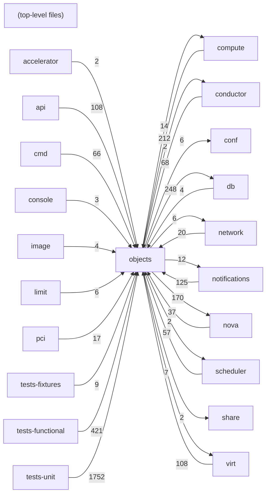

# Component: objects

## Overview

Versioned objects: Oslo versionedobjects wrappers for all Nova domain entities (instances, services, migrations, etc.).
49 files (3.2% of 1509 source files), 12,412 code lines (2.6% of 473,713 total).
Main neighbours: **tests-unit** (←1752 edges); **tests-functional** (←421 edges); **db** (→248/←4 edges); **compute** (→14/←212 edges); **nova** (→170/←37 edges).

## File Inventory

### (top-level)/

| File | Code Lines | Top CCN |
|------|-----------|---------|
| `__init__.py` | 95 | 1 |
| `aggregate.py` | 460 | 11 |
| `base.py` | 322 | 9 |
| `block_device.py` | 356 | 10 |
| `build_request.py` | 326 | 32 |
| `cell_mapping.py` | 228 | 4 |
| `compute_node.py` | 373 | 25 |
| `console_auth_token.py` | 149 | 5 |
| `diagnostics.py` | 127 | 1 |
| `ec2.py` | 186 | 4 |
| `external_event.py` | 39 | 2 |
| `fields.py` | 957 | 6 |
| `flavor.py` | 516 | 14 |
| `host_mapping.py` | 223 | 7 |
| `hv_spec.py` | 27 | 4 |
| `image_meta.py` | 408 | 42 |
| `instance.py` | 1,296 | 26 |
| `instance_action.py` | 220 | 5 |
| `instance_fault.py` | 74 | 3 |
| `instance_group.py` | 439 | 11 |
| `instance_info_cache.py` | 72 | 4 |
| `instance_mapping.py` | 352 | 10 |
| `instance_numa.py` | 259 | 12 |
| `instance_pci_requests.py` | 125 | 7 |
| `keypair.py` | 143 | 5 |
| `migrate_data.py` | 294 | 31 |
| `migration.py` | 249 | 13 |
| `migration_context.py` | 105 | 9 |
| `monitor_metric.py` | 67 | 5 |
| `network_metadata.py` | 30 | — |
| `network_request.py` | 77 | 7 |
| `numa.py` | 208 | 5 |
| `pci_device.py` | 466 | 15 |
| `pci_device_pool.py` | 68 | 7 |
| `quotas.py` | 504 | 13 |
| `request_spec.py` | 1,049 | 18 |
| `resource.py` | 63 | 3 |
| `security_group.py` | 132 | 3 |
| `selection.py` | 71 | 3 |
| `service.py` | 426 | 13 |
| `share_mapping.py` | 201 | 3 |
| `tag.py` | 54 | 2 |
| `task_log.py` | 64 | 2 |
| `trusted_certs.py` | 22 | 3 |
| `vcpu_model.py` | 46 | 3 |
| `virt_cpu_topology.py` | 24 | 1 |
| `virt_device_metadata.py` | 110 | 5 |
| `virtual_interface.py` | 232 | 13 |
| `volume_usage.py` | 78 | 4 |

**Top 5 Functions by CCN**

| Function | Kind | CCN | File | Line Range |
|----------|------|-----|------|------------|
| `obj_make_compatible` | method | 42 | `image_meta.py` | L216–L332 |
| `_pass_exact_filters` | method | 32 | `build_request.py` | L290–L341 |
| `obj_make_compatible` | method | 31 | `migrate_data.py` | L303–L361 |
| `create` | method | 26 | `instance.py` | L550–L669 |
| `obj_make_compatible` | method | 25 | `compute_node.py` | L105–L147 |

## Defined Symbols

Total: 2,099

| Kind | Count |
|------|-------|
| method | 818 |
| constant | 650 |
| class | 239 |
| field | 121 |
| variable | 110 |
| function | 96 |
| property | 65 |

## External Dependencies

| Package | Files Importing |
|---------|----------------|
| `oslo_utils` | 33 |
| `oslo_log` | 20 |
| `oslo_serialization` | 20 |
| `oslo_db` | 13 |
| `sqlalchemy` | 8 |
| `copy` | 6 |
| `oslo_versionedobjects` | 4 |
| `functools` | 3 |
| `itertools` | 3 |
| `typing` | 2 |
| `contextlib` | 2 |
| `re` | 2 |
| `urllib` | 2 |
| `collections` | 2 |
| `datetime` | 1 |
| `traceback` | 1 |
| `netaddr` | 1 |
| `oslo_messaging` | 1 |
| `os` | 1 |
| `cursive` | 1 |
| `oslo_config` | 1 |
| `os_resource_classes` | 1 |
| `hashlib` | 1 |
| `logging` | 1 |

## Side Effects

| Kind | Count |
|------|-------|
| global-mutation | 649 |
| network | 108 |

## Component Diagram

## Local Data Flow

_No security-surface entries recorded in the KB for this component._

## Cross-Component Interfaces

| Component | Dir | File Edges | Summed Count | Kinds |
|-----------|-----|-----------|-------------|-------|
| **accelerator** | ← | 1 | 2 | call, import |
| **api** | ← | 34 | 108 | call, import |
| **cmd** | ← | 18 | 66 | call, import |
| **compute** | → | 6 | 14 | call, import |
| **compute** | ← | 39 | 212 | call, import |
| **conductor** | → | 1 | 2 | call, import |
| **conductor** | ← | 9 | 68 | call, import |
| **conf** | → | 6 | 6 | import |
| **console** | ← | 1 | 3 | call, import |
| **db** | → | 56 | 248 | call, import |
| **db** | ← | 3 | 4 | call, import |
| **image** | ← | 2 | 4 | call, import |
| **limit** | ← | 2 | 6 | call, import |
| **network** | → | 3 | 6 | call, import |
| **network** | ← | 3 | 20 | call, import |
| **notifications** | → | 5 | 12 | call, import |
| **notifications** | ← | 32 | 125 | call, import, inherit |
| **nova** | → | 51 | 170 | call, import |
| **nova** | ← | 12 | 37 | call, import |
| **pci** | ← | 9 | 17 | call, import |
| **scheduler** | → | 1 | 2 | call, import |
| **scheduler** | ← | 17 | 57 | call, import |
| **share** | → | 1 | 2 | call, import |
| **tests-fixtures** | ← | 6 | 9 | call, import |
| **tests-functional** | ← | 122 | 421 | call, import |
| **tests-unit** | ← | 362 | 1752 | call, import, inherit |
| **virt** | → | 4 | 7 | call, import |
| **virt** | ← | 36 | 108 | call, import |

No cross-component seams recorded in the link graph.
