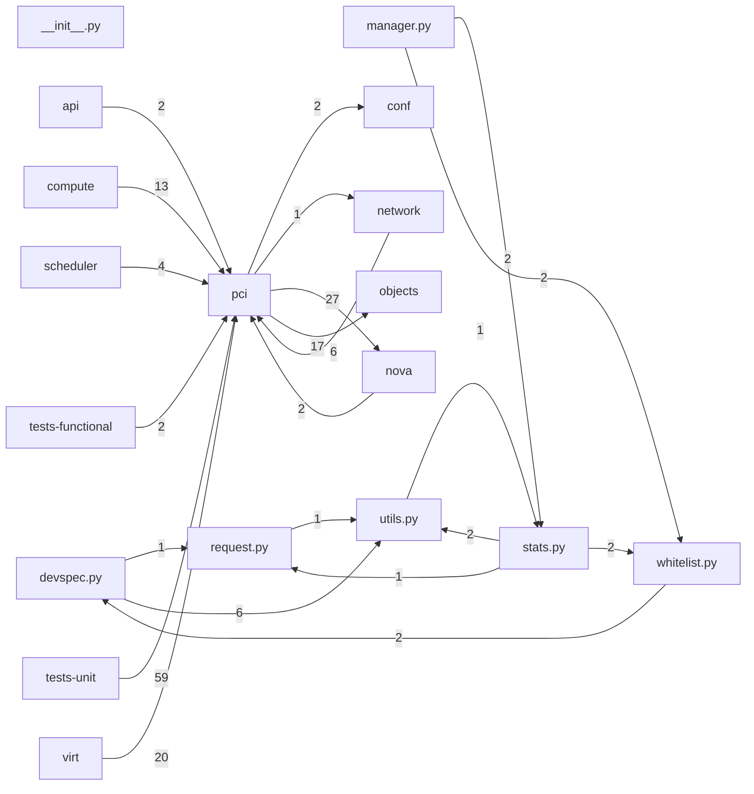

# Component: pci

## Overview

PCI device management: PCI request specification, device tracker, NUMA affinity, and SR-IOV PF/VF tracking.
7 files (0.5% of 1509 source files), 1,979 code lines (0.4% of 473,713 total).
Main neighbours: **tests-unit** (←59 edges); **nova** (→27/←2 edges); **virt** (←20 edges); **objects** (→17 edges); **compute** (←13 edges).

## File Inventory

### (top-level)/

| File | Code Lines | Top CCN |
|------|-----------|---------|
| `__init__.py` | 0 | — |
| `devspec.py` | 320 | 14 |
| `manager.py` | 344 | 13 |
| `request.py` | 294 | 13 |
| `stats.py` | 746 | 20 |
| `utils.py` | 201 | 4 |
| `whitelist.py` | 74 | 7 |

**Top 5 Functions by CCN**

| Function | Kind | CCN | File | Line Range |
|----------|------|-----|------|------------|
| `_filter_pools` | method | 20 | `stats.py` | L656–L790 |
| `_filter_pools_for_numa_cells` | method | 18 | `stats.py` | L393–L474 |
| `_init_dev_details` | method | 14 | `devspec.py` | L294–L371 |
| `_set_hvdevs` | method | 13 | `manager.py` | L217–L308 |
| `_validate_required_ids` | function | 13 | `request.py` | L138–L165 |

## Defined Symbols

Total: 151

| Kind | Count |
|------|-------|
| method | 81 |
| constant | 23 |
| function | 21 |
| variable | 9 |
| class | 9 |
| staticmethod | 5 |
| field | 2 |
| property | 1 |

## External Dependencies

| Package | Files Importing |
|---------|----------------|
| `typing` | 5 |
| `oslo_log` | 5 |
| `copy` | 3 |
| `oslo_utils` | 3 |
| `oslo_serialization` | 3 |
| `re` | 2 |
| `collections` | 2 |
| `oslo_config` | 2 |
| `abc` | 1 |
| `string` | 1 |
| `functools` | 1 |
| `jsonschema` | 1 |
| `glob` | 1 |
| `os` | 1 |

## Side Effects

| Kind | Count |
|------|-------|
| global-mutation | 24 |
| file-io | 9 |

## Component Diagram

## Local Data Flow

**Sinks** (8 total):

- **db-write** (8)

_The KB records do not include sanitisation annotations; cross-file data-flow tracing requires the resolved link graph._

## Cross-Component Interfaces

| Component | Dir | File Edges | Summed Count | Kinds |
|-----------|-----|-----------|-------------|-------|
| **api** | ← | 1 | 2 | call, import |
| **compute** | ← | 7 | 13 | call, import |
| **conf** | → | 2 | 2 | import |
| **network** | → | 1 | 1 | import |
| **network** | ← | 3 | 6 | call, import |
| **nova** | → | 11 | 27 | call, import |
| **nova** | ← | 1 | 2 | call, import |
| **objects** | → | 9 | 17 | call, import |
| **scheduler** | ← | 2 | 4 | call, import |
| **tests-functional** | ← | 1 | 2 | call, import |
| **tests-unit** | ← | 25 | 59 | call, import |
| **virt** | ← | 7 | 20 | call, import |

No cross-component seams recorded in the link graph.
