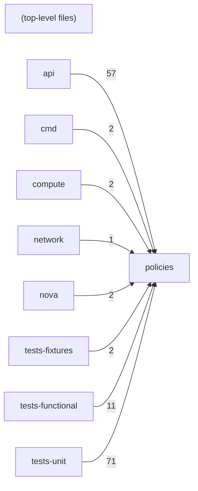

# Component: policies

## Overview

RBAC policy rules: oslo.policy rule definitions for every Nova API operation, organised by resource type.
56 files (3.7% of 1509 source files), 3,427 code lines (0.7% of 473,713 total).
Main neighbours: **tests-unit** (←71 edges); **api** (←57 edges); **tests-functional** (←11 edges); **compute** (←2 edges); **cmd** (←2 edges).

## File Inventory

### (top-level)/

| File | Code Lines | Top CCN |
|------|-----------|---------|
| `__init__.py` | 114 | 1 |
| `admin_actions.py` | 29 | 1 |
| `admin_password.py` | 18 | 1 |
| `aggregates.py` | 107 | 1 |
| `assisted_volume_snapshots.py` | 29 | 1 |
| `attach_interfaces.py` | 67 | 1 |
| `availability_zone.py` | 31 | 1 |
| `baremetal_nodes.py` | 45 | 1 |
| `base.py` | 90 | 1 |
| `console_auth_tokens.py` | 19 | 1 |
| `console_output.py` | 18 | 1 |
| `create_backup.py` | 18 | 1 |
| `deferred_delete.py` | 42 | 1 |
| `evacuate.py` | 18 | 1 |
| `extended_server_attributes.py` | 49 | 1 |
| `extensions.py` | 23 | 1 |
| `flavor_access.py` | 56 | 1 |
| `flavor_extra_specs.py` | 88 | 1 |
| `flavor_manage.py` | 40 | 1 |
| `floating_ip_pools.py` | 18 | 1 |
| `floating_ips.py` | 93 | 1 |
| `hosts.py` | 97 | 1 |
| `hypervisors.py` | 106 | 1 |
| `instance_actions.py` | 80 | 1 |
| `instance_usage_audit_log.py` | 44 | 1 |
| `ips.py` | 30 | 1 |
| `keypairs.py` | 51 | 1 |
| `limits.py` | 46 | 1 |
| `lock_server.py` | 45 | 1 |
| `migrate_server.py` | 68 | 1 |
| `migrations.py` | 56 | 1 |
| `multinic.py` | 47 | 1 |
| `networks.py` | 45 | 1 |
| `pause_server.py` | 31 | 1 |
| `quota_class_sets.py` | 29 | 1 |
| `quota_sets.py` | 62 | 1 |
| `remote_consoles.py` | 35 | 1 |
| `rescue.py` | 42 | 1 |
| `security_groups.py` | 139 | 1 |
| `server_diagnostics.py` | 18 | 1 |
| `server_external_events.py` | 18 | 1 |
| `server_groups.py` | 67 | 1 |
| `server_metadata.py` | 79 | 1 |
| `server_password.py` | 44 | 1 |
| `server_shares.py` | 51 | 1 |
| `server_tags.py` | 78 | 1 |
| `server_topology.py` | 30 | 1 |
| `servers.py` | 458 | 1 |
| `servers_migrations.py` | 81 | 1 |
| `services.py` | 54 | 1 |
| `shelve.py` | 52 | 1 |
| `simple_tenant_usage.py` | 29 | 1 |
| `suspend_server.py` | 29 | 1 |
| `tenant_networks.py` | 45 | 1 |
| `volumes.py` | 149 | 1 |
| `volumes_attachments.py` | 80 | 1 |

**Top 5 Functions by CCN**

| Function | Kind | CCN | File | Line Range |
|----------|------|-----|------|------------|
| `list_rules` | function | 1 | `__init__.py` | L73–L130 |
| `list_rules` | function | 1 | `admin_actions.py` | L50–L51 |
| `list_rules` | function | 1 | `admin_password.py` | L39–L40 |
| `list_rules` | function | 1 | `aggregates.py` | L128–L129 |
| `list_rules` | function | 1 | `assisted_volume_snapshots.py` | L50–L51 |

## Defined Symbols

Total: 239

| Kind | Count |
|------|-------|
| constant | 128 |
| function | 56 |
| variable | 55 |

## External Dependencies

| Package | Files Importing |
|---------|----------------|
| `oslo_policy` | 55 |
| `itertools` | 1 |

## Side Effects

| Kind | Count |
|------|-------|
| global-mutation | 128 |

## Component Diagram

## Local Data Flow

**Sinks** (28 total):

- **db-write** (28)

_The KB records do not include sanitisation annotations; cross-file data-flow tracing requires the resolved link graph._

## Cross-Component Interfaces

| Component | Dir | File Edges | Summed Count | Kinds |
|-----------|-----|-----------|-------------|-------|
| **api** | ← | 57 | 57 | import |
| **cmd** | ← | 1 | 2 | call, import |
| **compute** | ← | 2 | 2 | import |
| **network** | ← | 1 | 1 | import |
| **nova** | ← | 1 | 2 | call, import |
| **tests-fixtures** | ← | 1 | 2 | call, import |
| **tests-functional** | ← | 11 | 11 | import |
| **tests-unit** | ← | 70 | 71 | call, import |

No cross-component seams recorded in the link graph.
