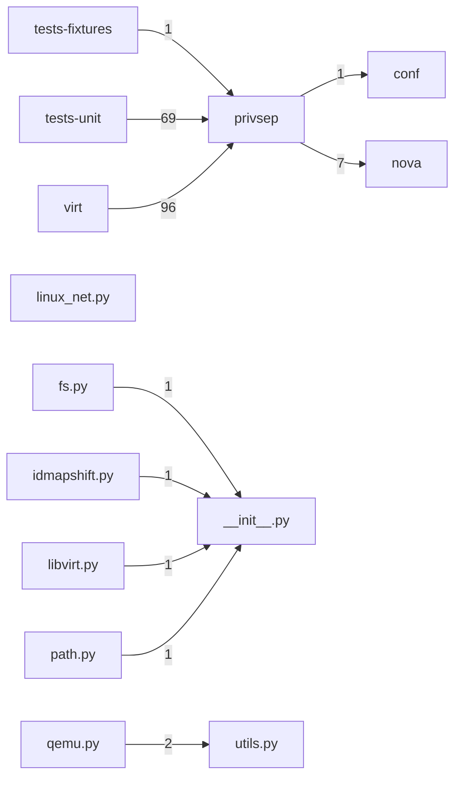

# Component: privsep

## Overview

Privilege separation: oslo.privsep entrypoints for filesystem, networking, and crypto operations requiring elevated privileges.
8 files (0.5% of 1509 source files), 782 code lines (0.2% of 473,713 total).
Main neighbours: **virt** (←96 edges); **tests-unit** (←69 edges); **nova** (→7 edges); **tests-fixtures** (←1 edges); **conf** (→1 edges).

## File Inventory

### (top-level)/

| File | Code Lines | Top CCN |
|------|-----------|---------|
| `__init__.py` | 14 | — |
| `fs.py` | 188 | 7 |
| `idmapshift.py` | 94 | 10 |
| `libvirt.py` | 135 | 2 |
| `linux_net.py` | 86 | 6 |
| `path.py` | 65 | 7 |
| `qemu.py` | 152 | 14 |
| `utils.py` | 48 | 8 |

**Top 5 Functions by CCN**

| Function | Kind | CCN | File | Line Range |
|----------|------|-----|------|------------|
| `unprivileged_convert_image` | function | 14 | `qemu.py` | L57–L222 |
| `confirm_path` | function | 10 | `idmapshift.py` | L93–L112 |
| `unprivileged_qemu_img_info` | function | 9 | `qemu.py` | L235–L270 |
| `supports_direct_io` | function | 8 | `utils.py` | L43–L90 |
| `configurable_mkfs` | function | 7 | `fs.py` | L281–L305 |

## Defined Symbols

Total: 106

| Kind | Count |
|------|-------|
| function | 82 |
| constant | 16 |
| variable | 5 |
| field | 2 |
| class | 1 |

## External Dependencies

| Package | Files Importing |
|---------|----------------|
| `oslo_log` | 6 |
| `os` | 6 |
| `oslo_utils` | 5 |
| `oslo_concurrency` | 4 |
| `errno` | 2 |
| `oslo_privsep` | 1 |
| `hashlib` | 1 |
| `binascii` | 1 |
| `stat` | 1 |
| `fcntl` | 1 |
| `shutil` | 1 |
| `contextlib` | 1 |
| `tempfile` | 1 |
| `typing` | 1 |
| `mmap` | 1 |
| `random` | 1 |
| `sys` | 1 |

## Side Effects

| Kind | Count |
|------|-------|
| process-spawn | 58 |
| file-io | 25 |
| global-mutation | 16 |
| syscall | 7 |

## Component Diagram

## Local Data Flow

**Sinks** (5 total):

- **file-write** (5)

**Privileged operations**: 58 entries recorded.

_The KB records do not include sanitisation annotations; cross-file data-flow tracing requires the resolved link graph._

## Cross-Component Interfaces

| Component | Dir | File Edges | Summed Count | Kinds |
|-----------|-----|-----------|-------------|-------|
| **conf** | → | 1 | 1 | import |
| **nova** | → | 3 | 7 | call, import |
| **tests-fixtures** | ← | 1 | 1 | import |
| **tests-unit** | ← | 11 | 69 | call, import |
| **virt** | ← | 26 | 96 | call, import |

No cross-component seams recorded in the link graph.
