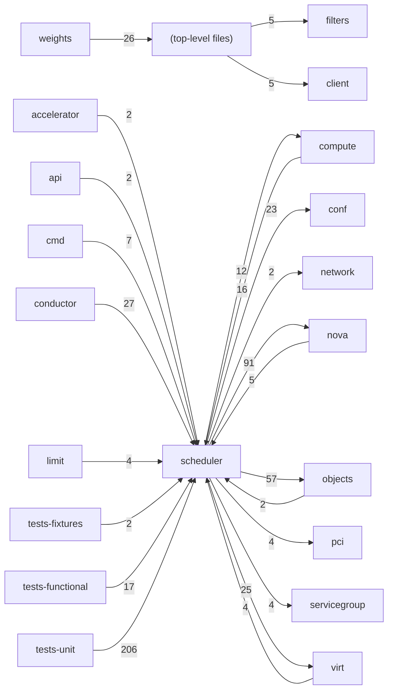

# Component: scheduler

## Overview

Filter scheduler: host selection pipeline, filter and weight plugins, and the scheduler client.
41 files (2.7% of 1509 source files), 6,326 code lines (1.3% of 473,713 total).
Main neighbours: **tests-unit** (←206 edges); **nova** (→91/←5 edges); **objects** (→57/←2 edges); **virt** (→25/←4 edges); **compute** (→12/←16 edges).

## File Inventory

### (top-level)/

| File | Code Lines | Top CCN |
|------|-----------|---------|
| `__init__.py` | 7 | — |
| `host_manager.py` | 724 | 19 |
| `manager.py` | 511 | 16 |
| `request_filter.py` | 463 | 15 |
| `rpcapi.py` | 137 | 6 |
| `utils.py` | 1,064 | 27 |

### client/

| File | Code Lines | Top CCN |
|------|-----------|---------|
| `client/__init__.py` | 0 | — |
| `client/query.py` | 64 | 1 |
| `client/report.py` | 1,993 | 12 |

### filters/

| File | Code Lines | Top CCN |
|------|-----------|---------|
| `filters/__init__.py` | 62 | 3 |
| `filters/affinity_filter.py` | 95 | 8 |
| `filters/aggregate_image_properties_isolation.py` | 52 | 9 |
| `filters/aggregate_instance_extra_specs.py` | 47 | 9 |
| `filters/aggregate_multitenancy_isolation.py` | 32 | 6 |
| `filters/all_hosts_filter.py` | 7 | 1 |
| `filters/compute_capabilities_filter.py` | 82 | 10 |
| `filters/compute_filter.py` | 24 | 3 |
| `filters/extra_specs_ops.py` | 39 | 12 |
| `filters/image_props_filter.py` | 84 | 7 |
| `filters/io_ops_filter.py` | 41 | 2 |
| `filters/isolated_hosts_filter.py` | 36 | 7 |
| `filters/json_filter.py` | 107 | 6 |
| `filters/metrics_filter.py` | 30 | 3 |
| `filters/num_instances_filter.py` | 39 | 2 |
| `filters/numa_topology_filter.py` | 86 | 9 |
| `filters/pci_passthrough_filter.py` | 42 | 5 |
| `filters/type_filter.py` | 16 | 4 |
| `filters/utils.py` | 52 | 6 |

### weights/

| File | Code Lines | Top CCN |
|------|-----------|---------|
| `weights/__init__.py` | 22 | 1 |
| `weights/affinity.py` | 42 | 3 |
| `weights/compute.py` | 18 | 1 |
| `weights/cpu.py` | 24 | 1 |
| `weights/cross_cell.py` | 37 | 7 |
| `weights/disk.py` | 21 | 1 |
| `weights/hypervisor_version.py` | 19 | 2 |
| `weights/image_props.py` | 69 | 12 |
| `weights/io_ops.py` | 23 | 1 |
| `weights/metrics.py` | 43 | 7 |
| `weights/num_instances.py` | 22 | 1 |
| `weights/pci.py` | 29 | 4 |
| `weights/ram.py` | 21 | 1 |

**Top 5 Functions by CCN**

| Function | Kind | CCN | File | Line Range |
|----------|------|-----|------|------------|
| `resources_from_request_spec` | function | 27 | `utils.py` | L721–L831 |
| `get_filtered_hosts` | method | 19 | `host_manager.py` | L498–L617 |
| `_get_group_details` | function | 17 | `utils.py` | L1175–L1235 |
| `select_destinations` | method | 16 | `manager.py` | L188–L307 |
| `routed_networks_filter` | function | 15 | `request_filter.py` | L296–L387 |

## Defined Symbols

Total: 497

| Kind | Count |
|------|-------|
| method | 238 |
| constant | 87 |
| function | 83 |
| class | 53 |
| field | 23 |
| variable | 10 |
| property | 3 |

## External Dependencies

| Package | Files Importing |
|---------|----------------|
| `oslo_log` | 20 |
| `collections` | 5 |
| `oslo_utils` | 4 |
| `oslo_serialization` | 4 |
| `functools` | 3 |
| `os_traits` | 3 |
| `copy` | 2 |
| `random` | 2 |
| `keystoneauth1` | 2 |
| `os_resource_classes` | 2 |
| `operator` | 2 |
| `oslo_messaging` | 2 |
| `contextlib` | 1 |
| `time` | 1 |
| `oslo_middleware` | 1 |
| `retrying` | 1 |
| `netaddr` | 1 |
| `datetime` | 1 |
| `oslo_service` | 1 |
| `re` | 1 |
| `sys` | 1 |
| `urllib` | 1 |
| `oslo_config` | 1 |

## Side Effects

| Kind | Count |
|------|-------|
| global-mutation | 89 |
| network | 6 |

## Component Diagram

## Local Data Flow

**Sinks** (45 total):

- **db-write** (45)

**Privileged operations**: 17 entries recorded.

_The KB records do not include sanitisation annotations; cross-file data-flow tracing requires the resolved link graph._

## Cross-Component Interfaces

| Component | Dir | File Edges | Summed Count | Kinds |
|-----------|-----|-----------|-------------|-------|
| **accelerator** | ← | 1 | 2 | call, import |
| **api** | ← | 1 | 2 | call, import |
| **cmd** | ← | 3 | 7 | call, import |
| **compute** | → | 4 | 12 | call, import |
| **compute** | ← | 7 | 16 | call, import |
| **conductor** | ← | 7 | 27 | call, import |
| **conf** | → | 23 | 23 | import |
| **limit** | ← | 2 | 4 | call, import |
| **network** | → | 1 | 2 | call, import |
| **nova** | → | 29 | 91 | call, import, inherit |
| **nova** | ← | 3 | 5 | call, import |
| **objects** | → | 17 | 57 | call, import |
| **objects** | ← | 1 | 2 | call, import |
| **pci** | → | 2 | 4 | call, import |
| **servicegroup** | → | 2 | 4 | call, import |
| **tests-fixtures** | ← | 1 | 2 | import, inherit |
| **tests-functional** | ← | 10 | 17 | call, import, inherit |
| **tests-unit** | ← | 83 | 206 | call, import, inherit |
| **virt** | → | 4 | 25 | call, import |
| **virt** | ← | 2 | 4 | call, import |

No cross-component seams recorded in the link graph.
