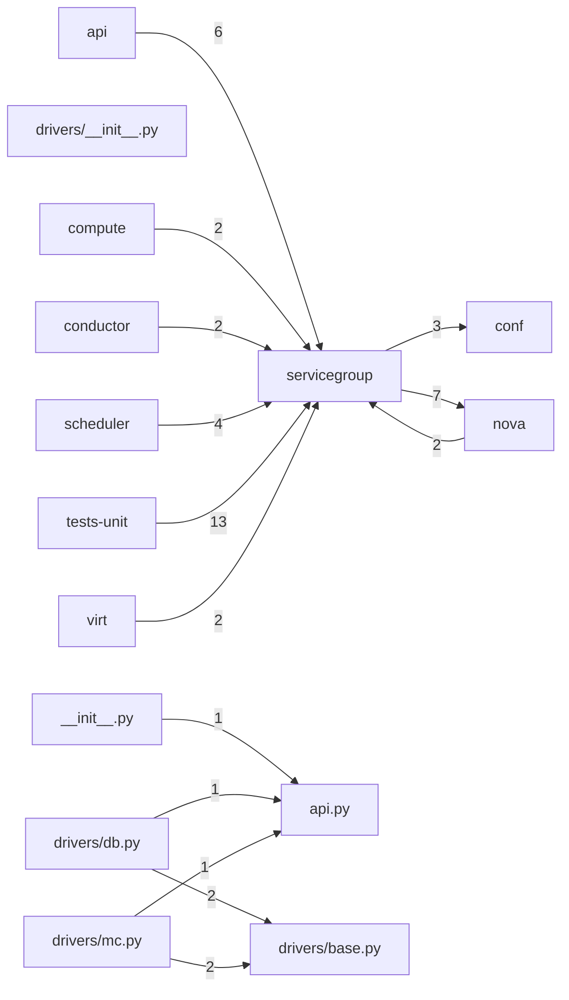

# Component: servicegroup

## Overview

Service group: heartbeat-based compute-service aliveness tracking via ZooKeeper or database drivers.
6 files (0.4% of 1509 source files), 216 code lines (0.0% of 473,713 total).
Main neighbours: **tests-unit** (←13 edges); **nova** (→7/←2 edges); **api** (←6 edges); **scheduler** (←4 edges); **conf** (→3 edges).

## File Inventory

### (top-level)/

| File | Code Lines | Top CCN |
|------|-----------|---------|
| `__init__.py` | 6 | — |
| `api.py` | 47 | 2 |

### drivers/

| File | Code Lines | Top CCN |
|------|-----------|---------|
| `drivers/__init__.py` | 0 | — |
| `drivers/base.py` | 15 | 1 |
| `drivers/db.py` | 78 | 6 |
| `drivers/mc.py` | 70 | 4 |

**Top 5 Functions by CCN**

| Function | Kind | CCN | File | Line Range |
|----------|------|-----|------|------------|
| `_report_state` | method | 6 | `drivers/db.py` | L87–L124 |
| `is_up` | method | 4 | `drivers/db.py` | L57–L81 |
| `updated_time` | method | 4 | `drivers/mc.py` | L73–L90 |
| `_report_state` | method | 4 | `drivers/mc.py` | L92–L117 |
| `join` | method | 3 | `drivers/db.py` | L37–L55 |

## Defined Symbols

Total: 30

| Kind | Count |
|------|-------|
| method | 17 |
| constant | 8 |
| class | 4 |
| variable | 1 |

## External Dependencies

| Package | Files Importing |
|---------|----------------|
| `oslo_log` | 3 |
| `oslo_utils` | 3 |
| `oslo_messaging` | 1 |
| `datetime` | 1 |

## Side Effects

| Kind | Count |
|------|-------|
| global-mutation | 8 |

## Component Diagram

## Local Data Flow

**Sinks** (2 total):

- **db-write** (2)

_The KB records do not include sanitisation annotations; cross-file data-flow tracing requires the resolved link graph._

## Cross-Component Interfaces

| Component | Dir | File Edges | Summed Count | Kinds |
|-----------|-----|-----------|-------------|-------|
| **api** | ← | 3 | 6 | call, import |
| **compute** | ← | 1 | 2 | call, import |
| **conductor** | ← | 1 | 2 | call, import |
| **conf** | → | 3 | 3 | import |
| **nova** | → | 4 | 7 | call, import |
| **nova** | ← | 1 | 2 | call, import |
| **scheduler** | ← | 2 | 4 | call, import |
| **tests-unit** | ← | 8 | 13 | call, import |
| **virt** | ← | 1 | 2 | call, import |

No cross-component seams recorded in the link graph.
