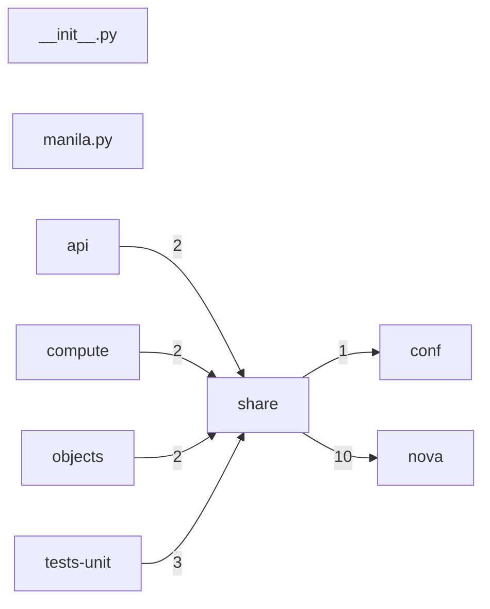

# Component: share

## Overview

Share service client: Manila shared-filesystem attachment helpers.
2 files (0.1% of 1509 source files), 301 code lines (0.1% of 473,713 total).
Main neighbours: **nova** (→10 edges); **tests-unit** (←3 edges); **compute** (←2 edges); **api** (←2 edges); **objects** (←2 edges).

## File Inventory

### (top-level)/

| File | Code Lines | Top CCN |
|------|-----------|---------|
| `__init__.py` | 0 | — |
| `manila.py` | 301 | 4 |

**Top 5 Functions by CCN**

| Function | Kind | CCN | File | Line Range |
|----------|------|-----|------|------------|
| `get_access` | method | 4 | `manila.py` | L224–L252 |
| `deny` | method | 3 | `manila.py` | L311–L346 |
| `get_access_rules` | method | 2 | `manila.py` | L255–L259 |
| `has_access` | method | 2 | `manila.py` | L348–L362 |
| `_manilaclient` | function | 1 | `manila.py` | L32–L48 |

## Defined Symbols

Total: 50

| Kind | Count |
|------|-------|
| field | 21 |
| function | 11 |
| method | 9 |
| constant | 3 |
| class | 3 |
| classmethod | 3 |

## External Dependencies

| Package | Files Importing |
|---------|----------------|
| `dataclasses` | 1 |
| `functools` | 1 |
| `openstack` | 1 |
| `oslo_log` | 1 |

## Side Effects

| Kind | Count |
|------|-------|
| global-mutation | 3 |
| network | 2 |

## Component Diagram

## Local Data Flow

_No security-surface entries recorded in the KB for this component._

## Cross-Component Interfaces

| Component | Dir | File Edges | Summed Count | Kinds |
|-----------|-----|-----------|-------------|-------|
| **api** | ← | 1 | 2 | call, import |
| **compute** | ← | 1 | 2 | call, import |
| **conf** | → | 1 | 1 | import |
| **nova** | → | 2 | 10 | call, import |
| **objects** | ← | 1 | 2 | call, import |
| **tests-unit** | ← | 1 | 3 | call, import |

No cross-component seams recorded in the link graph.
