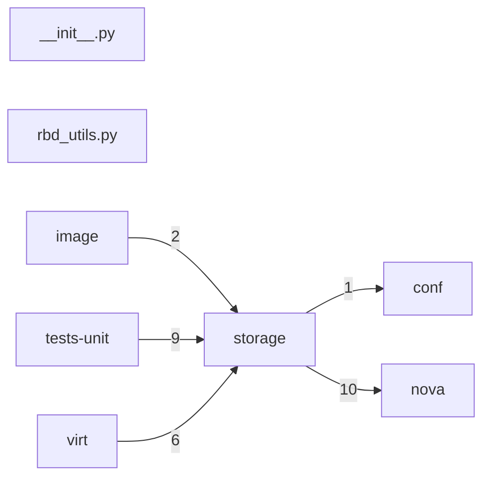

# Component: storage

## Overview

Storage helpers: ephemeral disk and snapshot utility wrappers for the compute host.
2 files (0.1% of 1509 source files), 386 code lines (0.1% of 473,713 total).
Main neighbours: **nova** (→10 edges); **tests-unit** (←9 edges); **virt** (←6 edges); **image** (←2 edges); **conf** (→1 edges).

## File Inventory

### (top-level)/

| File | Code Lines | Top CCN |
|------|-----------|---------|
| `__init__.py` | 0 | — |
| `rbd_utils.py` | 386 | 7 |

**Top 5 Functions by CCN**

| Function | Kind | CCN | File | Line Range |
|----------|------|-----|------|------------|
| `remove_snap` | method | 7 | `rbd_utils.py` | L467–L493 |
| `__init__` | method | 5 | `rbd_utils.py` | L125–L137 |
| `get_mon_addrs` | method | 5 | `rbd_utils.py` | L190–L207 |
| `parse_url` | method | 5 | `rbd_utils.py` | L209–L222 |
| `is_cloneable` | method | 5 | `rbd_utils.py` | L228–L254 |

## Defined Symbols

Total: 46

| Kind | Count |
|------|-------|
| method | 35 |
| class | 4 |
| constant | 3 |
| variable | 2 |
| function | 1 |
| property | 1 |

## External Dependencies

| Package | Files Importing |
|---------|----------------|
| `urllib` | 1 |
| `oslo_concurrency` | 1 |
| `oslo_log` | 1 |
| `oslo_serialization` | 1 |
| `oslo_service` | 1 |
| `oslo_utils` | 1 |
| `rados` | 1 |
| `rbd` | 1 |

## Side Effects

| Kind | Count |
|------|-------|
| global-mutation | 3 |

## Component Diagram

## Local Data Flow

_No security-surface entries recorded in the KB for this component._

## Cross-Component Interfaces

| Component | Dir | File Edges | Summed Count | Kinds |
|-----------|-----|-----------|-------------|-------|
| **conf** | → | 1 | 1 | import |
| **image** | ← | 1 | 2 | call, import |
| **nova** | → | 3 | 10 | call, import |
| **tests-unit** | ← | 5 | 9 | call, import |
| **virt** | ← | 3 | 6 | call, import |

No cross-component seams recorded in the link graph.
