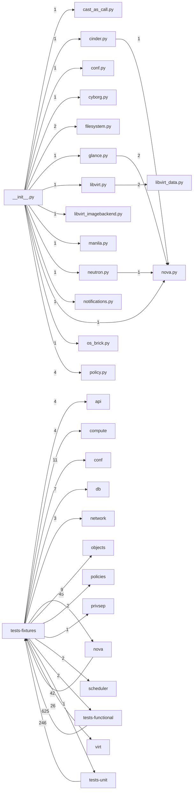

# Component: tests-fixtures

## Overview

Test fixtures: reusable Nova test fixtures covering database setup, config, and RPC stubs.
16 files (1.1% of 1509 source files), 8,539 code lines (1.8% of 473,713 total).
Main neighbours: **tests-functional** (→2/←625 edges); **tests-unit** (→1/←246 edges); **nova** (→45/←26 edges); **virt** (→42 edges); **conf** (→11 edges).

## File Inventory

### (top-level)/

| File | Code Lines | Top CCN |
|------|-----------|---------|
| `__init__.py` | 19 | — |
| `cast_as_call.py` | 42 | 3 |
| `cinder.py` | 413 | 17 |
| `conf.py` | 34 | 1 |
| `cyborg.py` | 321 | 6 |
| `filesystem.py` | 55 | 3 |
| `glance.py` | 301 | 10 |
| `libvirt.py` | 2,249 | 41 |
| `libvirt_data.py` | 2,049 | 1 |
| `libvirt_imagebackend.py` | 136 | 3 |
| `manila.py` | 110 | 5 |
| `neutron.py` | 793 | 8 |
| `notifications.py` | 172 | 4 |
| `nova.py` | 1,679 | 11 |
| `os_brick.py` | 51 | 2 |
| `policy.py` | 115 | 4 |

**Top 5 Functions by CCN**

| Function | Kind | CCN | File | Line Range |
|----------|------|-----|------|------------|
| `XMLDesc` | method | 41 | `libvirt.py` | L1590–L1900 |
| `_parse_definition` | method | 38 | `libvirt.py` | L1172–L1385 |
| `generate_xml` | method | 32 | `libvirt.py` | L365–L481 |
| `fake_get` | method | 17 | `cinder.py` | L231–L329 |
| `detachDevice` | method | 16 | `libvirt.py` | L1528–L1582 |

## Defined Symbols

Total: 843

| Kind | Count |
|------|-------|
| method | 404 |
| constant | 203 |
| class | 90 |
| field | 68 |
| function | 54 |
| variable | 12 |
| staticmethod | 6 |
| property | 5 |
| classmethod | 1 |

## External Dependencies

| Package | Files Importing |
|---------|----------------|
| `fixtures` | 13 |
| `collections` | 7 |
| `oslo_log` | 7 |
| `oslo_utils` | 7 |
| `copy` | 5 |
| `os` | 5 |
| `oslo_config` | 4 |
| `unittest` | 4 |
| `sys` | 3 |
| `oslo_messaging` | 3 |
| `functools` | 3 |
| `os_brick` | 2 |
| `oslo_policy` | 2 |
| `tempfile` | 2 |
| `lxml` | 2 |
| `threading` | 2 |
| `oslo_serialization` | 2 |
| `cast_as_call` | 1 |
| `cinder` | 1 |
| `conf` | 1 |
| `cyborg` | 1 |
| `filesystem` | 1 |
| `glance` | 1 |
| `libvirt` | 1 |
| `libvirt_imagebackend` | 1 |
| `manila` | 1 |
| `neutron` | 1 |
| `notifications` | 1 |
| `policy` | 1 |
| `shutil` | 1 |
| `datetime` | 1 |
| `textwrap` | 1 |
| `time` | 1 |
| `os_vif` | 1 |
| `random` | 1 |
| `neutronclient` | 1 |
| `os_resource_classes` | 1 |
| `contextlib` | 1 |
| `importlib` | 1 |
| `logging` | 1 |

## Side Effects

| Kind | Count |
|------|-------|
| global-mutation | 203 |
| file-io | 21 |
| network | 16 |
| process-spawn | 4 |

## Component Diagram

## Local Data Flow

**Entry points** (2 total):

- **env** (2): `nova.py`

**Sinks** (24 total):

- **db-write** (18)
- **file-write** (6)

**Privileged operations**: 8 entries recorded.

_The KB records do not include sanitisation annotations; cross-file data-flow tracing requires the resolved link graph._

## Cross-Component Interfaces

| Component | Dir | File Edges | Summed Count | Kinds |
|-----------|-----|-----------|-------------|-------|
| **api** | → | 2 | 4 | call, import |
| **compute** | → | 2 | 4 | call, import |
| **conf** | → | 7 | 11 | call, import |
| **db** | → | 3 | 7 | call, import |
| **network** | → | 2 | 3 | call, import |
| **nova** | → | 16 | 45 | call, import, inherit |
| **nova** | ← | 1 | 26 | call, import |
| **objects** | → | 6 | 9 | call, import |
| **policies** | → | 1 | 2 | call, import |
| **privsep** | → | 1 | 1 | import |
| **scheduler** | → | 1 | 2 | import, inherit |
| **tests-functional** | → | 1 | 2 | call, import |
| **tests-functional** | ← | 176 | 625 | call, import, inherit |
| **tests-unit** | → | 1 | 1 | import |
| **tests-unit** | ← | 85 | 246 | call, import |
| **virt** | → | 11 | 42 | call, import, inherit |

No cross-component seams recorded in the link graph.
