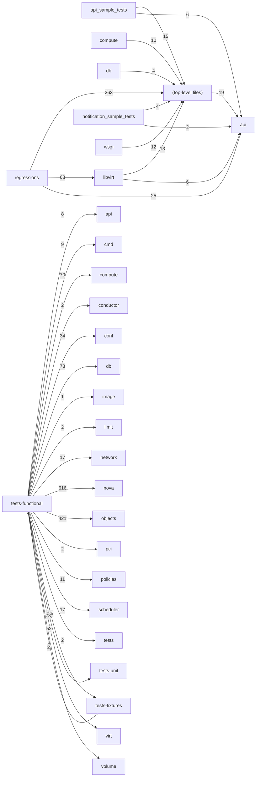

# Component: tests-functional

## Overview

Functional test suite: end-to-end in-process Nova API and compute flow tests.
314 files (20.8% of 1509 source files), 57,800 code lines (12.2% of 473,713 total).
Main neighbours: **tests-fixtures** (→625/←2 edges); **nova** (→616 edges); **objects** (→421 edges); **tests-unit** (→78 edges); **db** (→73 edges).

## File Inventory

### (top-level)/

| File | Code Lines | Top CCN |
|------|-----------|---------|
| `__init__.py` | 1 | — |
| `api_samples_test_base.py` | 391 | 38 |
| `fixtures.py` | 106 | 3 |
| `integrated_helpers.py` | 1,128 | 10 |
| `test_aggregates.py` | 771 | 4 |
| `test_availability_zones.py` | 376 | 3 |
| `test_boot_from_volume.py` | 166 | 3 |
| `test_cold_migrate.py` | 80 | 1 |
| `test_compute_mgr.py` | 62 | 1 |
| `test_conf_max_attach_disk_devices.py` | 63 | 1 |
| `test_cross_az_attach.py` | 137 | 1 |
| `test_cross_cell_migrate.py` | 800 | 16 |
| `test_ephemeral_encryption.py` | 308 | 4 |
| `test_external_networks.py` | 49 | 1 |
| `test_flavor_extraspecs.py` | 93 | 1 |
| `test_graceful_shutdown.py` | 658 | 4 |
| `test_images.py` | 61 | 3 |
| `test_instance_actions.py` | 169 | 3 |
| `test_ip_allocation.py` | 33 | 1 |
| `test_json_filter.py` | 36 | 2 |
| `test_legacy_v2_compatible_wrapper.py` | 59 | 3 |
| `test_list_servers_ip_filter.py` | 69 | 4 |
| `test_metadata.py` | 132 | 4 |
| `test_middleware.py` | 101 | 2 |
| `test_multiattach.py` | 46 | 1 |
| `test_nova_manage.py` | 2,056 | 10 |
| `test_policy.py` | 96 | 3 |
| `test_report_client.py` | 1,200 | 15 |
| `test_routed_networks.py` | 387 | 4 |
| `test_scheduler.py` | 188 | 1 |
| `test_server_external_events.py` | 70 | 5 |
| `test_server_faults.py` | 59 | 1 |
| `test_server_group.py` | 790 | 3 |
| `test_server_rescue.py` | 130 | 2 |
| `test_servers.py` | 4,767 | 9 |
| `test_servers_provider_tree.py` | 577 | 8 |
| `test_servers_resource_request.py` | 2,183 | 6 |
| `test_service.py` | 124 | 3 |
| `test_unified_limits.py` | 332 | 3 |

### api/

| File | Code Lines | Top CCN |
|------|-----------|---------|
| `api/__init__.py` | 4 | — |
| `api/client.py` | 421 | 10 |
| `api/openstack/__init__.py` | 0 | — |

### api_sample_tests/

| File | Code Lines | Top CCN |
|------|-----------|---------|
| `api_sample_tests/__init__.py` | 0 | — |
| `api_sample_tests/api_sample_base.py` | 44 | 5 |
| `api_sample_tests/test_admin_actions.py` | 22 | 1 |
| `api_sample_tests/test_admin_password.py` | 11 | 1 |
| `api_sample_tests/test_agents.py` | 10 | 1 |
| `api_sample_tests/test_aggregates.py` | 94 | 1 |
| `api_sample_tests/test_assisted_volume_snapshots.py` | 30 | 1 |
| `api_sample_tests/test_attach_interfaces.py` | 182 | 2 |
| `api_sample_tests/test_availability_zone.py` | 12 | 1 |
| `api_sample_tests/test_baremetal_nodes.py` | 46 | 2 |
| `api_sample_tests/test_block_device_mapping_boot.py` | 11 | 1 |
| `api_sample_tests/test_cells.py` | 32 | 1 |
| `api_sample_tests/test_compare_result.py` | 379 | 1 |
| `api_sample_tests/test_console_auth_tokens.py` | 55 | 1 |
| `api_sample_tests/test_console_output.py` | 8 | 1 |
| `api_sample_tests/test_consoles.py` | 15 | 1 |
| `api_sample_tests/test_create_backup.py` | 27 | 1 |
| `api_sample_tests/test_deferred_delete.py` | 20 | 1 |
| `api_sample_tests/test_evacuate.py` | 202 | 2 |
| `api_sample_tests/test_extension_info.py` | 14 | 2 |
| `api_sample_tests/test_fixed_ips.py` | 13 | 1 |
| `api_sample_tests/test_flavor_access.py` | 67 | 1 |
| `api_sample_tests/test_flavor_extraspecs.py` | 46 | 1 |
| `api_sample_tests/test_flavor_manage.py` | 31 | 1 |
| `api_sample_tests/test_flavors.py` | 96 | 2 |
| `api_sample_tests/test_floating_ip_dns.py` | 47 | 1 |
| `api_sample_tests/test_floating_ip_pools.py` | 18 | 1 |
| `api_sample_tests/test_floating_ips.py` | 175 | 3 |
| `api_sample_tests/test_floating_ips_bulk.py` | 29 | 1 |
| `api_sample_tests/test_fping.py` | 13 | 1 |
| `api_sample_tests/test_hosts.py` | 23 | 1 |
| `api_sample_tests/test_hypervisors.py` | 230 | 1 |
| `api_sample_tests/test_images.py` | 64 | 1 |
| `api_sample_tests/test_instance_actions.py` | 108 | 2 |
| `api_sample_tests/test_instance_usage_audit_log.py` | 50 | 2 |
| `api_sample_tests/test_keypairs.py` | 264 | 4 |
| `api_sample_tests/test_limits.py` | 45 | 1 |
| `api_sample_tests/test_lock_server.py` | 41 | 1 |
| `api_sample_tests/test_migrate_server.py` | 157 | 2 |
| `api_sample_tests/test_migrations.py` | 392 | 2 |
| `api_sample_tests/test_multinic.py` | 32 | 2 |
| `api_sample_tests/test_multiple_create.py` | 23 | 1 |
| `api_sample_tests/test_networks.py` | 29 | 1 |
| `api_sample_tests/test_networks_associate.py` | 19 | 1 |
| `api_sample_tests/test_pause_server.py` | 18 | 1 |
| `api_sample_tests/test_preserve_ephemeral_rebuild.py` | 39 | 2 |
| `api_sample_tests/test_quota_classes.py` | 22 | 1 |
| `api_sample_tests/test_quota_sets.py` | 58 | 1 |
| `api_sample_tests/test_remote_consoles.py` | 102 | 1 |
| `api_sample_tests/test_rescue.py` | 67 | 1 |
| `api_sample_tests/test_security_group_default_rules.py` | 12 | 1 |
| `api_sample_tests/test_security_groups.py` | 121 | 2 |
| `api_sample_tests/test_server_diagnostics.py` | 12 | 1 |
| `api_sample_tests/test_server_external_events.py` | 21 | 1 |
| `api_sample_tests/test_server_groups.py` | 49 | 1 |
| `api_sample_tests/test_server_metadata.py` | 48 | 1 |
| `api_sample_tests/test_server_migrations.py` | 257 | 1 |
| `api_sample_tests/test_server_password.py` | 22 | 1 |
| `api_sample_tests/test_server_shares.py` | 433 | 1 |
| `api_sample_tests/test_server_tags.py` | 79 | 1 |
| `api_sample_tests/test_server_topology.py` | 41 | 1 |
| `api_sample_tests/test_servers.py` | 935 | 6 |
| `api_sample_tests/test_servers_ips.py` | 14 | 1 |
| `api_sample_tests/test_services.py` | 200 | 1 |
| `api_sample_tests/test_shelve.py` | 281 | 2 |
| `api_sample_tests/test_simple_tenant_usage.py` | 105 | 2 |
| `api_sample_tests/test_snapshots.py` | 50 | 1 |
| `api_sample_tests/test_suspend_server.py` | 18 | 1 |
| `api_sample_tests/test_tenant_networks.py` | 15 | 1 |
| `api_sample_tests/test_versions.py` | 28 | 1 |
| `api_sample_tests/test_virtual_interfaces.py` | 10 | 1 |
| `api_sample_tests/test_volume_attachments.py` | 130 | 1 |
| `api_sample_tests/test_volumes.py` | 51 | 1 |

### compute/

| File | Code Lines | Top CCN |
|------|-----------|---------|
| `compute/__init__.py` | 0 | — |
| `compute/test_attached_volumes.py` | 82 | 3 |
| `compute/test_cache_image.py` | 70 | 5 |
| `compute/test_host_api.py` | 86 | 5 |
| `compute/test_init_host.py` | 110 | 4 |
| `compute/test_instance_list.py` | 431 | 11 |
| `compute/test_live_migration.py` | 189 | 2 |
| `compute/test_migration_list.py` | 71 | 3 |
| `compute/test_resource_tracker.py` | 531 | 25 |

### db/

| File | Code Lines | Top CCN |
|------|-----------|---------|
| `db/__init__.py` | 0 | — |
| `db/test_aggregate.py` | 553 | 3 |
| `db/test_archive.py` | 224 | 4 |
| `db/test_build_request.py` | 415 | 4 |
| `db/test_cell_mapping.py` | 122 | 4 |
| `db/test_compute_api.py` | 33 | 1 |
| `db/test_compute_node.py` | 220 | 3 |
| `db/test_connection_switch.py` | 134 | 5 |
| `db/test_console_auth_token.py` | 38 | 1 |
| `db/test_flavor.py` | 137 | 2 |
| `db/test_host_mapping.py` | 159 | 6 |
| `db/test_instance.py` | 149 | 3 |
| `db/test_instance_group.py` | 122 | 1 |
| `db/test_instance_mapping.py` | 422 | 11 |
| `db/test_keypair.py` | 138 | 6 |
| `db/test_quota.py` | 188 | 2 |
| `db/test_quota_model.py` | 44 | 7 |
| `db/test_quotas.py` | 256 | 2 |
| `db/test_request_spec.py` | 55 | 1 |
| `db/test_security_group.py` | 27 | 1 |
| `db/test_virtual_interface.py` | 256 | 9 |

### libvirt/

| File | Code Lines | Top CCN |
|------|-----------|---------|
| `libvirt/__init__.py` | 0 | — |
| `libvirt/base.py` | 437 | 9 |
| `libvirt/integrated_helpers.py` | 27 | 2 |
| `libvirt/test_amd_sev.py` | 132 | 1 |
| `libvirt/test_device_bus_migration.py` | 295 | 19 |
| `libvirt/test_evacuate.py` | 431 | 4 |
| `libvirt/test_intel_tdx.py` | 65 | 1 |
| `libvirt/test_live_migration.py` | 265 | 3 |
| `libvirt/test_machine_type.py` | 268 | 2 |
| `libvirt/test_migration_addr.py` | 55 | 3 |
| `libvirt/test_numa_live_migration.py` | 457 | 5 |
| `libvirt/test_numa_servers.py` | 1,050 | 8 |
| `libvirt/test_pci_in_placement.py` | 1,923 | 2 |
| `libvirt/test_pci_sriov_servers.py` | 5,653 | 6 |
| `libvirt/test_power_manage.py` | 340 | 6 |
| `libvirt/test_report_cpu_traits.py` | 348 | 7 |
| `libvirt/test_rescue_deleted_base.py` | 118 | 4 |
| `libvirt/test_reshape.py` | 317 | 8 |
| `libvirt/test_rt_servers.py` | 29 | 1 |
| `libvirt/test_server_shares.py` | 471 | 4 |
| `libvirt/test_shared_resource_provider.py` | 125 | 1 |
| `libvirt/test_stateless_firmware.py` | 199 | 1 |
| `libvirt/test_uefi.py` | 618 | 3 |
| `libvirt/test_vgpu.py` | 577 | 7 |
| `libvirt/test_vif_model.py` | 70 | 1 |
| `libvirt/test_vpmem.py` | 215 | 2 |
| `libvirt/test_vtpm.py` | 694 | 4 |

### notification_sample_tests/

| File | Code Lines | Top CCN |
|------|-----------|---------|
| `notification_sample_tests/__init__.py` | 0 | — |
| `notification_sample_tests/notification_sample_base.py` | 218 | 8 |
| `notification_sample_tests/test_aggregate.py` | 178 | 1 |
| `notification_sample_tests/test_compute_task.py` | 96 | 1 |
| `notification_sample_tests/test_exception_notification.py` | 25 | 1 |
| `notification_sample_tests/test_flavor.py` | 97 | 1 |
| `notification_sample_tests/test_instance.py` | 1,934 | 5 |
| `notification_sample_tests/test_keypair.py` | 63 | 1 |
| `notification_sample_tests/test_libvirt.py` | 33 | 1 |
| `notification_sample_tests/test_metrics.py` | 19 | 1 |
| `notification_sample_tests/test_server_group.py` | 46 | 1 |
| `notification_sample_tests/test_service.py` | 118 | 2 |
| `notification_sample_tests/test_volume.py` | 37 | 1 |

### regressions/

| File | Code Lines | Top CCN |
|------|-----------|---------|
| `regressions/__init__.py` | 0 | — |
| `regressions/test_bug_1404867.py` | 41 | 1 |
| `regressions/test_bug_1522536.py` | 33 | 1 |
| `regressions/test_bug_1541691.py` | 28 | 1 |
| `regressions/test_bug_1548980.py` | 46 | 3 |
| `regressions/test_bug_1552888.py` | 18 | 1 |
| `regressions/test_bug_1554631.py` | 78 | 1 |
| `regressions/test_bug_1558866.py` | 44 | 1 |
| `regressions/test_bug_1568208.py` | 12 | 1 |
| `regressions/test_bug_1595962.py` | 138 | 6 |
| `regressions/test_bug_1620248.py` | 25 | 1 |
| `regressions/test_bug_1628606.py` | 37 | 1 |
| `regressions/test_bug_1669054.py` | 40 | 1 |
| `regressions/test_bug_1670627.py` | 89 | 4 |
| `regressions/test_bug_1671648.py` | 76 | 4 |
| `regressions/test_bug_1675570.py` | 53 | 2 |
| `regressions/test_bug_1678326.py` | 46 | 1 |
| `regressions/test_bug_1679750.py` | 97 | 4 |
| `regressions/test_bug_1682693.py` | 47 | 2 |
| `regressions/test_bug_1689692.py` | 42 | 2 |
| `regressions/test_bug_1702454.py` | 63 | 1 |
| `regressions/test_bug_1713783.py` | 75 | 6 |
| `regressions/test_bug_1718455.py` | 80 | 5 |
| `regressions/test_bug_1718512.py` | 79 | 2 |
| `regressions/test_bug_1719730.py` | 65 | 1 |
| `regressions/test_bug_1732947.py` | 46 | 1 |
| `regressions/test_bug_1735407.py` | 85 | 2 |
| `regressions/test_bug_1741125.py` | 51 | 2 |
| `regressions/test_bug_1741364.py` | 171 | 2 |
| `regressions/test_bug_1746483.py` | 58 | 2 |
| `regressions/test_bug_1764556.py` | 86 | 4 |
| `regressions/test_bug_1764883.py` | 57 | 1 |
| `regressions/test_bug_1778305.py` | 30 | 3 |
| `regressions/test_bug_1780373.py` | 74 | 3 |
| `regressions/test_bug_1781286.py` | 99 | 1 |
| `regressions/test_bug_1781710.py` | 68 | 2 |
| `regressions/test_bug_1784353.py` | 48 | 1 |
| `regressions/test_bug_1790204.py` | 42 | 1 |
| `regressions/test_bug_1794996.py` | 41 | 1 |
| `regressions/test_bug_1797580.py` | 52 | 2 |
| `regressions/test_bug_1806064.py` | 86 | 1 |
| `regressions/test_bug_1806515.py` | 36 | 1 |
| `regressions/test_bug_1815153.py` | 95 | 2 |
| `regressions/test_bug_1823370.py` | 40 | 2 |
| `regressions/test_bug_1825020.py` | 49 | 1 |
| `regressions/test_bug_1825034.py` | 49 | 2 |
| `regressions/test_bug_1825537.py` | 34 | 1 |
| `regressions/test_bug_1830747.py` | 82 | 1 |
| `regressions/test_bug_1831771.py` | 45 | 1 |
| `regressions/test_bug_1835822.py` | 116 | 2 |
| `regressions/test_bug_1837955.py` | 57 | 4 |
| `regressions/test_bug_1839560.py` | 78 | 2 |
| `regressions/test_bug_1843090.py` | 46 | 1 |
| `regressions/test_bug_1843708.py` | 45 | 1 |
| `regressions/test_bug_1845291.py` | 47 | 1 |
| `regressions/test_bug_1848343.py` | 90 | 3 |
| `regressions/test_bug_1849165.py` | 34 | 1 |
| `regressions/test_bug_1849409.py` | 35 | 1 |
| `regressions/test_bug_1852458.py` | 52 | 1 |
| `regressions/test_bug_1853009.py` | 96 | 1 |
| `regressions/test_bug_1862633.py` | 58 | 1 |
| `regressions/test_bug_1879878.py` | 218 | 2 |
| `regressions/test_bug_1886418.py` | 39 | 1 |
| `regressions/test_bug_1888395.py` | 99 | 1 |
| `regressions/test_bug_1889108.py` | 58 | 1 |
| `regressions/test_bug_1890244.py` | 60 | 1 |
| `regressions/test_bug_1893284.py` | 53 | 1 |
| `regressions/test_bug_1894966.py` | 23 | 1 |
| `regressions/test_bug_1895696.py` | 107 | 1 |
| `regressions/test_bug_1896463.py` | 108 | 3 |
| `regressions/test_bug_1899649.py` | 54 | 1 |
| `regressions/test_bug_1899835.py` | 145 | 1 |
| `regressions/test_bug_1902925.py` | 23 | 1 |
| `regressions/test_bug_1908075.py` | 50 | 1 |
| `regressions/test_bug_1909120.py` | 28 | 1 |
| `regressions/test_bug_1914777.py` | 81 | 1 |
| `regressions/test_bug_1922053.py` | 63 | 1 |
| `regressions/test_bug_1928063.py` | 31 | 1 |
| `regressions/test_bug_1937084.py` | 48 | 1 |
| `regressions/test_bug_1937375.py` | 38 | 1 |
| `regressions/test_bug_1938326.py` | 97 | 1 |
| `regressions/test_bug_1939545.py` | 46 | 1 |
| `regressions/test_bug_1943431.py` | 83 | 1 |
| `regressions/test_bug_1944619.py` | 49 | 1 |
| `regressions/test_bug_1978983.py` | 40 | 1 |
| `regressions/test_bug_1980720.py` | 41 | 1 |
| `regressions/test_bug_1983753.py` | 128 | 3 |
| `regressions/test_bug_1995153.py` | 73 | 1 |
| `regressions/test_bug_2007968.py` | 33 | 1 |
| `regressions/test_bug_2016173.py` | 26 | 1 |
| `regressions/test_bug_2025480.py` | 59 | 1 |
| `regressions/test_bug_2040264.py` | 25 | 1 |
| `regressions/test_bug_2044235.py` | 31 | 1 |
| `regressions/test_bug_2048837.py` | 71 | 2 |
| `regressions/test_bug_2062127.py` | 85 | 1 |
| `regressions/test_bug_2062425.py` | 38 | 1 |
| `regressions/test_bug_2074219.py` | 35 | 1 |
| `regressions/test_bug_2077980.py` | 28 | 1 |
| `regressions/test_bug_2079850.py` | 69 | 3 |
| `regressions/test_bug_2080531.py` | 95 | 2 |
| `regressions/test_bug_2085135.py` | 41 | 1 |
| `regressions/test_bug_2085975.py` | 71 | 1 |
| `regressions/test_bug_2088066.py` | 61 | 1 |
| `regressions/test_bug_2098496.py` | 105 | 1 |
| `regressions/test_bug_2098892.py` | 27 | 1 |
| `regressions/test_bug_2102038.py` | 42 | 1 |
| `regressions/test_bug_2108974.py` | 87 | 2 |
| `regressions/test_bug_2111440.py` | 31 | 1 |
| `regressions/test_bug_2112187.py` | 40 | 1 |
| `regressions/test_bug_2125052.py` | 46 | 1 |
| `regressions/test_bug_2125935.py` | 62 | 1 |
| `regressions/test_bug_2127196.py` | 83 | 1 |
| `regressions/test_bug_2134375.py` | 49 | 1 |
| `regressions/test_bug_2139351.py` | 122 | 1 |
| `regressions/test_bug_2140537.py` | 165 | 1 |
| `regressions/test_bug_2140631.py` | 214 | 1 |
| `regressions/test_bug_2143972.py` | 55 | 1 |
| `regressions/test_bug_2152697.py` | 73 | 1 |
| `regressions/test_bug_2153425.py` | 72 | 2 |
| `regressions/test_bug_2154495.py` | 76 | 1 |
| `regressions/test_bug_2160224.py` | 39 | 2 |
| `regressions/test_bug_2164869.py` | 51 | 1 |
| `regressions/test_bug_2166786.py` | 216 | 2 |

### wsgi/

| File | Code Lines | Top CCN |
|------|-----------|---------|
| `wsgi/__init__.py` | 0 | — |
| `wsgi/test_flavor_manage.py` | 161 | 3 |
| `wsgi/test_interfaces.py` | 24 | 1 |
| `wsgi/test_secgroup.py` | 45 | 2 |
| `wsgi/test_servers.py` | 347 | 2 |
| `wsgi/test_services.py` | 239 | 3 |

**Top 5 Functions by CCN**

| Function | Kind | CCN | File | Line Range |
|----------|------|-----|------|------------|
| `_compare_result` | method | 38 | `api_samples_test_base.py` | L145–L313 |
| `_assert_inventory_and_traits` | method | 25 | `compute/test_resource_tracker.py` | L545–L617 |
| `_assert_guest_config` | method | 19 | `libvirt/test_device_bus_migration.py` | L243–L304 |
| `_resize_and_validate` | method | 16 | `test_cross_cell_migrate.py` | L191–L414 |
| `test_update_from_provider_tree_reshape` | method | 15 | `test_report_client.py` | L1385–L1540 |

## Defined Symbols

Total: 5,279

| Kind | Count |
|------|-------|
| method | 3,272 |
| class | 680 |
| field | 636 |
| constant | 393 |
| function | 253 |
| staticmethod | 22 |
| variable | 14 |
| classmethod | 5 |
| property | 4 |

## External Dependencies

| Package | Files Importing |
|---------|----------------|
| `unittest` | 96 |
| `oslo_utils` | 78 |
| `fixtures` | 43 |
| `oslo_serialization` | 24 |
| `copy` | 22 |
| `datetime` | 21 |
| `oslo_log` | 20 |
| `oslo_config` | 18 |
| `time` | 16 |
| `os` | 12 |
| `lxml` | 11 |
| `ddt` | 10 |
| `os_resource_classes` | 8 |
| `os_traits` | 8 |
| `re` | 6 |
| `threading` | 6 |
| `collections` | 6 |
| `urllib` | 5 |
| `requests` | 5 |
| `io` | 5 |
| `oslo_db` | 4 |
| `keystoneauth1` | 4 |
| `oslo_concurrency` | 4 |
| `testscenarios` | 3 |
| `cinderclient` | 3 |
| `neutronclient` | 3 |
| `oslo_limit` | 3 |
| `testtools` | 2 |
| `pprint` | 2 |
| `oslo_versionedobjects` | 2 |
| `placement` | 2 |
| `oslo_messaging` | 2 |
| `functools` | 2 |
| `openstack` | 1 |
| `futurist` | 1 |
| `base64` | 1 |
| `yaml` | 1 |
| `dateutil` | 1 |
| `sqlalchemy` | 1 |
| `random` | 1 |

## Side Effects

| Kind | Count |
|------|-------|
| global-mutation | 453 |
| network | 197 |
| file-io | 59 |
| process-spawn | 4 |

## Component Diagram

## Local Data Flow

**Entry points** (4 total):

- **env** (4): `api_sample_tests/api_sample_base.py`, `libvirt/test_server_shares.py`

**Sinks** (187 total):

- **db-write** (182)
- **file-write** (5)

**Privileged operations**: 32 entries recorded.

_The KB records do not include sanitisation annotations; cross-file data-flow tracing requires the resolved link graph._

## Cross-Component Interfaces

| Component | Dir | File Edges | Summed Count | Kinds |
|-----------|-----|-----------|-------------|-------|
| **api** | → | 5 | 8 | call, import |
| **cmd** | → | 3 | 9 | call, import |
| **compute** | → | 58 | 70 | call, import, inherit |
| **conductor** | → | 2 | 2 | import |
| **conf** | → | 31 | 34 | call, import |
| **db** | → | 24 | 73 | call, import |
| **image** | → | 1 | 1 | import |
| **limit** | → | 2 | 2 | import |
| **network** | → | 12 | 17 | call, import |
| **nova** | → | 295 | 616 | call, import, inherit |
| **objects** | → | 122 | 421 | call, import |
| **pci** | → | 1 | 2 | call, import |
| **policies** | → | 11 | 11 | import |
| **scheduler** | → | 10 | 17 | call, import, inherit |
| **tests** | → | 1 | 2 | call, import |
| **tests-fixtures** | → | 176 | 625 | call, import, inherit |
| **tests-fixtures** | ← | 1 | 2 | call, import |
| **tests-unit** | → | 41 | 78 | call, import, inherit |
| **virt** | → | 35 | 52 | call, import, inherit |
| **volume** | → | 3 | 4 | call, import |

No cross-component seams recorded in the link graph.
