# Component: tests-unit

## Overview

Unit test suite: per-module unit tests covering all Nova production components.
514 files (34.1% of 1509 source files), 250,431 code lines (52.9% of 473,713 total).
Main neighbours: **nova** (→2232/←2 edges); **objects** (→1752 edges); **virt** (→795 edges); **api** (→428 edges); **compute** (→319 edges).

## File Inventory

### (top-level)/

| File | Code Lines | Top CCN |
|------|-----------|---------|
| `__init__.py` | 9 | — |
| `fake_block_device.py` | 35 | 3 |
| `fake_build_request.py` | 76 | 9 |
| `fake_console_auth_token.py` | 19 | — |
| `fake_crypto.py` | 30 | 1 |
| `fake_diagnostics.py` | 19 | 7 |
| `fake_flavor.py` | 35 | 6 |
| `fake_hosts.py` | 17 | — |
| `fake_instance.py` | 137 | 11 |
| `fake_ldap.py` | 227 | 13 |
| `fake_network.py` | 185 | 3 |
| `fake_network_cache_model.py` | 82 | 4 |
| `fake_pci_device_pools.py` | 17 | — |
| `fake_policy.py` | 204 | — |
| `fake_processutils.py` | 61 | 6 |
| `fake_request_spec.py` | 74 | 2 |
| `fake_requests.py` | 22 | 3 |
| `fake_server_actions.py` | 108 | 1 |
| `fake_volume.py` | 213 | 5 |
| `image_fixtures.py` | 47 | 4 |
| `matchers.py` | 437 | 22 |
| `test_api_validation.py` | 831 | 6 |
| `test_availability_zones.py` | 205 | 1 |
| `test_baserpc.py` | 23 | 1 |
| `test_block_device.py` | 743 | 3 |
| `test_cache.py` | 39 | 2 |
| `test_cinder.py` | 185 | 1 |
| `test_conf.py` | 74 | 4 |
| `test_configdrive2.py` | 86 | 3 |
| `test_context.py` | 526 | 3 |
| `test_crypto.py` | 382 | 2 |
| `test_exception.py` | 107 | 7 |
| `test_exception_wrapper.py` | 103 | 2 |
| `test_filesystem.py` | 94 | 1 |
| `test_fixtures.py` | 460 | 5 |
| `test_hacking.py` | 945 | 5 |
| `test_identity.py` | 89 | 1 |
| `test_json_ref.py` | 130 | 1 |
| `test_loadables.py` | 84 | 2 |
| `test_manager.py` | 261 | 1 |
| `test_manila.py` | 541 | 2 |
| `test_matchers.py` | 519 | — |
| `test_metadata.py` | 1,471 | 12 |
| `test_notifications.py` | 406 | 2 |
| `test_notifier.py` | 34 | 2 |
| `test_policy.py` | 540 | 3 |
| `test_profiler.py` | 42 | 8 |
| `test_quota.py` | 2,060 | 5 |
| `test_rpc.py` | 349 | 3 |
| `test_safeutils.py` | 60 | 1 |
| `test_service.py` | 692 | 1 |
| `test_service_auth.py` | 43 | 1 |
| `test_test.py` | 342 | 2 |
| `test_test_utils.py` | 33 | 1 |
| `test_thread_pool_factory.py` | 886 | 3 |
| `test_utils.py` | 1,376 | 7 |
| `test_versions.py` | 30 | 1 |
| `test_weights.py` | 79 | 2 |
| `utils.py` | 289 | 8 |

### accelerator/

| File | Code Lines | Top CCN |
|------|-----------|---------|
| `accelerator/__init__.py` | 0 | — |
| `accelerator/test_cyborg.py` | 405 | 3 |

### api/

| File | Code Lines | Top CCN |
|------|-----------|---------|
| `api/__init__.py` | 0 | — |
| `api/openstack/__init__.py` | 0 | — |
| `api/openstack/common.py` | 27 | 4 |
| `api/openstack/compute/__init__.py` | 0 | — |
| `api/openstack/compute/admin_only_action_common.py` | 227 | 7 |
| `api/openstack/compute/dummy_schema.py` | 29 | — |
| `api/openstack/compute/microversions.py` | 78 | 3 |
| `api/openstack/compute/test_access_ips.py` | 107 | 3 |
| `api/openstack/compute/test_admin_actions.py` | 24 | 1 |
| `api/openstack/compute/test_admin_password.py` | 117 | 1 |
| `api/openstack/compute/test_aggregates.py` | 645 | 2 |
| `api/openstack/compute/test_api.py` | 113 | 3 |
| `api/openstack/compute/test_assisted_snapshots.py` | 203 | 1 |
| `api/openstack/compute/test_attach_interfaces.py` | 570 | 5 |
| `api/openstack/compute/test_availability_zone.py` | 264 | 5 |
| `api/openstack/compute/test_baremetal_nodes.py` | 146 | 1 |
| `api/openstack/compute/test_certificates.py` | 22 | 1 |
| `api/openstack/compute/test_cloudpipe.py` | 23 | 1 |
| `api/openstack/compute/test_cloudpipe_update.py` | 13 | 1 |
| `api/openstack/compute/test_console_auth_tokens.py` | 96 | 1 |
| `api/openstack/compute/test_console_output.py` | 103 | 4 |
| `api/openstack/compute/test_create_backup.py` | 351 | 1 |
| `api/openstack/compute/test_deferred_delete.py` | 130 | 2 |
| `api/openstack/compute/test_disk_config.py` | 342 | 3 |
| `api/openstack/compute/test_evacuate.py` | 344 | 3 |
| `api/openstack/compute/test_extended_ips.py` | 113 | 3 |
| `api/openstack/compute/test_extended_ips_mac.py` | 118 | 3 |
| `api/openstack/compute/test_extension_info.py` | 28 | 1 |
| `api/openstack/compute/test_flavor_access.py` | 328 | 7 |
| `api/openstack/compute/test_flavor_disabled.py` | 36 | 1 |
| `api/openstack/compute/test_flavor_manage.py` | 460 | 2 |
| `api/openstack/compute/test_flavorextradata.py` | 62 | 4 |
| `api/openstack/compute/test_flavors.py` | 939 | 8 |
| `api/openstack/compute/test_flavors_extraspecs.py` | 359 | 2 |
| `api/openstack/compute/test_floating_ip_pools.py` | 45 | 2 |
| `api/openstack/compute/test_floating_ips.py` | 108 | 1 |
| `api/openstack/compute/test_hosts.py` | 341 | 5 |
| `api/openstack/compute/test_hypervisors.py` | 1,273 | 9 |
| `api/openstack/compute/test_image_metadata.py` | 307 | 1 |
| `api/openstack/compute/test_images.py` | 392 | 1 |
| `api/openstack/compute/test_instance_actions.py` | 373 | 8 |
| `api/openstack/compute/test_instance_usage_audit_log.py` | 138 | 7 |
| `api/openstack/compute/test_keypairs.py` | 485 | 4 |
| `api/openstack/compute/test_limits.py` | 430 | 2 |
| `api/openstack/compute/test_lock_server.py` | 80 | 1 |
| `api/openstack/compute/test_microversions.py` | 206 | 3 |
| `api/openstack/compute/test_migrate_server.py` | 497 | 2 |
| `api/openstack/compute/test_migrations.py` | 417 | 3 |
| `api/openstack/compute/test_multinic.py` | 120 | 1 |
| `api/openstack/compute/test_networks.py` | 106 | 3 |
| `api/openstack/compute/test_pause_server.py` | 35 | 1 |
| `api/openstack/compute/test_quota_classes.py` | 319 | 4 |
| `api/openstack/compute/test_quota_sets.py` | 938 | 3 |
| `api/openstack/compute/test_remote_consoles.py` | 421 | 2 |
| `api/openstack/compute/test_rescue.py` | 212 | 2 |
| `api/openstack/compute/test_schemas.py` | 105 | 16 |
| `api/openstack/compute/test_security_groups.py` | 1,310 | 13 |
| `api/openstack/compute/test_server_actions.py` | 1,062 | 6 |
| `api/openstack/compute/test_server_diagnostics.py` | 136 | 2 |
| `api/openstack/compute/test_server_external_events.py` | 232 | 4 |
| `api/openstack/compute/test_server_group_quotas.py` | 210 | 7 |
| `api/openstack/compute/test_server_groups.py` | 642 | 7 |
| `api/openstack/compute/test_server_metadata.py` | 570 | 3 |
| `api/openstack/compute/test_server_migrations.py` | 288 | 3 |
| `api/openstack/compute/test_server_password.py` | 37 | 1 |
| `api/openstack/compute/test_server_reset_state.py` | 116 | 2 |
| `api/openstack/compute/test_server_shares.py` | 350 | 1 |
| `api/openstack/compute/test_server_start_stop.py` | 89 | 1 |
| `api/openstack/compute/test_server_tags.py` | 268 | 2 |
| `api/openstack/compute/test_server_topology.py` | 72 | 1 |
| `api/openstack/compute/test_servers.py` | 7,227 | 5 |
| `api/openstack/compute/test_services.py` | 1,199 | 3 |
| `api/openstack/compute/test_shelve.py` | 389 | 1 |
| `api/openstack/compute/test_simple_tenant_usage.py` | 495 | 6 |
| `api/openstack/compute/test_snapshots.py` | 189 | 3 |
| `api/openstack/compute/test_suspend_server.py` | 57 | 1 |
| `api/openstack/compute/test_tenant_networks.py` | 94 | 3 |
| `api/openstack/compute/test_urlmap.py` | 98 | 2 |
| `api/openstack/compute/test_versions.py` | 440 | 3 |
| `api/openstack/compute/test_volume_attachments.py` | 1,279 | 4 |
| `api/openstack/compute/test_volumes.py` | 291 | 2 |
| `api/openstack/compute/test_volumes_boot.py` | 43 | 4 |
| `api/openstack/fakes.py` | 624 | 5 |
| `api/openstack/test_api_version_request.py` | 95 | 1 |
| `api/openstack/test_common.py` | 487 | 3 |
| `api/openstack/test_faults.py` | 95 | 2 |
| `api/openstack/test_legacy_v2_compatible_wrapper.py` | 159 | 1 |
| `api/openstack/test_mapper.py` | 25 | 1 |
| `api/openstack/test_requestlog.py` | 94 | 2 |
| `api/openstack/test_wsgi.py` | 769 | 2 |
| `api/openstack/test_wsgi_app.py` | 107 | 2 |
| `api/test_auth.py` | 100 | 2 |
| `api/test_compute_req_id.py` | 20 | 1 |
| `api/test_wsgi.py` | 79 | 1 |
| `api/test_wsgi_loader.py` | 17 | 1 |
| `api/validation/__init__.py` | 0 | — |
| `api/validation/extra_specs/__init__.py` | 0 | — |
| `api/validation/extra_specs/test_validators.py` | 118 | 3 |

### cmd/

| File | Code Lines | Top CCN |
|------|-----------|---------|
| `cmd/__init__.py` | 0 | — |
| `cmd/test_baseproxy.py` | 101 | 1 |
| `cmd/test_common.py` | 90 | 2 |
| `cmd/test_compute.py` | 64 | 2 |
| `cmd/test_manage.py` | 3,844 | 12 |
| `cmd/test_policy.py` | 162 | 4 |
| `cmd/test_scheduler.py` | 52 | 1 |
| `cmd/test_status.py` | 357 | 2 |

### compute/

| File | Code Lines | Top CCN |
|------|-----------|---------|
| `compute/__init__.py` | 0 | — |
| `compute/fake_resource_tracker.py` | 12 | 2 |
| `compute/monitors/__init__.py` | 0 | — |
| `compute/monitors/cpu/__init__.py` | 0 | — |
| `compute/monitors/cpu/test_virt_driver.py` | 53 | 3 |
| `compute/monitors/test_monitors.py` | 35 | 1 |
| `compute/test_api.py` | 7,705 | 27 |
| `compute/test_claims.py` | 354 | 5 |
| `compute/test_compute.py` | 12,149 | 20 |
| `compute/test_compute_mgr.py` | 15,523 | 6 |
| `compute/test_flavors.py` | 273 | 3 |
| `compute/test_host_api.py` | 589 | 4 |
| `compute/test_instance_list.py` | 254 | 4 |
| `compute/test_keypairs.py` | 272 | 2 |
| `compute/test_multi_cell_list.py` | 291 | 5 |
| `compute/test_pci_placement_translator.py` | 548 | 3 |
| `compute/test_provider_config.py` | 382 | 3 |
| `compute/test_provider_tree.py` | 616 | 4 |
| `compute/test_resource_tracker.py` | 3,987 | 7 |
| `compute/test_rpcapi.py` | 1,203 | 18 |
| `compute/test_shelve.py` | 1,381 | 6 |
| `compute/test_stats.py` | 210 | 3 |
| `compute/test_utils.py` | 1,507 | 3 |
| `compute/test_virtapi.py` | 305 | 4 |

### conductor/

| File | Code Lines | Top CCN |
|------|-----------|---------|
| `conductor/__init__.py` | 0 | — |
| `conductor/tasks/__init__.py` | 0 | — |
| `conductor/tasks/test_base.py` | 31 | 2 |
| `conductor/tasks/test_cross_cell_migrate.py` | 1,334 | 6 |
| `conductor/tasks/test_live_migrate.py` | 867 | 1 |
| `conductor/tasks/test_migrate.py` | 365 | 5 |
| `conductor/test_conductor.py` | 4,702 | 5 |

### conf/

| File | Code Lines | Top CCN |
|------|-----------|---------|
| `conf/__init__.py` | 0 | — |
| `conf/test_base.py` | 9 | 1 |
| `conf/test_devices.py` | 16 | 1 |
| `conf/test_neutron.py` | 13 | 1 |

### console/

| File | Code Lines | Top CCN |
|------|-----------|---------|
| `console/__init__.py` | 0 | — |
| `console/rfb/__init__.py` | 0 | — |
| `console/rfb/test_auth.py` | 41 | 1 |
| `console/rfb/test_authnone.py` | 13 | 1 |
| `console/rfb/test_authvencrypt.py` | 148 | 1 |
| `console/securityproxy/__init__.py` | 0 | — |
| `console/securityproxy/test_rfb.py` | 215 | 2 |
| `console/test_serial.py` | 83 | 3 |
| `console/test_type.py` | 30 | 1 |
| `console/test_websocketproxy.py` | 748 | 5 |

### db/

| File | Code Lines | Top CCN |
|------|-----------|---------|
| `db/__init__.py` | 4 | — |
| `db/api/__init__.py` | 0 | — |
| `db/api/test_api.py` | 8 | 1 |
| `db/api/test_migrations.py` | 183 | 7 |
| `db/main/__init__.py` | 0 | — |
| `db/main/test_api.py` | 6,059 | 9 |
| `db/main/test_migrations.py` | 337 | 7 |
| `db/test_migration.py` | 73 | 1 |
| `db/test_models.py` | 41 | 6 |
| `db/test_utils.py` | 116 | 2 |

### fake_loadables/

| File | Code Lines | Top CCN |
|------|-----------|---------|
| `fake_loadables/__init__.py` | 9 | 1 |
| `fake_loadables/fake_loadable1.py` | 18 | 1 |
| `fake_loadables/fake_loadable2.py` | 15 | 1 |

### fixtures/

| File | Code Lines | Top CCN |
|------|-----------|---------|
| `fixtures/__init__.py` | 0 | — |
| `fixtures/test_libvirt.py` | 410 | 2 |
| `fixtures/test_notifications.py` | 43 | 1 |

### image/

| File | Code Lines | Top CCN |
|------|-----------|---------|
| `image/__init__.py` | 0 | — |
| `image/fake.py` | 25 | 5 |
| `image/test_glance.py` | 1,920 | 7 |

### keymgr/

| File | Code Lines | Top CCN |
|------|-----------|---------|
| `keymgr/__init__.py` | 0 | — |
| `keymgr/fake.py` | 4 | 1 |
| `keymgr/test_conf_key_mgr.py` | 69 | 1 |

### limit/

| File | Code Lines | Top CCN |
|------|-----------|---------|
| `limit/__init__.py` | 0 | — |
| `limit/test_local.py` | 208 | 1 |
| `limit/test_placement.py` | 342 | 1 |

### network/

| File | Code Lines | Top CCN |
|------|-----------|---------|
| `network/__init__.py` | 0 | — |
| `network/security_group/__init__.py` | 0 | — |
| `network/test_network_info.py` | 1,154 | 9 |
| `network/test_neutron.py` | 8,826 | 25 |
| `network/test_os_vif_util.py` | 1,178 | 2 |
| `network/test_security_group.py` | 366 | 4 |

### notifications/

| File | Code Lines | Top CCN |
|------|-----------|---------|
| `notifications/__init__.py` | 0 | — |
| `notifications/objects/__init__.py` | 0 | — |
| `notifications/objects/test_exception.py` | 30 | 2 |
| `notifications/objects/test_flavor.py` | 115 | 9 |
| `notifications/objects/test_instance.py` | 170 | 3 |
| `notifications/objects/test_notification.py` | 398 | 2 |
| `notifications/objects/test_service.py` | 73 | 6 |
| `notifications/test_base.py` | 101 | 1 |

### objects/

| File | Code Lines | Top CCN |
|------|-----------|---------|
| `objects/__init__.py` | 0 | — |
| `objects/test_aggregate.py` | 233 | 1 |
| `objects/test_block_device.py` | 479 | 4 |
| `objects/test_build_request.py` | 162 | 3 |
| `objects/test_cell_mapping.py` | 270 | 5 |
| `objects/test_compute_node.py` | 634 | 3 |
| `objects/test_console_auth_token.py` | 183 | 2 |
| `objects/test_diagnostics.py` | 113 | 4 |
| `objects/test_ec2.py` | 143 | 2 |
| `objects/test_external_event.py` | 30 | 2 |
| `objects/test_fields.py` | 564 | 2 |
| `objects/test_flavor.py` | 452 | 4 |
| `objects/test_host_mapping.py` | 281 | 2 |
| `objects/test_hv_spec.py` | 46 | 1 |
| `objects/test_image_meta.py` | 566 | 6 |
| `objects/test_instance.py` | 1,997 | 7 |
| `objects/test_instance_action.py` | 371 | 2 |
| `objects/test_instance_device_metadata.py` | 74 | 4 |
| `objects/test_instance_fault.py` | 79 | 3 |
| `objects/test_instance_group.py` | 346 | 3 |
| `objects/test_instance_info_cache.py` | 93 | 1 |
| `objects/test_instance_mapping.py` | 207 | 2 |
| `objects/test_instance_numa.py` | 404 | 3 |
| `objects/test_instance_pci_requests.py` | 143 | 3 |
| `objects/test_keypair.py` | 121 | 1 |
| `objects/test_migrate_data.py` | 269 | 3 |
| `objects/test_migration.py` | 351 | 2 |
| `objects/test_migration_context.py` | 123 | 3 |
| `objects/test_monitor_metric.py` | 80 | 3 |
| `objects/test_network_request.py` | 109 | 1 |
| `objects/test_numa.py` | 376 | 1 |
| `objects/test_objects.py` | 1,084 | 9 |
| `objects/test_pci_device.py` | 819 | 4 |
| `objects/test_pci_device_pool.py` | 77 | 1 |
| `objects/test_quotas.py` | 327 | 2 |
| `objects/test_request_spec.py` | 1,788 | 4 |
| `objects/test_resource.py` | 86 | 2 |
| `objects/test_security_group.py` | 153 | 2 |
| `objects/test_selection.py` | 159 | 1 |
| `objects/test_service.py` | 477 | 2 |
| `objects/test_share_mapping.py` | 367 | 1 |
| `objects/test_tag.py` | 74 | 2 |
| `objects/test_task_log.py` | 108 | 2 |
| `objects/test_trusted_certs.py` | 22 | 1 |
| `objects/test_vcpu_model.py` | 70 | 1 |
| `objects/test_virt_cpu_topology.py` | 24 | 1 |
| `objects/test_virtual_interface.py` | 142 | 2 |
| `objects/test_volume_usage.py` | 69 | 1 |

### pci/

| File | Code Lines | Top CCN |
|------|-----------|---------|
| `pci/__init__.py` | 0 | — |
| `pci/fakes.py` | 19 | 1 |
| `pci/test_devspec.py` | 585 | 2 |
| `pci/test_manager.py` | 828 | 11 |
| `pci/test_request.py` | 511 | 2 |
| `pci/test_stats.py` | 1,654 | 9 |
| `pci/test_utils.py` | 359 | 1 |
| `pci/test_whitelist.py` | 110 | 1 |

### policies/

| File | Code Lines | Top CCN |
|------|-----------|---------|
| `policies/__init__.py` | 0 | — |
| `policies/base.py` | 230 | 7 |
| `policies/test_admin_actions.py` | 52 | 1 |
| `policies/test_admin_password.py` | 74 | 1 |
| `policies/test_aggregates.py` | 116 | 1 |
| `policies/test_assisted_volume_snapshots.py` | 54 | 1 |
| `policies/test_attach_interfaces.py` | 152 | 1 |
| `policies/test_availability_zone.py` | 36 | 1 |
| `policies/test_baremetal_nodes.py` | 47 | 1 |
| `policies/test_console_auth_tokens.py` | 41 | 1 |
| `policies/test_console_output.py` | 50 | 2 |
| `policies/test_create_backup.py` | 55 | 1 |
| `policies/test_deferred_delete.py` | 84 | 1 |
| `policies/test_evacuate.py` | 84 | 1 |
| `policies/test_extensions.py` | 35 | 1 |
| `policies/test_flavor_access.py` | 75 | 1 |
| `policies/test_flavor_extra_specs.py` | 164 | 3 |
| `policies/test_flavor_manage.py` | 78 | 1 |
| `policies/test_floating_ip_pools.py` | 28 | 1 |
| `policies/test_floating_ips.py` | 164 | 1 |
| `policies/test_hosts.py` | 72 | 1 |
| `policies/test_hypervisors.py` | 118 | 1 |
| `policies/test_instance_actions.py` | 180 | 5 |
| `policies/test_instance_usage_audit_log.py` | 44 | 1 |
| `policies/test_keypairs.py` | 112 | 1 |
| `policies/test_limits.py` | 75 | 1 |
| `policies/test_lock_server.py` | 119 | 1 |
| `policies/test_migrate_server.py` | 115 | 1 |
| `policies/test_migrations.py` | 218 | 5 |
| `policies/test_multinic.py` | 65 | 1 |
| `policies/test_networks.py` | 61 | 1 |
| `policies/test_pause_server.py` | 81 | 1 |
| `policies/test_quota_class_sets.py` | 50 | 1 |
| `policies/test_quota_sets.py` | 141 | 5 |
| `policies/test_remote_consoles.py` | 56 | 1 |
| `policies/test_rescue.py` | 87 | 1 |
| `policies/test_security_groups.py` | 257 | 1 |
| `policies/test_server_diagnostics.py` | 75 | 1 |
| `policies/test_server_external_events.py` | 40 | 1 |
| `policies/test_server_groups.py` | 141 | 5 |
| `policies/test_server_ips.py` | 62 | 1 |
| `policies/test_server_metadata.py` | 91 | 1 |
| `policies/test_server_migrations.py` | 188 | 3 |
| `policies/test_server_password.py` | 64 | 1 |
| `policies/test_server_tags.py` | 104 | 1 |
| `policies/test_server_topology.py` | 70 | 3 |
| `policies/test_servers.py` | 1,135 | 5 |
| `policies/test_services.py` | 56 | 1 |
| `policies/test_shelve.py` | 89 | 1 |
| `policies/test_simple_tenant_usage.py` | 51 | 1 |
| `policies/test_snapshots.py` | 126 | 1 |
| `policies/test_suspend_server.py` | 78 | 1 |
| `policies/test_tenant_networks.py` | 60 | 1 |
| `policies/test_volume_attachments.py` | 177 | 4 |
| `policies/test_volumes.py` | 141 | 1 |

### privsep/

| File | Code Lines | Top CCN |
|------|-----------|---------|
| `privsep/__init__.py` | 0 | — |
| `privsep/test_fs.py` | 230 | 1 |
| `privsep/test_idmapshift.py` | 316 | 3 |
| `privsep/test_libvirt.py` | 166 | 2 |
| `privsep/test_linux_net.py` | 81 | 1 |
| `privsep/test_path.py` | 128 | 2 |
| `privsep/test_qemu.py` | 174 | 4 |
| `privsep/test_utils.py` | 83 | 2 |

### scheduler/

| File | Code Lines | Top CCN |
|------|-----------|---------|
| `scheduler/__init__.py` | 0 | — |
| `scheduler/client/__init__.py` | 0 | — |
| `scheduler/client/test_query.py` | 53 | 1 |
| `scheduler/client/test_report.py` | 4,040 | 4 |
| `scheduler/fakes.py` | 194 | 4 |
| `scheduler/filters/__init__.py` | 0 | — |
| `scheduler/filters/test_affinity_filters.py` | 191 | 1 |
| `scheduler/filters/test_aggregate_image_properties_isolation_filters.py` | 122 | 1 |
| `scheduler/filters/test_aggregate_instance_extra_specs_filters.py` | 61 | 2 |
| `scheduler/filters/test_aggregate_multitenancy_isolation_filters.py` | 64 | 1 |
| `scheduler/filters/test_compute_capabilities_filters.py` | 153 | 2 |
| `scheduler/filters/test_compute_filters.py` | 36 | 1 |
| `scheduler/filters/test_extra_specs_ops.py` | 186 | 2 |
| `scheduler/filters/test_image_props_filters.py` | 264 | 1 |
| `scheduler/filters/test_io_ops_filters.py` | 42 | 1 |
| `scheduler/filters/test_isolated_hosts_filter.py` | 55 | 4 |
| `scheduler/filters/test_json_filters.py` | 218 | 2 |
| `scheduler/filters/test_metrics_filters.py` | 35 | 1 |
| `scheduler/filters/test_num_instances_filters.py` | 41 | 1 |
| `scheduler/filters/test_numa_topology_filters.py` | 343 | 4 |
| `scheduler/filters/test_pci_passthrough_filters.py` | 143 | 1 |
| `scheduler/filters/test_type_filters.py` | 63 | 1 |
| `scheduler/filters/test_utils.py` | 73 | 2 |
| `scheduler/ironic_fakes.py` | 86 | 3 |
| `scheduler/test_filters.py` | 165 | 4 |
| `scheduler/test_host_filters.py` | 19 | 1 |
| `scheduler/test_host_manager.py` | 1,436 | 8 |
| `scheduler/test_manager.py` | 1,923 | 8 |
| `scheduler/test_request_filter.py` | 944 | 4 |
| `scheduler/test_rpcapi.py` | 129 | 6 |
| `scheduler/test_utils.py` | 2,466 | 22 |
| `scheduler/weights/__init__.py` | 0 | — |
| `scheduler/weights/test_cross_cell.py` | 104 | 5 |
| `scheduler/weights/test_weights_affinity.py` | 202 | 2 |
| `scheduler/weights/test_weights_compute.py` | 88 | 3 |
| `scheduler/weights/test_weights_cpu.py` | 113 | 2 |
| `scheduler/weights/test_weights_disk.py` | 102 | 2 |
| `scheduler/weights/test_weights_hosts.py` | 25 | 1 |
| `scheduler/weights/test_weights_hypervisor_version.py` | 76 | 3 |
| `scheduler/weights/test_weights_image_props.py` | 185 | 5 |
| `scheduler/weights/test_weights_ioopsweight.py` | 95 | 2 |
| `scheduler/weights/test_weights_metrics.py` | 158 | 2 |
| `scheduler/weights/test_weights_num_instances.py` | 49 | 2 |
| `scheduler/weights/test_weights_pci.py` | 161 | 3 |
| `scheduler/weights/test_weights_ram.py` | 102 | 2 |

### servicegroup/

| File | Code Lines | Top CCN |
|------|-----------|---------|
| `servicegroup/__init__.py` | 0 | — |
| `servicegroup/test_api.py` | 46 | 2 |
| `servicegroup/test_db_servicegroup.py` | 89 | 1 |
| `servicegroup/test_mc_servicegroup.py` | 72 | 1 |

### share/

| File | Code Lines | Top CCN |
|------|-----------|---------|
| `share/__init__.py` | 0 | — |

### storage/

| File | Code Lines | Top CCN |
|------|-----------|---------|
| `storage/__init__.py` | 0 | — |
| `storage/test_rbd.py` | 578 | 2 |

### virt/

| File | Code Lines | Top CCN |
|------|-----------|---------|
| `virt/__init__.py` | 0 | — |
| `virt/disk/__init__.py` | 0 | — |
| `virt/disk/mount/__init__.py` | 0 | — |
| `virt/disk/mount/test_api.py` | 174 | 2 |
| `virt/disk/mount/test_block.py` | 21 | 1 |
| `virt/disk/mount/test_loop.py` | 52 | 1 |
| `virt/disk/mount/test_nbd.py` | 231 | 3 |
| `virt/disk/test_api.py` | 163 | 1 |
| `virt/disk/test_inject.py` | 218 | 4 |
| `virt/disk/vfs/__init__.py` | 0 | — |
| `virt/disk/vfs/fakeguestfs.py` | 146 | 11 |
| `virt/disk/vfs/test_guestfs.py` | 283 | 3 |
| `virt/fakelibosinfo.py` | 119 | 3 |
| `virt/image/__init__.py` | 0 | — |
| `virt/image/test_model.py` | 66 | 1 |
| `virt/ironic/__init__.py` | 0 | — |
| `virt/ironic/test_driver.py` | 3,259 | 7 |
| `virt/ironic/test_patcher.py` | 213 | 3 |
| `virt/ironic/utils.py` | 198 | 7 |
| `virt/libvirt/__init__.py` | 0 | — |
| `virt/libvirt/cpu/__init__.py` | 0 | — |
| `virt/libvirt/cpu/test_api.py` | 187 | 1 |
| `virt/libvirt/cpu/test_core.py` | 92 | 1 |
| `virt/libvirt/storage/__init__.py` | 0 | — |
| `virt/libvirt/storage/test_dmcrypt.py` | 60 | 2 |
| `virt/libvirt/storage/test_lvm.py` | 91 | 1 |
| `virt/libvirt/test_blockinfo.py` | 1,415 | 5 |
| `virt/libvirt/test_config.py` | 4,339 | 3 |
| `virt/libvirt/test_designer.py` | 202 | 2 |
| `virt/libvirt/test_driver.py` | 28,374 | 16 |
| `virt/libvirt/test_guest.py` | 989 | 1 |
| `virt/libvirt/test_host.py` | 2,351 | 7 |
| `virt/libvirt/test_imagebackend.py` | 1,809 | 2 |
| `virt/libvirt/test_imagecache.py` | 591 | 4 |
| `virt/libvirt/test_machine_type_utils.py` | 392 | 3 |
| `virt/libvirt/test_migration.py` | 1,717 | 2 |
| `virt/libvirt/test_utils.py` | 773 | 7 |
| `virt/libvirt/test_vif.py` | 1,555 | 6 |
| `virt/libvirt/volume/__init__.py` | 0 | — |
| `virt/libvirt/volume/test_cephfs.py` | 129 | 1 |
| `virt/libvirt/volume/test_fibrechannel.py` | 83 | 3 |
| `virt/libvirt/volume/test_fs.py` | 33 | 1 |
| `virt/libvirt/volume/test_gpfs.py` | 16 | 1 |
| `virt/libvirt/volume/test_iscsi.py` | 70 | 3 |
| `virt/libvirt/volume/test_iser.py` | 7 | 1 |
| `virt/libvirt/volume/test_lightos.py` | 59 | 1 |
| `virt/libvirt/volume/test_mount.py` | 439 | 3 |
| `virt/libvirt/volume/test_net.py` | 172 | 3 |
| `virt/libvirt/volume/test_nfs.py` | 123 | 1 |
| `virt/libvirt/volume/test_nvme.py` | 83 | 1 |
| `virt/libvirt/volume/test_quobyte.py` | 404 | 3 |
| `virt/libvirt/volume/test_remotefs.py` | 192 | 2 |
| `virt/libvirt/volume/test_scaleio.py` | 48 | 1 |
| `virt/libvirt/volume/test_smbfs.py` | 84 | 1 |
| `virt/libvirt/volume/test_storpool.py` | 129 | 2 |
| `virt/libvirt/volume/test_volume.py` | 363 | 3 |
| `virt/libvirt/volume/test_vzstorage.py` | 88 | 2 |
| `virt/test_block_device.py` | 1,401 | 33 |
| `virt/test_configdrive.py` | 56 | 1 |
| `virt/test_events.py` | 15 | 1 |
| `virt/test_fake.py` | 14 | 1 |
| `virt/test_hardware.py` | 5,643 | 7 |
| `virt/test_imagecache.py` | 144 | 2 |
| `virt/test_images.py` | 318 | 1 |
| `virt/test_netutils.py` | 39 | 3 |
| `virt/test_node.py` | 93 | 2 |
| `virt/test_osinfo.py` | 99 | 1 |
| `virt/test_virt.py` | 254 | 1 |
| `virt/test_virt_drivers.py` | 766 | 4 |
| `virt/vmwareapi/__init__.py` | 7 | — |
| `virt/vmwareapi/fake.py` | 1,277 | 33 |
| `virt/vmwareapi/stubs.py` | 48 | 1 |
| `virt/vmwareapi/test_configdrive.py` | 136 | 2 |
| `virt/vmwareapi/test_driver_api.py` | 2,029 | 8 |
| `virt/vmwareapi/test_ds_util.py` | 384 | 2 |
| `virt/vmwareapi/test_ds_util_datastore_selection.py` | 120 | 4 |
| `virt/vmwareapi/test_imagecache.py` | 227 | 2 |
| `virt/vmwareapi/test_images.py` | 302 | 2 |
| `virt/vmwareapi/test_network_util.py` | 127 | 2 |
| `virt/vmwareapi/test_session.py` | 157 | 2 |
| `virt/vmwareapi/test_vif.py` | 230 | 3 |
| `virt/vmwareapi/test_vim_util.py` | 18 | 2 |
| `virt/vmwareapi/test_vm_util.py` | 1,758 | 3 |
| `virt/vmwareapi/test_vmops.py` | 2,633 | 12 |
| `virt/vmwareapi/test_volumeops.py` | 740 | 5 |
| `virt/zvm/__init__.py` | 7 | — |
| `virt/zvm/test_driver.py` | 478 | 4 |
| `virt/zvm/test_guest.py` | 55 | 1 |
| `virt/zvm/test_hypervisor.py` | 109 | 1 |
| `virt/zvm/test_utils.py` | 100 | 1 |

### volume/

| File | Code Lines | Top CCN |
|------|-----------|---------|
| `volume/__init__.py` | 0 | — |
| `volume/test_cinder.py` | 1,064 | 3 |

**Top 5 Functions by CCN**

| Function | Kind | CCN | File | Line Range |
|----------|------|-----|------|------------|
| `_test_volume_attach` | method | 33 | `virt/test_block_device.py` | L631–L832 |
| `__getattr__` | method | 33 | `virt/vmwareapi/fake.py` | L1594–L1690 |
| `_do_delete` | method | 27 | `compute/test_api.py` | L951–L1119 |
| `_test_resize` | method | 27 | `compute/test_api.py` | L2024–L2222 |
| `_test_allocate_for_instance` | method | 25 | `network/test_neutron.py` | L514–L711 |

## Defined Symbols

Total: 20,997

| Kind | Count |
|------|-------|
| method | 16,124 |
| class | 1,836 |
| function | 1,659 |
| field | 609 |
| constant | 447 |
| variable | 265 |
| staticmethod | 32 |
| property | 13 |
| classmethod | 12 |

## External Dependencies

| Package | Files Importing |
|---------|----------------|
| `unittest` | 330 |
| `oslo_utils` | 242 |
| `fixtures` | 86 |
| `oslo_serialization` | 80 |
| `webob` | 69 |
| `copy` | 56 |
| `datetime` | 51 |
| `ddt` | 38 |
| `os` | 35 |
| `oslo_config` | 30 |
| `collections` | 26 |
| `testtools` | 22 |
| `io` | 18 |
| `keystoneauth1` | 17 |
| `oslo_concurrency` | 17 |
| `oslo_log` | 16 |
| `oslo_versionedobjects` | 15 |
| `oslo_vmware` | 14 |
| `functools` | 13 |
| `oslo_db` | 13 |
| `oslo_messaging` | 13 |
| `time` | 11 |
| `tempfile` | 10 |
| `threading` | 10 |
| `oslo_limit` | 9 |
| `sys` | 9 |
| `contextlib` | 9 |
| `os_traits` | 9 |
| `urllib` | 8 |
| `lxml` | 8 |
| `os_brick` | 8 |
| `openstack` | 7 |
| `netaddr` | 7 |
| `oslo_service` | 6 |
| `castellan` | 6 |
| `os_resource_classes` | 6 |
| `sqlalchemy` | 6 |
| `re` | 6 |
| `itertools` | 5 |
| `requests` | 5 |

## Side Effects

| Kind | Count |
|------|-------|
| network | 1,094 |
| global-mutation | 485 |
| file-io | 476 |
| process-spawn | 364 |
| syscall | 65 |

## Component Diagram

```mermaid
graph LR
    hub-tests-unit["tests-unit"]
    sf-tests-unit-top["(top-level files)"]
    sf-tests-unit-accelerator["accelerator"]
    sf-tests-unit-api["api"]
    sf-tests-unit-cmd["cmd"]
    sf-tests-unit-compute["compute"]
    sf-tests-unit-conductor["conductor"]
    sf-tests-unit-conf["conf"]
    sf-tests-unit-console["console"]
    sf-tests-unit-db["db"]
    sf-tests-unit-fake-loadables["fake_loadables"]
    sf-tests-unit-fixtures["fixtures"]
    sf-tests-unit-image["image"]
    sf-tests-unit-keymgr["keymgr"]
    sf-tests-unit-limit["limit"]
    sf-tests-unit-network["network"]
    sf-tests-unit-notifications["notifications"]
    sf-tests-unit-objects["objects"]
    sf-tests-unit-pci["pci"]
    sf-tests-unit-policies["policies"]
    sf-tests-unit-privsep["privsep"]
    sf-tests-unit-scheduler["scheduler"]
    sf-tests-unit-servicegroup["servicegroup"]
    sf-tests-unit-share["share"]
    sf-tests-unit-storage["storage"]
    sf-tests-unit-virt["virt"]
    sf-tests-unit-volume["volume"]
    n-accelerator["accelerator"]
    n-api["api"]
    n-cmd["cmd"]
    n-compute["compute"]
    n-conductor["conductor"]
    n-conf["conf"]
    n-console["console"]
    n-db["db"]
    n-hacking["hacking"]
    n-image["image"]
    n-keymgr["keymgr"]
    n-limit["limit"]
    n-network["network"]
    n-notifications["notifications"]
    n-nova["nova"]
    n-objects["objects"]
    n-pci["pci"]
    n-policies["policies"]
    n-privsep["privsep"]
    n-scheduler["scheduler"]
    n-servicegroup["servicegroup"]
    n-share["share"]
    n-storage["storage"]
    n-tests["tests"]
    n-tests-fixtures["tests-fixtures"]
    n-tests-functional["tests-functional"]
    n-virt["virt"]
    n-volume["volume"]
    sf-tests-unit-policies -->|"112"| sf-tests-unit-api
    sf-tests-unit-virt -->|"90"| sf-tests-unit-top
    sf-tests-unit-api -->|"81"| sf-tests-unit-top
    sf-tests-unit-compute -->|"80"| sf-tests-unit-top
    sf-tests-unit-policies -->|"65"| sf-tests-unit-top
    sf-tests-unit-objects -->|"33"| sf-tests-unit-top
    sf-tests-unit-conductor -->|"26"| sf-tests-unit-top
    sf-tests-unit-compute -->|"18"| sf-tests-unit-objects
    sf-tests-unit-scheduler -->|"13"| sf-tests-unit-top
    sf-tests-unit-conductor -->|"12"| sf-tests-unit-objects
    sf-tests-unit-network -->|"10"| sf-tests-unit-top
    sf-tests-unit-virt -->|"8"| sf-tests-unit-objects
    sf-tests-unit-api -->|"6"| sf-tests-unit-objects
    sf-tests-unit-top -->|"6"| sf-tests-unit-api
    sf-tests-unit-cmd -->|"5"| sf-tests-unit-top
    sf-tests-unit-notifications -->|"4"| sf-tests-unit-objects
    sf-tests-unit-notifications -->|"4"| sf-tests-unit-top
    sf-tests-unit-virt -->|"4"| sf-tests-unit-image
    sf-tests-unit-accelerator -->|"2"| sf-tests-unit-top
    sf-tests-unit-conductor -->|"2"| sf-tests-unit-db
    sf-tests-unit-top -->|"2"| sf-tests-unit-fake-loadables
    sf-tests-unit-volume -->|"2"| sf-tests-unit-top
    sf-tests-unit-compute -->|"1"| sf-tests-unit-pci
    sf-tests-unit-console -->|"1"| sf-tests-unit-top
    sf-tests-unit-db -->|"1"| sf-tests-unit-top
    sf-tests-unit-pci -->|"1"| sf-tests-unit-api
    hub-tests-unit -->|"8"| n-accelerator
    hub-tests-unit -->|"428"| n-api
    hub-tests-unit -->|"30"| n-cmd
    hub-tests-unit -->|"319"| n-compute
    hub-tests-unit -->|"33"| n-conductor
    hub-tests-unit -->|"68"| n-conf
    hub-tests-unit -->|"37"| n-console
    hub-tests-unit -->|"300"| n-db
    hub-tests-unit -->|"14"| n-hacking
    hub-tests-unit -->|"34"| n-image
    hub-tests-unit -->|"2"| n-keymgr
    hub-tests-unit -->|"29"| n-limit
    hub-tests-unit -->|"176"| n-network
    hub-tests-unit -->|"30"| n-notifications
    hub-tests-unit -->|"2232"| n-nova
    hub-tests-unit -->|"1752"| n-objects
    hub-tests-unit -->|"59"| n-pci
    hub-tests-unit -->|"71"| n-policies
    hub-tests-unit -->|"69"| n-privsep
    hub-tests-unit -->|"206"| n-scheduler
    hub-tests-unit -->|"13"| n-servicegroup
    hub-tests-unit -->|"3"| n-share
    hub-tests-unit -->|"9"| n-storage
    hub-tests-unit -->|"3"| n-tests
    hub-tests-unit -->|"246"| n-tests-fixtures
    hub-tests-unit -->|"795"| n-virt
    hub-tests-unit -->|"18"| n-volume
    n-nova -->|"2"| hub-tests-unit
    n-tests-fixtures -->|"1"| hub-tests-unit
    n-tests-functional -->|"78"| hub-tests-unit
```

## Local Data Flow

**Entry points** (115 total):

- **http-param** (100): `api/openstack/common.py`, `api/openstack/compute/test_versions.py`, `api/openstack/fakes.py`, `api/openstack/test_common.py`, `api/openstack/test_faults.py`, … (7 more)
- **env** (13): `cmd/test_compute.py`, `objects/test_objects.py`, `test_profiler.py`, `test_thread_pool_factory.py`, `test_utils.py`
- **cli-args** (2): `api/openstack/test_wsgi_app.py`

**Sinks** (692 total):

- **db-write** (655)
- **file-write** (37)

**Privileged operations**: 455 entries recorded.

_The KB records do not include sanitisation annotations; cross-file data-flow tracing requires the resolved link graph._

## Cross-Component Interfaces

| Component | Dir | File Edges | Summed Count | Kinds |
|-----------|-----|-----------|-------------|-------|
| **accelerator** | → | 3 | 8 | call, import |
| **api** | → | 204 | 428 | call, import, inherit |
| **cmd** | → | 7 | 30 | call, import, inherit |
| **compute** | → | 199 | 319 | call, import, inherit |
| **conductor** | → | 12 | 33 | call, import, inherit |
| **conf** | → | 58 | 68 | call, import |
| **console** | → | 18 | 37 | call, import |
| **db** | → | 70 | 300 | call, import |
| **hacking** | → | 1 | 14 | call, import |
| **image** | → | 11 | 34 | call, import |
| **keymgr** | → | 1 | 2 | call, import |
| **limit** | → | 16 | 29 | call, import |
| **network** | → | 50 | 176 | call, import |
| **notifications** | → | 10 | 30 | call, import, inherit |
| **nova** | → | 784 | 2232 | call, import, inherit |
| **nova** | ← | 1 | 2 | call, import |
| **objects** | → | 362 | 1752 | call, import, inherit |
| **pci** | → | 25 | 59 | call, import |
| **policies** | → | 70 | 71 | call, import |
| **privsep** | → | 11 | 69 | call, import |
| **scheduler** | → | 83 | 206 | call, import, inherit |
| **servicegroup** | → | 8 | 13 | call, import |
| **share** | → | 1 | 3 | call, import |
| **storage** | → | 5 | 9 | call, import |
| **tests** | → | 1 | 3 | call, import |
| **tests-fixtures** | → | 85 | 246 | call, import |
| **tests-fixtures** | ← | 1 | 1 | import |
| **tests-functional** | ← | 41 | 78 | call, import, inherit |
| **virt** | → | 209 | 795 | call, import, inherit |
| **volume** | → | 12 | 18 | call, import |

No cross-component seams recorded in the link graph.
