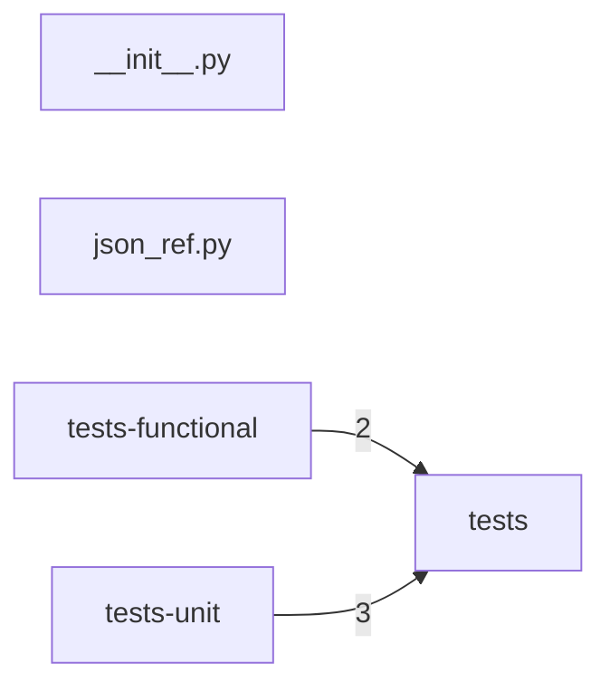

# Component: tests

## Overview

Test infrastructure: base test case classes and test runner configuration.
2 files (0.1% of 1509 source files), 37 code lines (0.0% of 473,713 total).
Main neighbours: **tests-unit** (←3 edges); **tests-functional** (←2 edges).

## File Inventory

### (top-level)/

| File | Code Lines | Top CCN |
|------|-----------|---------|
| `__init__.py` | 0 | — |
| `json_ref.py` | 37 | 6 |

**Top 5 Functions by CCN**

| Function | Kind | CCN | File | Line Range |
|----------|------|-----|------|------------|
| `resolve_refs` | function | 6 | `json_ref.py` | L35–L56 |
| `_update_dict_recursively` | function | 5 | `json_ref.py` | L59–L65 |
| `_resolve_ref` | function | 2 | `json_ref.py` | L20–L32 |

## Defined Symbols

Total: 3

| Kind | Count |
|------|-------|
| function | 3 |

## External Dependencies

| Package | Files Importing |
|---------|----------------|
| `os` | 1 |
| `oslo_serialization` | 1 |

## Side Effects

| Kind | Count |
|------|-------|
| file-io | 3 |

## Component Diagram

## Local Data Flow

**Sinks** (3 total):

- **db-write** (3)

_The KB records do not include sanitisation annotations; cross-file data-flow tracing requires the resolved link graph._

## Cross-Component Interfaces

| Component | Dir | File Edges | Summed Count | Kinds |
|-----------|-----|-----------|-------------|-------|
| **tests-functional** | ← | 1 | 2 | call, import |
| **tests-unit** | ← | 1 | 3 | call, import |

No cross-component seams recorded in the link graph.
