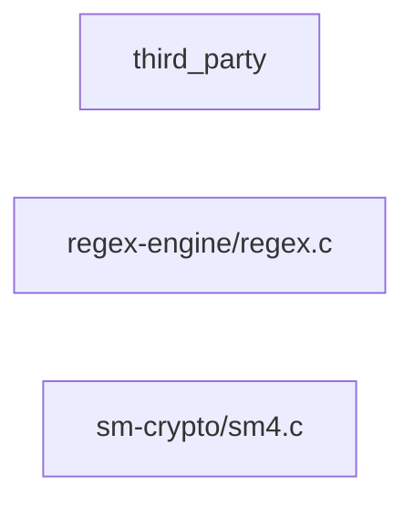

# Component: third_party

## Overview

_Purpose not yet written._
2 files (1.0% of 198 source files), 29 code lines (0.4% of 6,745 total).

## File Inventory

### regex-engine/

| File | Code Lines | Top CCN |
|---|---:|---:|
| `regex-engine/regex.c` | 11 | 5 |

### sm-crypto/

| File | Code Lines | Top CCN |
|---|---:|---:|
| `sm-crypto/sm4.c` | 18 | 3 |

**Top 5 Functions by CCN**

| Function | Kind | CCN | File | Line Range |
|---|---|---:|---|---|
| `regex_match` | function | 5 | `regex-engine/regex.c` | L4–L13 |
| `sm4_key_schedule` | function | 3 | `sm-crypto/sm4.c` | L10–L22 |

## Defined Symbols

Total: 3 (imports not counted)

| Kind | Count |
|---|---:|
| function | 2 |
| constant | 1 |

## External Dependencies

| Package | Kind | Files Importing |
|---|---|---:|
| `string.h` | system | 2 |
| `stdint.h` | system | 1 |

## Side Effects

None recorded by the Fact Extractor's pattern rules (Python, JavaScript, Go, Java, C and C++ only; a record's `warnings` say when a language has no rules), so this is not evidence that there are none.

## Component Diagram

## Call Flow

> Static call flow of resolved cross-file calls. Not a data flow: no parameters, no taint, no sanitisation.

### Summary

- Files: 2; symbols in call edges: 0
- Cross-file calls: 0 inside the component, 0 to other components, 0 from other components
- Boundary calls: none

No resolved cross-file calls touch this component.

## Cross-Component Interfaces

No cross-component file edges.

No cross-component seams recorded in the link graph.

A missing edge means no edge was found, never that there is no coupling (dynamic dispatch, calls on local variables and generated clients are not seen).
