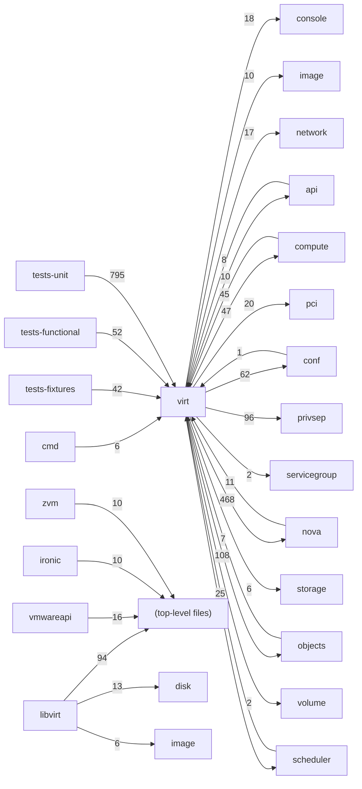

# Component: virt

## Overview

Hypervisor driver interface: libvirt, VMware, Ironic, and zVM driver implementations plus disk, image, and network helper layers.
91 files (6.0% of 1509 source files), 38,153 code lines (8.1% of 473,713 total).
Main neighbours: **tests-unit** (←795 edges); **nova** (→468/←11 edges); **objects** (→108/←7 edges); **privsep** (→96 edges); **compute** (→47/←45 edges).

## File Inventory

### (top-level)/

| File | Code Lines | Top CCN |
|------|-----------|---------|
| `__init__.py` | 0 | — |
| `arch.py` | 43 | — |
| `block_device.py` | 775 | 13 |
| `configdrive.py` | 116 | 5 |
| `driver.py` | 1,680 | 6 |
| `event.py` | 81 | 2 |
| `fake.py` | 885 | 4 |
| `hardware.py` | 2,433 | 42 |
| `imagecache.py` | 95 | 11 |
| `images.py` | 198 | 15 |
| `netutils.py` | 281 | 20 |
| `node.py` | 65 | 8 |
| `osinfo.py` | 101 | 5 |
| `storage_users.py` | 49 | 1 |
| `virtapi.py` | 17 | 1 |

### disk/

| File | Code Lines | Top CCN |
|------|-----------|---------|
| `disk/__init__.py` | 4 | — |
| `disk/api.py` | 477 | 11 |
| `disk/mount/__init__.py` | 3 | — |
| `disk/mount/api.py` | 215 | 8 |
| `disk/mount/block.py` | 15 | 1 |
| `disk/mount/loop.py` | 30 | 2 |
| `disk/mount/nbd.py` | 93 | 8 |
| `disk/vfs/__init__.py` | 3 | — |
| `disk/vfs/api.py` | 93 | 2 |
| `disk/vfs/guestfs.py` | 263 | 13 |

### image/

| File | Code Lines | Top CCN |
|------|-----------|---------|
| `image/__init__.py` | 0 | — |
| `image/model.py` | 84 | 2 |

### ironic/

| File | Code Lines | Top CCN |
|------|-----------|---------|
| `ironic/__init__.py` | 2 | — |
| `ironic/driver.py` | 1,795 | 16 |
| `ironic/ironic_states.py` | 228 | — |
| `ironic/patcher.py` | 90 | 12 |

### libvirt/

| File | Code Lines | Top CCN |
|------|-----------|---------|
| `libvirt/__init__.py` | 2 | — |
| `libvirt/blockinfo.py` | 573 | 16 |
| `libvirt/config.py` | 3,239 | 45 |
| `libvirt/cpu/__init__.py` | 0 | — |
| `libvirt/cpu/api.py` | 151 | 13 |
| `libvirt/cpu/core.py` | 48 | 2 |
| `libvirt/designer.py` | 153 | 6 |
| `libvirt/driver.py` | 10,031 | 25 |
| `libvirt/event.py` | 24 | 1 |
| `libvirt/guest.py` | 734 | 11 |
| `libvirt/host.py` | 1,740 | 10 |
| `libvirt/imagebackend.py` | 1,020 | 12 |
| `libvirt/imagecache.py` | 291 | 10 |
| `libvirt/instancejobtracker.py` | 57 | 6 |
| `libvirt/machine_type_utils.py` | 154 | 6 |
| `libvirt/migration.py` | 627 | 15 |
| `libvirt/storage/__init__.py` | 0 | — |
| `libvirt/storage/dmcrypt.py` | 53 | 3 |
| `libvirt/storage/lvm.py` | 134 | 5 |
| `libvirt/utils.py` | 561 | 15 |
| `libvirt/vif.py` | 646 | 12 |
| `libvirt/volume/__init__.py` | 0 | — |
| `libvirt/volume/cephfs.py` | 26 | 4 |
| `libvirt/volume/fibrechannel.py` | 52 | 2 |
| `libvirt/volume/fs.py` | 83 | 1 |
| `libvirt/volume/gpfs.py` | 12 | 1 |
| `libvirt/volume/iscsi.py` | 61 | 2 |
| `libvirt/volume/iser.py` | 18 | 1 |
| `libvirt/volume/lightos.py` | 40 | 1 |
| `libvirt/volume/mount.py` | 271 | 5 |
| `libvirt/volume/net.py` | 54 | 4 |
| `libvirt/volume/nfs.py` | 29 | 3 |
| `libvirt/volume/nvme.py` | 39 | 1 |
| `libvirt/volume/quobyte.py` | 157 | 6 |
| `libvirt/volume/remotefs.py` | 230 | 3 |
| `libvirt/volume/scaleio.py` | 46 | 1 |
| `libvirt/volume/smbfs.py` | 49 | 3 |
| `libvirt/volume/storpool.py` | 40 | 1 |
| `libvirt/volume/volume.py` | 123 | 19 |
| `libvirt/volume/vzstorage.py` | 90 | 3 |

### vmwareapi/

| File | Code Lines | Top CCN |
|------|-----------|---------|
| `vmwareapi/__init__.py` | 5 | — |
| `vmwareapi/constants.py` | 197 | — |
| `vmwareapi/driver.py` | 573 | 8 |
| `vmwareapi/ds_util.py` | 403 | 8 |
| `vmwareapi/error_util.py` | 11 | — |
| `vmwareapi/host.py` | 89 | 3 |
| `vmwareapi/imagecache.py` | 142 | 6 |
| `vmwareapi/images.py` | 366 | 9 |
| `vmwareapi/network_util.py` | 73 | 8 |
| `vmwareapi/session.py` | 109 | 9 |
| `vmwareapi/vif.py` | 90 | 11 |
| `vmwareapi/vim_util.py` | 128 | 7 |
| `vmwareapi/vm_util.py` | 1,272 | 15 |
| `vmwareapi/vmops.py` | 1,723 | 13 |
| `vmwareapi/volumeops.py` | 527 | 23 |

### zvm/

| File | Code Lines | Top CCN |
|------|-----------|---------|
| `zvm/__init__.py` | 2 | — |
| `zvm/driver.py` | 359 | 7 |
| `zvm/guest.py` | 26 | 1 |
| `zvm/hypervisor.py` | 106 | 3 |
| `zvm/utils.py` | 80 | 5 |

**Top 5 Functions by CCN**

| Function | Kind | CCN | File | Line Range |
|----------|------|-----|------|------------|
| `format_dom` | method | 45 | `libvirt/config.py` | L1955–L2078 |
| `numa_get_constraints` | function | 42 | `hardware.py` | L2387–L2600 |
| `parse_dom` | method | 37 | `libvirt/config.py` | L2080–L2169 |
| `format_dom` | method | 31 | `libvirt/config.py` | L1307–L1410 |
| `parse_dom` | method | 30 | `libvirt/config.py` | L3425–L3497 |

## Defined Symbols

Total: 3,423

| Kind | Count |
|------|-------|
| method | 1,966 |
| function | 500 |
| constant | 393 |
| class | 266 |
| field | 111 |
| property | 72 |
| staticmethod | 66 |
| variable | 39 |
| classmethod | 10 |

## External Dependencies

| Package | Files Importing |
|---------|----------------|
| `oslo_log` | 55 |
| `oslo_utils` | 39 |
| `os` | 29 |
| `oslo_concurrency` | 17 |
| `collections` | 14 |
| `time` | 13 |
| `oslo_vmware` | 12 |
| `oslo_serialization` | 11 |
| `os_brick` | 10 |
| `re` | 10 |
| `itertools` | 7 |
| `os_traits` | 7 |
| `oslo_service` | 6 |
| `os_resource_classes` | 6 |
| `lxml` | 6 |
| `typing` | 5 |
| `contextlib` | 5 |
| `abc` | 5 |
| `oslo_config` | 5 |
| `shutil` | 4 |
| `tempfile` | 4 |
| `uuid` | 4 |
| `libvirt` | 4 |
| `functools` | 3 |
| `random` | 3 |
| `copy` | 3 |
| `operator` | 3 |
| `errno` | 3 |
| `pwd` | 3 |
| `threading` | 3 |
| `warnings` | 3 |
| `dataclasses` | 2 |
| `sys` | 2 |
| `base64` | 2 |
| `urllib` | 2 |
| `grp` | 2 |
| `castellan` | 2 |
| `fixtures` | 1 |
| `gzip` | 1 |
| `openstack` | 1 |

## Side Effects

| Kind | Count |
|------|-------|
| global-mutation | 397 |
| file-io | 314 |
| process-spawn | 131 |
| syscall | 27 |
| network | 8 |

## Component Diagram

## Local Data Flow

**Sinks** (138 total):

- **db-write** (121)
- **file-write** (17)

**Privileged operations**: 127 entries recorded.

_The KB records do not include sanitisation annotations; cross-file data-flow tracing requires the resolved link graph._

## Cross-Component Interfaces

| Component | Dir | File Edges | Summed Count | Kinds |
|-----------|-----|-----------|-------------|-------|
| **api** | → | 5 | 10 | call, import |
| **api** | ← | 3 | 8 | call, import |
| **cmd** | ← | 2 | 6 | call, import |
| **compute** | → | 31 | 47 | call, import |
| **compute** | ← | 12 | 45 | call, import, inherit |
| **conf** | → | 49 | 62 | call, import |
| **conf** | ← | 1 | 1 | import |
| **console** | → | 5 | 18 | call, import |
| **image** | → | 5 | 10 | call, import |
| **network** | → | 10 | 17 | call, import |
| **nova** | → | 122 | 468 | call, import, inherit |
| **nova** | ← | 5 | 11 | call, import |
| **objects** | → | 36 | 108 | call, import |
| **objects** | ← | 4 | 7 | call, import |
| **pci** | → | 7 | 20 | call, import |
| **privsep** | → | 26 | 96 | call, import |
| **scheduler** | → | 2 | 4 | call, import |
| **scheduler** | ← | 4 | 25 | call, import |
| **servicegroup** | → | 1 | 2 | call, import |
| **storage** | → | 3 | 6 | call, import |
| **tests-fixtures** | ← | 11 | 42 | call, import, inherit |
| **tests-functional** | ← | 35 | 52 | call, import, inherit |
| **tests-unit** | ← | 209 | 795 | call, import, inherit |
| **volume** | → | 1 | 2 | call, import |

No cross-component seams recorded in the link graph.
