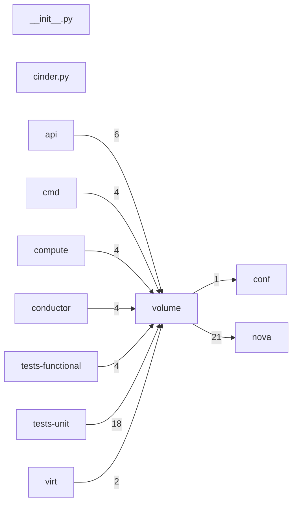

# Component: volume

## Overview

Volume service client: Cinder volume attachment, encryptor selection, and multiattach helpers.
2 files (0.1% of 1509 source files), 712 code lines (0.2% of 473,713 total).
Main neighbours: **nova** (→21 edges); **tests-unit** (←18 edges); **api** (←6 edges); **compute** (←4 edges); **cmd** (←4 edges).

## File Inventory

### (top-level)/

| File | Code Lines | Top CCN |
|------|-----------|---------|
| `__init__.py` | 0 | — |
| `cinder.py` | 712 | 8 |

**Top 5 Functions by CCN**

| Function | Kind | CCN | File | Line Range |
|----------|------|-----|------|------------|
| `_get_server_version` | function | 8 | `cinder.py` | L84–L134 |
| `_untranslate_volume_summary_view` | function | 7 | `cinder.py` | L260–L312 |
| `attachment_get_all` | method | 7 | `cinder.py` | L821–L852 |
| `cinderclient` | function | 6 | `cinder.py` | L200–L257 |
| `attachment_create` | method | 6 | `cinder.py` | L747–L794 |

## Defined Symbols

Total: 60

| Kind | Count |
|------|-------|
| method | 32 |
| function | 25 |
| constant | 2 |
| class | 1 |

## External Dependencies

| Package | Files Importing |
|---------|----------------|
| `collections` | 1 |
| `copy` | 1 |
| `functools` | 1 |
| `sys` | 1 |
| `urllib` | 1 |
| `cinderclient` | 1 |
| `keystoneauth1` | 1 |
| `oslo_log` | 1 |
| `oslo_serialization` | 1 |
| `oslo_utils` | 1 |
| `retrying` | 1 |

## Side Effects

| Kind | Count |
|------|-------|
| global-mutation | 2 |
| network | 1 |

## Component Diagram

## Local Data Flow

**Sinks** (6 total):

- **db-write** (6)

**Privileged operations**: 2 entries recorded.

_The KB records do not include sanitisation annotations; cross-file data-flow tracing requires the resolved link graph._

## Cross-Component Interfaces

| Component | Dir | File Edges | Summed Count | Kinds |
|-----------|-----|-----------|-------------|-------|
| **api** | ← | 3 | 6 | call, import |
| **cmd** | ← | 2 | 4 | call, import |
| **compute** | ← | 2 | 4 | call, import |
| **conductor** | ← | 2 | 4 | call, import |
| **conf** | → | 1 | 1 | import |
| **nova** | → | 4 | 21 | call, import |
| **tests-functional** | ← | 3 | 4 | call, import |
| **tests-unit** | ← | 12 | 18 | call, import |
| **virt** | ← | 1 | 2 | call, import |

No cross-component seams recorded in the link graph.
