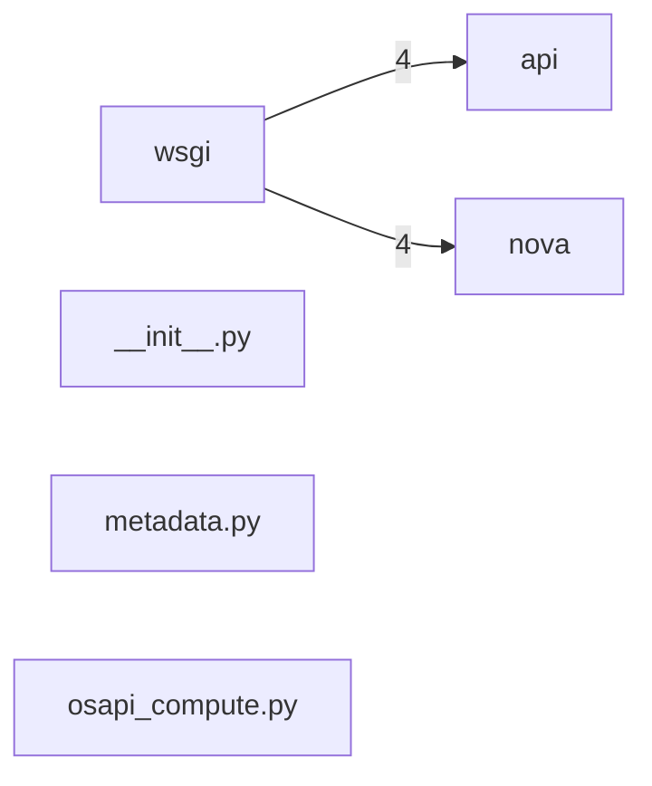

# Component: wsgi

## Overview

WSGI server: eventlet-based WSGI server wrapper and loader for the Nova API application.
3 files (0.2% of 1509 source files), 22 code lines (0.0% of 473,713 total).
Main neighbours: **nova** (→4 edges); **api** (→4 edges).

## File Inventory

### (top-level)/

| File | Code Lines | Top CCN |
|------|-----------|---------|
| `__init__.py` | 0 | — |
| `metadata.py` | 11 | — |
| `osapi_compute.py` | 11 | — |

**Top 5 Functions by CCN**

_No CCN data found._

## Defined Symbols

Total: 10

| Kind | Count |
|------|-------|
| variable | 6 |
| constant | 4 |

## External Dependencies

| Package | Files Importing |
|---------|----------------|
| `threading` | 2 |

## Side Effects

| Kind | Count |
|------|-------|
| global-mutation | 4 |

## Component Diagram

## Local Data Flow

_No security-surface entries recorded in the KB for this component._

## Cross-Component Interfaces

| Component | Dir | File Edges | Summed Count | Kinds |
|-----------|-----|-----------|-------------|-------|
| **api** | → | 2 | 4 | call, import |
| **nova** | → | 2 | 4 | call, import |

No cross-component seams recorded in the link graph.
